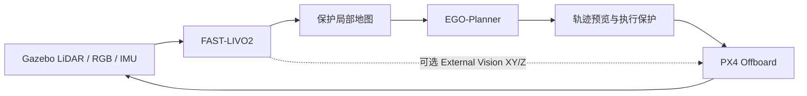

# Astra · ROS 2 自主飞行仿真

基于 [ShuWei-2024/XT-Drone2](https://github.com/ShuWei-2024/XT-Drone2)，集成等效 Mid-360 / RGB / IMU、FAST-LIVO2、局部地图、EGO-Planner 和受保护的 PX4 Offboard 执行链。当前开发分支：`astra/px4-1.17`。

**[文档索引](docs/README.md) · [安装与快速启动](docs/QUICKSTART.md) · [操作指南](docs/OPERATIONS.md) · [AI 接手上下文](docs/PROJECT_CONTEXT.md)**

## 完整启动：RViz2 航点飞行 + Gazebo 窗口

首次使用先完成 [依赖安装、构建和地图准备](docs/QUICKSTART.md)。已部署的电脑在新终端执行：

```bash
cd ~/dev/XT-Drone2-astra
bash astra/rviz_outdoor_117.bash outdoor_$(date +%Y%m%d_%H%M%S) \
  --external-vision
```

这条命令启动 PX4、传感器、FAST-LIVO2、局部地图、EGO-Planner 和执行保护，**自动打开 RViz2 与中文航点窗口**，不用逐个启动模块。运行名称自动带时间戳，避免重复。

**本机保留了旧灰色默认地图，使用下面这条替代上面的启动命令，选择已复测的彩色地图：**

```bash
cd ~/dev/XT-Drone2-astra
bash astra/rviz_outdoor_117.bash outdoor_$(date +%Y%m%d_%H%M%S) \
  --scan-dir astra/runtime/maps/baylands_park_coloured \
  --external-vision
```

`baylands_park_coloured` 是本机另行生成的目录，不随 Git 下载；新电脑按教程准备的默认 `baylands_park` 已含颜色修复，使用第一条即可。旧生成资源不会因 `git pull` 自动更新。

**另开终端，打开 Gazebo 场景窗口：**

```bash
GZ_PARTITION=astra_px4_117 gz sim -g
```

等待任务窗口显示 **READY**，在 RViz2 按 **G / 2D Goal Pose** 点选 XY 航点，选择末点动作，再点击 **开始任务**。启动后不会自动起飞。RViz2 显示三维地图与规划轨迹，Gazebo 显示仿真飞机与场景。

支持多航点、暂停/继续、空中追加、末点降落或有时限悬停；结束时点降落，等落地上锁和运行器清理。一次只运行一套仿真。操作细节见 [地图航点指南](docs/OPERATIONS.md#rviz2-交互任务)。

室内 Replica office4 地图准备完成后，也可使用 `bash astra/rviz_flight_117.bash`。

## 环境

| 组件 | 版本 |
| --- | --- |
| 操作系统 | Ubuntu 24.04 |
| ROS / 仿真器 | ROS 2 Jazzy / Gazebo Harmonic |
| 飞控 / ROS 消息 | PX4 v1.17.0 / 固定版本 px4_msgs |
| 定位 / 规划 | FAST-LIVO2 ROS 2 移植 / EGO-Planner Jazzy 核心 |

准确提交与补丁见 [依赖锁](astra/dependencies.lock.json)。地图、大型日志和构建缓存在本机生成，不随 Git 下载。

## 工作流程



RViz2 提供三维显示和多航点任务界面；Gazebo 显示实际仿真运动。定位、传感器障碍图与已知几何安全边界的职责见 [架构说明](docs/ARCHITECTURE.md)。

## 快速入口

首次使用先完成 [依赖安装、PX4/Agent 构建和地图准备](docs/QUICKSTART.md)，再在仓库根目录运行：

```bash
bash astra/build_px4_117.bash
bash astra/build_117.bash
bash astra/run_117.bash static static_check_01 --seconds 60
```

## 验证状态

截至 2026-10-14，已完成室内扫描场景、室外箱体/圆柱绕障及部分长路线闭环验证。最新东侧八航点实际飞行 **64.91 m**，通过完整精度和安全审计；FAST-LIVO2 真值 XY/Z p95 为 **0.0433 / 0.0216 m**。

**重复稳定性尚未通过**：同配置东侧复测首段被拒绝；西侧八航点完成，但一处终点误差超过门槛；树旁路线出现高度漂移与长绕行超时。宽范围长期内存、跨地图通用性和真实硬件尚未认证。结果与失败证据统一见 [验证索引](astra/validation/README.md)。

## 开发与许可

代码位于 `astra/packages/`，运行/审计工具位于 `astra/tools/`。构建、回归、提交规则见 [开发指南](docs/DEVELOPMENT.md)。给其他 AI 接手时，先提供 [项目上下文](docs/PROJECT_CONTEXT.md)，再按索引读取相关模块。

保留 XT-Drone2 的 [MIT 许可](LICENSE) 和 [上游介绍](docs/README.upstream.md)；EGO-Planner 保留 GPL-3.0，各依赖及地图遵循各自许可，详见开发指南。
