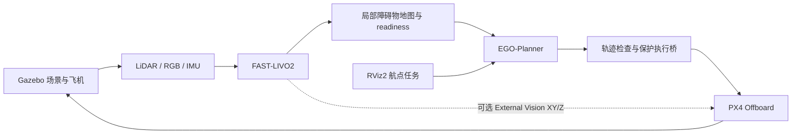

# Astra · ROS 2 自主飞行仿真

基于 ShuWei-2024/XT-Drone2，集成等效 Mid-360、RGB 相机与 IMU，实现定位、局部建图、航点规划和受保护的 PX4 闭环飞行。当前开发分支：`astra/px4-1.17`。

## 环境与组成

| 组件 | 当前配置 |
| --- | --- |
| 操作系统 | Ubuntu 24.04 |
| ROS / 仿真器 | ROS 2 Jazzy / Gazebo Harmonic |
| 飞控 / 通信 | PX4 v1.17.0 / Micro XRCE-DDS Agent / 固定版本 px4_msgs |
| 定位 / 建图 | FAST-LIVO2：LiDAR + RGB + IMU；带健康门控的局部障碍物地图 |
| 规划 / 执行 | EGO-Planner B-spline / 坐标转换、轨迹检查与 Offboard 执行保护 |
| 交互界面 | RViz2 三维地图与多航点窗口；Gazebo 仿真场景 |

依赖的准确版本与补丁记录在 `astra/dependencies.lock.json`。大型地图、原始日志和构建产物在本机生成，不随 Git 下载。

## 系统流程



FAST-LIVO2 提供实际估计位姿和配准点云；规划器根据实时障碍物生成轨迹，执行桥转换为 PX4 setpoint。External Vision 可将定位结果的 XY/Z 融入 PX4，当前不融合视觉航向或速度。

Gazebo 显示仿真飞机与场景，RViz2 显示三维地图、规划轨迹和航点。背景模型用于显示，实时障碍物来自传感器；已知几何另用于共享安全边界检查。

## 构建与测试

首次部署先按文档索引中的《安装教程》准备系统依赖、PX4/DDS Agent 和地图。下面命令均在仓库根目录执行。

**构建 PX4 和 ROS 包：**

```bash
cd ~/dev/XT-Drone2-astra
bash astra/build_px4_117.bash
bash astra/build_117.bash
```

已有环境更新后也需重跑 PX4 构建，以应用本地位置 DDS 100 Hz 输出补丁；Offboard setpoint 仍为 20 Hz。

**在新终端加载环境，运行回归：**

```bash
cd ~/dev/XT-Drone2-astra
source astra/env_117.bash
python3 -m pytest -q astra/validation \
  astra/packages/astra_px4_offboard/test astra/packages/astra_fast_livo2/test
ctest --test-dir build_117/astra_fast_livo2_core --output-on-failure
```

**运行 60 秒静止检查：**

```bash
bash astra/run_117.bash static static_$(date +%Y%m%d_%H%M%S) --seconds 60
```

静止检查不解锁，结果写入 `astra/runtime/<运行名>/`。回归和静止检查通过后，还需按场景进行闭环飞行验收；详细审计及可选规划器回归见开发文档。

## 启动使用

### 1. 启动项目与 RViz2

已完成构建和地图准备后，在新终端执行：

```bash
cd ~/dev/XT-Drone2-astra
bash astra/rviz_outdoor_117.bash outdoor_$(date +%Y%m%d_%H%M%S) \
  --external-vision
```

自动启动 PX4、传感器、FAST-LIVO2、地图、规划与执行保护，并打开 **RViz2 和中文航点窗口**。运行名称带时间戳，避免重复；启动后不会自动起飞。

需要全图范围选点时，先生成独立空域配置（只需一次，不覆盖原地图）：

```bash
astra/runtime/map_tools_venv/bin/python astra/tools/prepare_return_airspace.py \
  --source astra/runtime/maps/baylands_park \
  --output astra/runtime/maps/baylands_whole_map --whole-map
```

之后第一条启动命令会优先使用 `baylands_whole_map`。本机已从彩色场景生成；新电脑按安装教程生成的 `baylands_park` 也已含颜色。仍可用 `--scan-dir` 显式选择其他场景。

### 2. 打开 Gazebo 窗口

另开终端，连接同一仿真：

```bash
GZ_PARTITION=astra_px4_117 gz sim -g
```

### 3. 设置航点并飞行

| 步骤 | 操作 |
| --- | --- |
| 等待就绪 | 中文任务窗口显示 **READY**，此时飞机仍未解锁 |
| 添加目标 | 在 RViz2 按 **G / 2D Goal Pose** 选择 XY，或在任务窗口输入坐标 |
| 开始飞行 | 检查航点队列，选择返航降落、末点降落或悬停，点击 **开始任务** |
| 飞行中 | 可追加航点、暂停与继续；末点悬停有等待时限 |
| 结束 | 可点击“避障返航并降落”；原地降落要求当前位置有下降净空，落地上锁后再启动下一轮 |

一次只运行一套仿真。RViz2 是可旋转的三维视图，按钮中的“2D”表示选取 XY；绿色地面格表示下降净空，蓝色表示独立巡航空域。全图配置检查 XY ±30 m，目标距离上限 43 m，可选面积约 1265 m²；障碍、净空不足、不连通区域和地图边缘 5 m 不开放。保留的旧配置仍有 10 m 限制。空域开放与实际路线验证结果见文档索引的“全图范围选点”。

室内 Replica office4 已准备好时，可使用 `bash astra/rviz_flight_117.bash`，同样自动打开 RViz2 和任务窗口。

## 验证状态

以下依据截至 2026-10-16 的运行证据，完整指标与失败记录见验证报告。

| 验证项 | 当前结果 | 适用范围与限制 |
| --- | --- | --- |
| PX4 1.17 / ROS 2 链路 | 构建、传感器与受控起降已运行 | 隔离 SITL |
| 室内 / 室外绕障 | 指定室内路线、室外箱体和圆柱路线通过 | 尚非整张地图任意点可飞 |
| 彩色场景复测 | 短路线与 26.93 m 箱体绕障通过 | 各一轮；暂不需要因颜色修复重调定位 |
| 部分长距离路线 | 东侧 64.91 m、8 航点完整审计通过 | 同配置复测曾首段规划失败，重复稳定性未通过 |
| External Vision | ULog 确认实际融合 XY/Z | 不融合视觉航向/速度；当前转换限定已审计 SITL 条件 |
| 全图范围选点 | 连通可选面积约 1265 m²；事件模式东侧两轮约 69 m、西侧一轮 54.6 m 往返均通过 | 跨区与西侧重复待测；不代表任意航点或跨地图认证 |
| RViz 交互起飞 | 修复起飞前接收遗漏与区域显示重复构建；22.4 m 绕障往返一轮通过 | 单航点返航；用户原双航点路线尚未完整复测 |
| 通行区与返航 | EGO 返航通过；历史地图中断测试曾完成官方 RTL，本轮掉线使用受控降落 | 本轮 RTL 被状态新鲜度门控拒绝；下方无下降空间的恢复待测 |
| 未解决项 | 仍有短时接收暂停；东侧 PX4 XY 误差 p95 约 11 cm，未达 10 cm 精密门槛 | 长绕行、跨区重复、跨地图、长期运行和真实硬件尚未认证 |

## 文档索引

| 文档 | 查阅内容 |
| --- | --- |
| [安装教程](docs/QUICKSTART.md) | 系统依赖、PX4/DDS Agent、构建与地图准备 |
| [操作指南](docs/OPERATIONS.md) | RViz2/Gazebo 操作、自动测试、运行记录与排障 |
| [架构与接口](docs/ARCHITECTURE.md) | 各模块流程、话题、坐标、时间同步与控制权 |
| [开发规范](docs/DEVELOPMENT.md) | 源码目录、回归方法、Git 工作流与依赖许可 |
| [验证报告](astra/validation/README.md) | 指定路线的精度、安全距离、延迟、成功与失败证据 |
| [人员 / AI 接手上下文](docs/PROJECT_CONTEXT.md) | 项目目标、技术决策、当前状态和后续任务 |
| [模块与专题索引](docs/README.md) | 传感器、定位、规划、执行、交互源码入口及专题报告 |

## 许可

框架保留 XT-Drone2 的 MIT 许可；EGO-Planner 使用 GPL-3.0，其余依赖与地图遵循各自许可。来源、上游说明和许可明细保留于开发文档及各模块目录。
