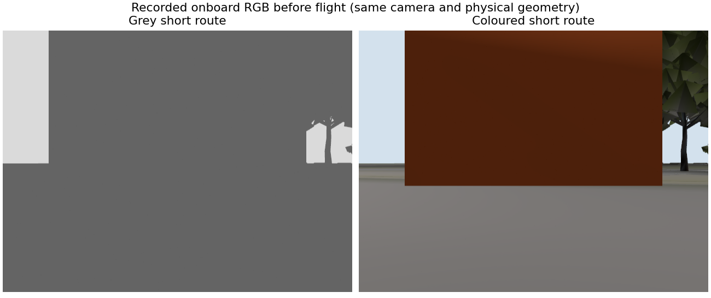
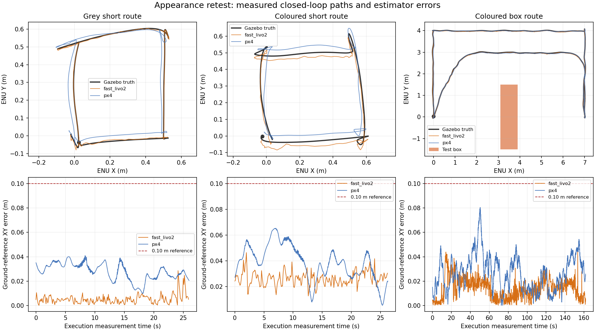

# Baylands 彩色外观复测

2026-10-14，测试源码提交 `f0698d6`，隔离 PX4 1.17 SITL。灰色短路线、彩色相同短路线、彩色箱体绕障各运行一次，三次均通过完整路线审计、降落上锁，原 PX4 基线保持。

结论：**本次彩色场景的短路线与箱体绕障通过，暂不需要重新调 FAST-LIVO2。**
彩色短路线的误差比灰色这一轮大，不能据此宣称外观改善了精度；一次对照也不能证明重复稳定性。此前树旁高度漂移与扩大区域偶发规划失败仍未解决。

## 配置与对照

仅改变 SDF 的显式 Ogre2 PBR 彩色纹理绑定、环境光和方向光；它同时改变机载相机输入。
两条短路线的碰撞网格、视觉网格、纹理文件、保护掩码和路线 SHA-256 相同。
三轮执行源码/二进制快照和估计器配置完全相同，未调整定位、规划、飞控参数或验收阈值。
External Vision 启用；ULog 确认实际融合 XY/Z，未融合视觉航向/速度。

短路线为 `[0.5,0] → [0.5,0.5] → [0,0.5] → [0,0]`；
绕障路线为 `[7,0] → [7,4] → [0,4] → [0,0]`，首段直线穿过测试箱体，未指定绕行中间点。
机载 RGB 初始图像中，通道差大于 20 的像素占比从 0% 变为 53.1%，确认颜色进入了传感器。



## 实测结果

误差统计使用起飞前冻结参考、固定 ENU/NED 轴转换和测量时间配对，没有空中重新拟合。
下表均为正式 EGO 执行阶段；实际航迹来自 Gazebo 机体中心。

| 运行 | 航点 / 完整审计 | 实际水平航迹 | LIVO XY/Z p95 | PX4 XY/Z p95 | 最差航点终点 XY |
| --- | --- | --- | --- | --- | --- |
| `appearance_grey_short_20261014_01` | 4/4，通过 | 2.678 m | 0.0110 / 0.0056 m | 0.0374 / 0.0379 m | 0.0605 m |
| `appearance_colour_short_20261014_01` | 4/4，通过 | 2.847 m | 0.0350 / 0.0118 m | 0.0596 / 0.0234 m | 0.0578 m |
| `appearance_colour_box_20261014_01` | 4/4，通过 | 26.934 m | 0.0284 / 0.0126 m | 0.0492 / 0.0514 m | 0.0407 m |

箱体首段实际横向绕行约 3.000 m；整段执行的最小已知表面距离为 **1.458 m**，
指机体中心距离，不是桨尖净空。四段实际沿目标方向进展分别为 6.997、4.015、7.017、4.022 m。
所有已执行曲线通过共同安全边界、全曲线连续距离和动态约束检查，全程无保护边界越界。
箱体路线规划峰值速度/加速度为 0.200 m/s、0.243 m/s²；实际三维峰值速度为 0.238 m/s，包含控制跟踪和高度变化。



## 延迟、视觉与保护

| 指标（执行阶段） | 灰色短路线 | 彩色短路线 | 彩色绕障 |
| --- | --- | --- | --- |
| 测量到 odom 发布 p95 / 最大 | 56 / 80 ms | 55.6 / 64 ms | 56 / 100 ms |
| LIO 墙钟处理 p95 / 最大 | 26.7 / 33.4 ms | 25.7 / 32.4 ms | 27.5 / 58.7 ms |
| VIO 墙钟处理 p95 / 最大 | 15.9 / 20.2 ms | 14.1 / 22.8 ms | 12.3 / 26.9 ms |
| odom 接收间隔最大 | 128.7 ms | 139.3 ms | 167.9 ms |
| 合并 Offboard setpoint 最大发送间隔 | 64.2 ms | 92.7 ms | 79.5 ms |

测量到发布使用仿真时钟；算法处理使用墙钟，包含调度等待，不能把两者直接相加。
odom 约 10 Hz，不代表 PX4 setpoint 只以 10 Hz 发送。三轮真值配对 p95 均为 8 ms；
绕障执行时 1618 个 LIVO 和 8086 个 PX4 位姿全部在 20 ms 内配对。
绕障监督 odom 年龄最大 200 ms，未触及现有 250 ms 门槛。

VIO 采用的图像块数最少为 76、70、11；最大提议水平修正为 0.0279、0.0226、0.0342 m，
执行阶段均没有触发视觉修正拒绝，记录的位姿/残差无 NaN/Inf。
绕障视觉均方残差 p95 为 229.9，与短路线观测不同，不能将原始像素残差跨路线当作定位精度。
LIO correspondence 最少为 4542、4566、4470；绕障 odom 单步位移最大 0.0472 m，包含正常运动。
三轮 EGO 执行阶段无估计器 reset；每轮解锁后的初始航向 reset 均在交接 EGO 前完成处理。
armed failsafe 均为零。灰色和彩色短路线地面预热曾出现 EV 新鲜度暂时失效，起飞前已恢复并通过检查；不把预热记录删作“全程无异常”。

绕障 FAST-LIVO2 RSS 约 195 → 453 MiB，含初始化与图像缓存预热；本轮不认证宽范围长期内存平台。
三次运行采用无 Gazebo GUI 的自动测试，不是 GUI/RViz 同时运行的性能认证。

## 命令与证据

三次分别使用 `baylands_grey_short_retest`、`baylands_coloured_short_retest`、`baylands_park_coloured`。
灰色目录保留旧外观；前两者只把 `route.json` 改为上述短路线，并同步路线预检查记录。
原地图未覆盖。新克隆生成的是修复后外观；只有保留旧资源的本机可以直接复现灰色对照。

```bash
cd ~/dev/XT-Drone2-astra
# SCENE 与 RUN 替换为本报告中的场景/运行名；重跑须用新的 RUN。
bash astra/run_117.bash obstacle RUN \
  --world-preset baylands --scan-dir astra/runtime/maps/SCENE \
  --route-json astra/runtime/maps/SCENE/route.json \
  --calibrate-ground-height --external-vision --executor-audit --isolate-estimator-cpus

# 仿真退出后审计。
source astra/env_117.bash
python3 astra/tools/audit_scan_flight.py astra/runtime/RUN
python3 astra/tools/audit_external_vision.py astra/runtime/RUN
python3 astra/tools/audit_shared_envelope.py astra/runtime/RUN
python3 astra/tools/audit_long_route_drift.py astra/runtime/RUN

# 本机仍保留旧默认地图时，交互入口显式选择已复测的彩色目录。
bash astra/rviz_outdoor_117.bash colour_demo_01 \
  --scan-dir astra/runtime/maps/baylands_park_coloured --external-vision
```

每次原始记录位于 `astra/runtime/<运行名>/`，含 CSV、ULog、机载相机图、执行快照、基线校验及四份审计。
可审查指标和对照 SHA-256 收录于 [汇总 JSON](appearance_retest_117.json)，原始运行资源不上传。
本轮仅验证列出的路线，不新增自然树枝、坡地、动态障碍、跨地图、重复性或实物认证。
