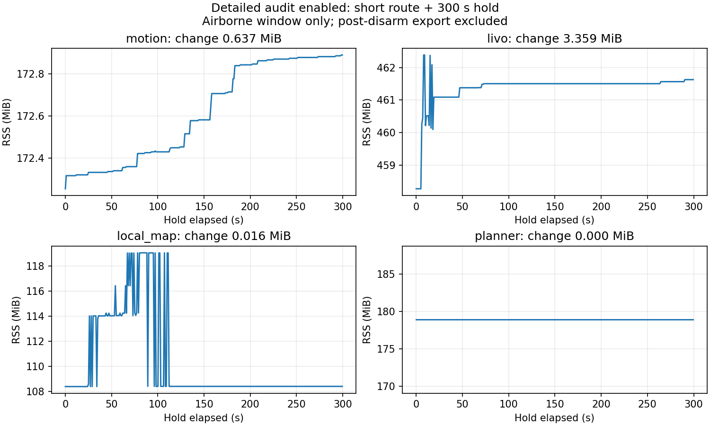
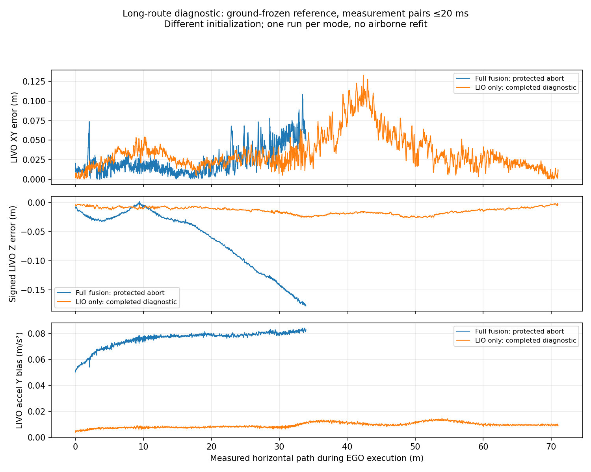

# 审计缓存收尾与长路线高度复测

日期：2026-10-19。隔离 PX4 1.17 / ROS 2 Jazzy / Gazebo SITL；保留 250 ms 时效、20 ms 配对、0.20 m 高度差与原净空门槛。

2026-10-20 后续：两轮人为 `−12 ms` 图像偏移诊断出现测量切片早于 LiDAR 采样、没有 Odom 输出，不能用于归因长路线高度漂移。默认偏移仍为 0；新静态对照、原始输入和发布时序证据见[测量切片时间审计](LIVO_CUT_TIMING_117.md)。严格 VIO 修正门槛的长路线既有一次成功也有一次高度保护失败，不构成稳定修复。

## 本次修改

详细执行器审计原先保留最多 65536 个 Odom 回调字典，旧长测结束时仅填入 22779 条。现以预分配字节缓冲保存同样的 65536 条窗口，每条 85 字节，共 5570560 字节（5.3125 MiB）。纳秒整数、标签、缺失测量时间及 DDS 元数据标志均保留；上锁后导出原有字典字段，并报告总量、保留量和覆盖量。

旧长测 22779 条记录逐条还原相等；离线追加 150000 条后仅保留最近 65536 条，填满后 Python 当前分配未继续增长。新增回归覆盖纳秒精度、空值、覆盖顺序及导出兼容。完整回归 **340 passed**，3 条既有 protobuf 弃用提示。此修改只涉及诊断记录，不调整定位、规划、控制或保护条件。

## 飞行结果

| 运行 | 结果 | 边界 |
| --- | --- | --- |
| `final_repeat_20261019_01` | 长路线实际 33.920 m，完成第 1 个目标，第二段触发地面冻结高度差超过 0.20 m；受控降落上锁，armed failsafe=0 | **长路线重复失败**；未进入 300 s 保持，不作长测内存验收 |
| `final_compact_hold_20261019_01` | 四短航点、300.003 s 保持及降落上锁完成，实际 2.497 m；完整路线、净空、动态约束审计通过 | 短路线与末端保持通过，不替代失败的长路线 |
| `final_lio_isolation_20261019_01` | EGO 交接前因周期性 failsafe 报告过期被拒绝，官方 RTL 后上锁 | 没有长路线运动，不能作 LIO 精度对照 |
| `final_lio_isolation_20261019_02` | 关闭视觉更新，两个远端航点＋EGO 返航，实际 71.008 m，完整路线、绕障、净空及动态约束审计通过，降落上锁 | 单轮诊断通过；不是默认完整融合或长保持重复通过 |

上述运行均保留 PX4 参数基线，运行期间执行源码不变。不能把一次旧长路线成功和本次失败合并为固定配置重复通过。

### 详细审计内存



| 进程 | 300 s 保持 RSS 增量 | 最后 120 s 增量 |
| --- | --- | --- |
| 执行进程 motion | 0.637 MiB | 0.176 MiB |
| FAST-LIVO2 | 3.359 MiB | 0.125 MiB |
| 局部地图 | 0.016 MiB | 0 MiB |
| EGO-Planner | 0 MiB | 0 MiB |

保持窗口执行进程 RSS 从 172.254 到 172.891 MiB；排除了上锁后的完整日志导出。新审计记录保留 10441 条 Odom 回调，未覆盖旧记录。其余慢回调／尾部记录仍采用原有有界窗口，整个进程不作无限运行保证。

旧长路线保持曾增加 6.59 MiB；本轮是短路线后的保持，预热与场景范围不同，**不能把两者视为严格单因素飞行 A/B，也不据此给出改善百分比**。

短路线端点 XY 误差 3.36 / 1.52 / 4.64 / 5.88 cm。EV 日志确认 XY/Z 实际融合；冻结 EV 变换差值 p95 为 XY 0.0563 m、Z 0.0307 m，测量配对覆盖 100%，p95/max 为 8/16 ms。

### 长路线失败分解

在仿真测量时间 352.956 s，飞机位于约 `[-1.387,18.936,1.479]` 时触发高度保护；Odom 测量年龄为 52 ms、接收年龄约 5.85 ms，地图仍 ready。约 1 s 后请求 Land，最终上锁。229 条已发布曲线的边界、净空及动态约束检查通过，不意味着两个目标均已完成。

以起飞前冻结真值参考统计 EGO 运动期：

| 估计器 | XY 误差 p95 | Z 误差 p95 |
| --- | --- | --- |
| FAST-LIVO2 | 0.0623 m | 0.1650 m |
| PX4 | 0.0578 m | 0.0392 m |

EV 的 XY/Z aid-source 各 2814/2814 个 armed 样本实际融合、没有拒绝。单一 EV 地面变换下，两估计器原始 Z 差 p95 为 0.3072 m；其中包含独立的绝对原点项，不能与地面冻结差值漂移门槛混用。固定原点诊断后的 p95 为 0.1429 m，诊断最大 0.2028 m；该诊断不参与控制或豁免保护。

离线描述性拟合发现，Z 误差随 XY 的变化近似一个小斜面，拟合余差 p95 约 3.76 mm；这只是排查线索，**没有对轨迹、EV 或控制应用拟合修正**。初始 IMU 重力方向接近竖直，不能据此认定初始重力对齐错误。运动中有约 0.5° 的两估计器姿态差、FAST-LIVO2 横向加速度偏置变化，且 LIO/VIO 对偏置的更新有相反贡献；相关性不能代替单因素归因。

### 关闭视觉更新的长路线诊断

`final_lio_isolation_20261019_02` 使用同一场景、两个远端目标及原保护门槛，仅在临时估计器配置关闭图像更新。出发前另包含下述周期报告等待修复；两轮初始化、地面原点及路线覆盖不同，不能称严格单因素重复认证。

| 指标 | 完整融合失败轮 | LIO-only 诊断轮 |
| --- | --- | --- |
| 实测水平路长 | 33.920 m，中途保护 | 71.008 m，两个目标＋规划返航完成 |
| LIVO 对真值 XY p95 | 0.0623 m | 0.0883 m |
| LIVO 对真值 Z p95 | 0.1650 m | 0.0244 m |
| PX4 对真值 XY/Z p95 | 0.0578 / 0.0392 m | 0.0606 / 0.0632 m |
| 运动期离线配对的冻结高度差 p95/max | 0.1579 / 0.2037 m | 0.0516 / 0.0935 m |
| 运动期横向加速度偏置绝对最大值 | 0.0843 m/s² | 0.0146 m/s² |

误差均使用起飞前冻结真值平移及 ≤20 ms 测量配对，未空中拟合。高度差行用独立记录器离线配对，不能等同监督器当时每一次检查值。高度改善明确，但 XY 没有在此对比中全面改善。



诊断轮 418 条完整曲线通过共享边界、连续净空及动态约束；最小已知表面机体中心净空 1.451 m。端点 XY 误差 2.63 / 8.19 / 7.29 cm；规划速度/加速度峰值 0.200 / 0.2484，单位分别为 m/s、m/s²。ULog 中 armed failsafe=0，EV XY/Z aid-source 各 4854/4854 样本实际融合，均无拒绝。EV 测量配对覆盖 99.981%，p95/max 为 8/16 ms；地面 EV 冻结变换下原始 XY/Z 差 p95 为 0.0647/0.0404 m。

爬升期间发生一次航向 reset，已重新对齐，在 EGO 交接之前；运动段未再出现该 reset。监督器测量/接收年龄最大 192/137.51 ms，未触发原 250 ms 门槛。保留 13942 条紧凑 Odom 历史且无覆盖，JSONL 与 CSV 数量/导出一致；默认仅 3 s 末端保持，**不计为又一次 300 s 内存测试**。

证据支持继续检查视觉更新及其与姿态/IMU 偏置的耦合，也需核对相机几何和测量时间；尚不能区分具体原因。没有关闭默认图像融合，没有修改协方差或质量门槛，也没有应用离线斜面修正。完整融合的长路线重复仍未通过。

## 复现与证据

### 出发前状态报告等待

首次 LIO-only 对照 `final_lio_isolation_20261019_01` 在 EGO 交接前被 `PX4 failsafe flags stale` 拒绝，官方 RTL 后上锁，未产生可用的长路线运动对照。接收日志显示拒绝时该报告年龄为 516.18 ms，27.43 ms 后收到下一条；ULog 中常见发布间隔约 540 ms，最大 600 ms。

已增加出发前有界等待：仅因这条报告过期时，在原位置保持并继续所有健康检查，最多等待 1.5 s；新报告仍须满足原 0.50 s 接收年龄和全部有效性条件。定位过期、reset、状态无效或持续缺失均不能借此出发。单一控制权不变，尚未将轨迹交给桥接器。新增 4 项回归，最新完整回归 **344 passed**。该改动发生在上面两轮完整融合飞行之后，阶段源码哈希分别保留。

第二轮 LIO-only 飞行通过出发门控，但当时已有新报告，**没有触发等待分支**；等待成功、持续缺失、状态无效及定位过期四条路径目前由回归测试覆盖，不声称空中实测恢复过此竞争条件。

使用新运行名，不覆盖已有目录：

```bash
# 完整融合的长路线重复；本次在第二段触发保护。
bash astra/run_117.bash obstacle compact_long_NEW \
  --world-preset baylands \
  --scan-dir astra/runtime/maps/baylands_gc_receiver_20261018 \
  --route-json astra/runtime/maps/baylands_gc_receiver_20261018/route.json \
  --calibrate-ground-height --external-vision --executor-audit \
  --isolate-estimator-cpus --execution-executor events \
  --end-action return_home --endpoint-hold-seconds 300

# 详细审计开启：四短航点与五分钟保持。
bash astra/run_117.bash obstacle compact_hold_NEW \
  --world-preset baylands \
  --scan-dir astra/runtime/maps/baylands_coloured_short_retest \
  --route-json astra/runtime/maps/baylands_coloured_short_retest/route.json \
  --calibrate-ground-height --external-vision --executor-audit \
  --isolate-estimator-cpus --execution-executor events \
  --endpoint-hold-seconds 300

# 仅作视觉贡献诊断；临时关闭图像更新，不改变默认融合配置。
bash astra/run_117.bash obstacle lio_isolation_NEW \
  --world-preset baylands \
  --scan-dir astra/runtime/maps/baylands_gc_receiver_20261018 \
  --route-json astra/runtime/maps/baylands_gc_receiver_20261018/route.json \
  --calibrate-ground-height --external-vision --executor-audit \
  --isolate-estimator-cpus --execution-executor events \
  --end-action return_home --lio-only-diagnostic

# 停止仿真后，对每个运行目录分别执行。
source astra/env_117.bash
python3 astra/tools/audit_scan_flight.py astra/runtime/<运行名>
python3 astra/tools/audit_external_vision.py astra/runtime/<运行名>
python3 astra/tools/audit_shared_envelope.py astra/runtime/<运行名>
```

结构化结果：[compact_audit_117.json](compact_audit_117.json)。原始日志位于对应 `astra/runtime/<运行名>/`，含源码快照、参数恢复记录、ULog、CSV、回调审计及失败记录。短保持汇总脚本为运行目录内的 `acceptance_tail.py`；LIO 对照的离线汇总与图由第二个诊断目录内的 `summarize_isolation.py` 生成。

尚未因本轮完成固定版本长路线重复、多位置恢复或全遥测／空中 reset 故障覆盖。实物验收仍需另做。
