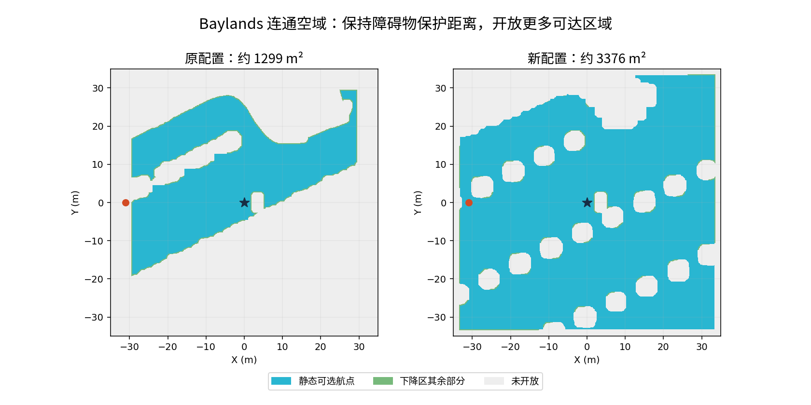

# 连通空域开放与绕障恢复

日期：2026-10-17。范围：已知静态 Baylands 地图、PX4 1.17 SITL、固定巡航高度；不代表实物或任意三维空间通过。

## 区域与策略



旧配置不仅要求净空，还将部分通行区限制为可直接 RTL 的矩形通道。新配置开放起点连通的巡航空域，由独立的已知几何恢复图提供通往可降落区的备用路线。

| 项目 | 原精化配置 | 连通空域配置 |
| --- | --- | --- |
| 检查 XY | ±30 m | ±34 m |
| 70 m 地图外缘预留 | 5 m | 1 m |
| 静态可选航点面积 | 约 1299 m² | 约 3376 m² |
| 共享飞行区域面积 | 1368.37 m² | 3510.00 m² |
| 障碍表面至机体中心保护距离 | 0.55 m | 0.55 m |
| 共享边界预留 | 0.40 m | 0.40 m |
| 规划端点额外预留 | 0.20 m | 0.20 m |
| 备用恢复 | 符合条件的直线 RTL 或原地降落 | 先原地安全降落；否则沿检查过的网格通道撤至可降落点 |

正常任务仍由实时局部障碍物地图和 EGO-Planner 生成轨迹。恢复图只用于已知静态场景的异常退出，不替代在线避障，也不使用失效后的 FAST-LIVO2 位姿规划。

恢复图在地面、起飞前生成：四邻接边全部位于共享飞行区域内；目标落在额外内缩的可下降区域。必须确认全部开放飞行单元都有恢复路线，否则拒绝起飞。执行恢复需要新鲜、有效的 PX4 位置/速度/航向、冻结的坐标变换和未改变的估计器 reset 计数；保留 Gazebo 真值几何监督。限制恢复目标速度 0.25 m/s、目标变化加速度 0.25 m/s²，并在转角停稳。输入无效时不承诺继续恢复飞行。

绿色仍为下降区域，青色为静态航点准入范围。树木、建筑、净空不足、不可达区域及地图最外缘仍不开放；当前不实现地形跟随或任意高度选点。

## 生成与恢复旧配置

```bash
astra/runtime/map_tools_venv/bin/python astra/tools/prepare_return_airspace.py \
  --source astra/runtime/maps/baylands_park \
  --output astra/runtime/maps/baylands_connected_full \
  --whole-map --connected-recovery --scene-edge-reserve-m 1 --refine-descent-prisms
```

输出目录必须不存在。彩色场景可将 source 指向本机的 `baylands_park_coloured`。原有目录不覆盖。恢复旧范围时，在启动命令追加：

```bash
--scan-dir astra/runtime/maps/baylands_whole_map_refined
```

## 验证证据

离线检查：351000 个开放飞行单元全部有恢复路线，249457 个恢复终点单元；逐边检查相邻性和区域覆盖，最长网格撤退距离 25.8 m。原始证据：`astra/runtime/connected_full_audit_20261017/geometry_audit.json`。这些是静态连通性结果，最长撤退路线尚未实飞。

新增回归覆盖绕过 U 形障碍的恢复路线、坐标原点平移、无恢复通道拒绝、PX4 超时/重置/无效速度拒绝，以及恢复失败不得下降。

计时代码另修复了每帧临时创建类造成的循环垃圾：复用一个上下文类，保留原有采样与计时功能，不关闭垃圾回收，不修改定位/配对超时阈值。2000 次检查的回归验证不再积累大量不可达类型对象。此修复不能单独证明所有调度暂停已消失。

**299 项回归通过**；Shell 语法、Python 编译和差异空白检查通过。

| 测试 | 结果 |
| --- | --- |
| `connected_recovery_20261017_01` | 新增航点 `[1.25,-4.75]` 到达，真值 `[1.237,-4.742,1.523]`；该位置不满足原地下降条件。主动停止本轮地图节点后 254.9 ms 冻结，沿静态恢复图退出，约 10.12 s 后进入可降落区并降落上锁。预期故障回归通过，**正常任务完整标志为 false**。 |
| `connected_west_20261017_01` | 新增西侧 `[-31,0]` 航点到达，真值 `[-31.084,-0.005,1.439]`；EGO 段实测水平路长 31.27 m。末点不能原地下降，沿恢复图移到附近可降落点，最终落地真值 `[-30.977,-0.674,-0.013]`，不返回起点。正常任务完成、完整路线审计及上锁均通过。 |

两轮均无 armed failsafe，实际 EV XY/Z 融合确认，参数基线保留且运行期间执行源码未改变。全程已知障碍表面到机体中心最小距离分别为 1.631 m、1.584 m；这是机体中心距离，不是旋翼边缘距离。规划动态约束、几何净空及共享区域检查通过。

西侧轮测量时间配对 p95 8 ms、最大 12 ms；冻结参考下 LIVO/PX4 XY 差 p95 0.0664 m、Z 差 p95 0.0749 m。20 Hz 合并 setpoint 输出最大间隔 97.5 ms。两轮计时均没有记录到第二代 GC；西侧 30050 次安全检查最大墙钟 24.3 ms。不能据此保证没有其他来源的暂停。

汇总证据：[connected_airspace_117_evidence.json](connected_airspace_117_evidence.json)。原始记录在上述同名 `astra/runtime/<run>/` 目录，包含模型、配置、时间戳、ULog、故障注入和各项离线审计。

## 本机复测命令

两份独立测试场景由 `baylands_connected_full` 复制而来，仅将各自 `flight_precheck.json` 的 `route_offsets_m` 与 `route.json` 同时改为对应的单航点；几何、世界、模型和保护参数保持一致。

```bash
# 受控故障：到达新增不可下降航点后停止本轮地图。
bash astra/run_117.bash obstacle connected_recovery_20261017_01 \
  --world-preset baylands --scan-dir astra/runtime/maps/baylands_connected_recovery_test \
  --route-json astra/runtime/maps/baylands_connected_recovery_test/route.json \
  --calibrate-ground-height --external-vision --executor-audit --isolate-estimator-cpus \
  --stop-map-at-transit-waypoint

# 正常西侧远端任务；末点附近安全降落。
bash astra/run_117.bash obstacle connected_west_20261017_01 \
  --world-preset baylands --scan-dir astra/runtime/maps/baylands_connected_west_test \
  --route-json astra/runtime/maps/baylands_connected_west_test/route.json \
  --calibrate-ground-height --external-vision --executor-audit --isolate-estimator-cpus
```

复测必须换新的运行名，不能覆盖原记录。仿真结束后运行 `audit_scan_flight.py`、`audit_shared_envelope.py`、`audit_external_vision.py`，参数为本轮运行目录。

目前只覆盖一轮新增区域故障恢复和一轮正常远端任务。没有逐点飞行、全图重复成功率、最长撤退路线、动态障碍、坡地跟随或实物认证；不将离线开放面积解释成这些项目已通过。
