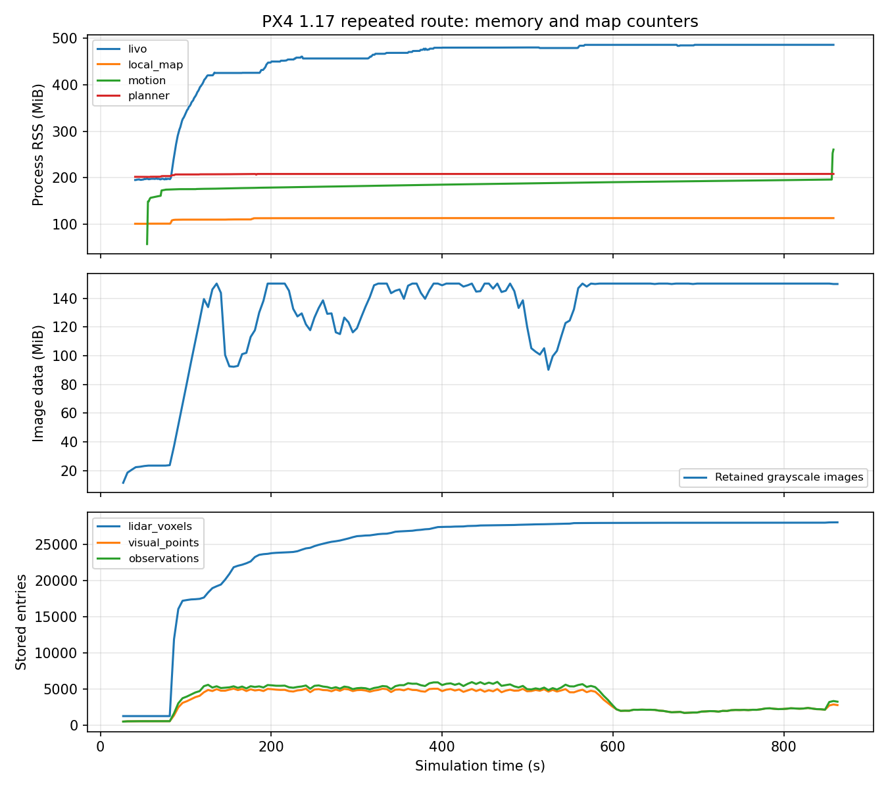
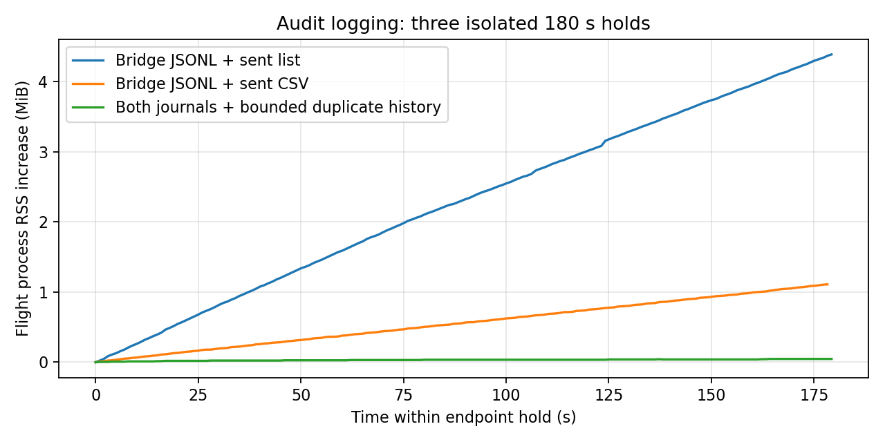
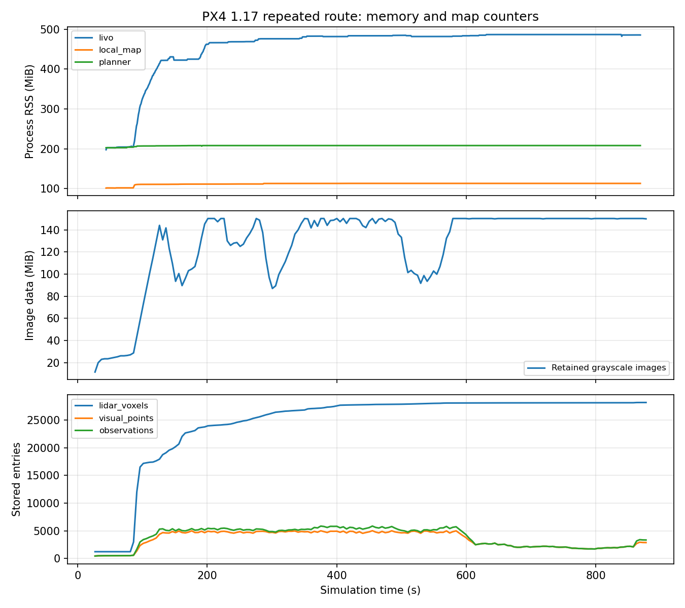

# 接收暂停与 GC 修复复测（更新至 2026-10-19）

[验证索引](README.md) · [运行与审计方法](../../docs/OPERATIONS.md)

## 目的

针对 `outdoor_20261017_091605` 中约 133.6 ms 的 Python 第二代 GC 暂停，复测原双航点、EGO 返航和自动降落路线。保留原有 250 ms 接收新鲜度、20 ms 测量配对和 0.20 m 高度差门槛。

## 执行端记录内存收尾（2026-10-19）

### 长路线、末端保持与独立故障补验

`final_long_ev_retest_20261019_01` 完成原双航点、EGO 返航、300.004 s 受监督保持和降落上锁。开启位置 EV、执行器审计、EventsExecutor 和 CPU 隔离；资源记录约 13.72 分钟，原 PX4 参数与运行期间源码保持。完整路线及已知表面阻挡绕行审计通过。

| 项目 | 结果 |
| --- | --- |
| 真值实际运动 | 测量时间航迹 71.301 m；三段端点 XY 误差 1.94 / 6.20 / 3.91 cm |
| 曲线与已知表面 | 419 条完整曲线的共享边界、连续净空和动态约束通过；全程最小机体中心净空 1.445 m |
| 规划峰值 | 速度 0.200 m/s，加速度 0.2483 m/s²，未放宽原限制 |
| 全窗口发送 | prestream 至请求降落合并发送记录最大间隔 71.28 ms；保持期间最大 67.93 ms，不等同 PX4 接收时延 |
| Odom | 监督器测量／接收年龄最大 188 / 159.13 ms；独立记录器回调间隔最大 181.78 ms |
| EV | armed XY/Z aid-source 各 7806/7806 样本融合，无拒绝；测量配对覆盖 99.780%，p95/max 8/16 ms |
| 两估计器差值 | 地面冻结 EV 变换下 armed XY/Z p95 0.0599 / 0.0996 m；Z 最大 0.1158 m，不作精密定高认证 |
| 地面冻结真值误差 | EGO 运动期 LIVO XY/Z p95 0.0727 / 0.0815 m；PX4 0.0604 / 0.0354 m |
| 保持实际运动 | XY 相对保持起点最大变化 0.0675 m，Z 全范围 0.1776 m；这是保持窗口，不是严格静止悬停认证 |
| 完整记录 | 8132 条 JSONL 与上锁后导出逐条一致，6456 条发送 CSV 与计数一致，累计路径一致 |
| GC／failsafe | prestream 至上锁间没有二代 GC；armed failsafe=0；不据此推翻旧长测出现过二代 GC 的事实 |

额外高度基准诊断保留原始值：本轮已知冻结原点 `ref_alt=0.118453 m`，按固定原点公式诊断后的 Z p95 为 0.1393 m，**比原始 0.0996 m 更大**。该项不替代原始差值，不修改控制或保护，也不能沿用旧轮“去除原点项后精度改善”的结论。

内存须分开判断：LIVO、地图和规划器最后 120 s 分别稳定在 485.15、113.70、208.41 MiB；执行进程在 300 s 保持从 189.59 增至 196.18 MiB（+6.59 MiB），最后 120 s 仍增 2.59 MiB。详细审计保留了 22779 条 Odom 回调，尚未到 65536 条的有界上限；这与诊断历史继续填充相符，不能只凭 RSS 排除其他分配，也不能宣称全栈已平台化。此前关闭审计的 180 s 保持 +0.0469 MiB 仍是对应配置的事实。



图末执行进程在上锁后恢复完整审计数组、序列化时有额外上升；上述空中统计均排除了该阶段。结构化结果见 [长路线与保持证据](final_long_ev_117.json)，重算脚本位于本轮目录的 `acceptance_tail.py`。

随后增加显式故障入口，补做三项独立故障。新增开关和位置转发器只在请求相应隔离测试时启用；常规控制、定位、规划算法及保护门槛未改。长路线运行在新增故障工具之前，两阶段哈希不同，不合并为逐字节相同版本的重复成功率。

| 故障与运行 | 首次保护响应 | 请求 Land | 落地结果与边界 |
| --- | --- | --- | --- |
| 仅定位算法退出：`final_livo_only_loss_20261019_02` | 230.61 ms 冻结目标；触发测量年龄超过 250 ms | 1235.23 ms，包含约 1 s 冻结保持 | 上锁；最小机体中心净空 2.801 m，时钟及适配器保留 |
| planner 退出：`final_planner_loss_20261019_01` | 285.94 ms 冻结目标；planner heartbeat 过期 | 1289.61 ms，包含约 1 s 冻结保持 | 上锁；最小净空 2.801 m，LIVO/PX4 继续更新 |
| 执行端 PX4 位置遥测中断：`final_px4_position_loss_20261019_01` | 252.83 ms 锁存；PX4 状态超过 250 ms | 253.41 ms | 上锁；最小净空 2.772 m；不用过期位置生成新的 hold |

时间从注入命令记录计算，包含定位子进程身份核验成本，是这次运行的响应时间，不是所有调度条件下的上界。三轮任务均按预期失败退出，不能算正常路线成功；都没有中止后的正常 bridge 采样，ULog armed failsafe=0，原参数和运行源码保持。

定位轮通过 pidfd 仅停止本轮 launch 会话中的唯一 `fastlivo_mapping`，不停止 launch、适配器或 ROS 时钟。注入后时钟推进 6.256 s，适配器继续记录 4115 个输入事件。之前的 `final_livo_loss_20261019_01` 停了整个 launch，连时钟桥一起停止，仅保留为联合故障调试证据，不能算独立定位故障通过。

位置遥测轮仅将执行进程的 `vehicle_local_position` 输入接到独立转发器，再停止转发器；原始 `/fmu/out`、PX4 命令、EV 和状态均不切断。独立记录器仍收到新 PX4 位置、52 个 Odom 与 14 个 PX4 status；不是停止 DDS Agent，也不是飞控自行 Offboard failsafe 的替代证明。转发保留原消息时间戳，实际 DDS 回归验证消息内容一致。

三项仅覆盖起点附近、可直接下降区域，不能覆盖全部 PX4 遥测失联、空中 reset、无 GPS、通行区长距离撤退或硬件。汇总与源码差异见 [独立故障证据](final_fault_matrix_117.json)。最终 Python 回归 **338 passed**，3 条既有 protobuf 弃用提示；本轮纯 Python 故障工具不重复计数旧 ROS 构建。

```bash
bash astra/run_117.bash obstacle final_long_NEW \
  --world-preset baylands \
  --scan-dir astra/runtime/maps/baylands_gc_receiver_20261018 \
  --route-json astra/runtime/maps/baylands_gc_receiver_20261018/route.json \
  --calibrate-ground-height --external-vision --executor-audit \
  --isolate-estimator-cpus --execution-executor events \
  --end-action return_home --endpoint-hold-seconds 300

# 故障测试只选一个开关；每轮使用新名称。
bash astra/run_117.bash obstacle final_fault_NEW \
  --world-preset baylands \
  --scan-dir astra/runtime/maps/baylands_coloured_short_retest \
  --route-json astra/runtime/maps/baylands_coloured_short_retest/route.json \
  --calibrate-ground-height --external-vision --executor-audit \
  --isolate-estimator-cpus --execution-executor events \
  --stop-livo-after-handoff-s 2
# 分别替换为 --stop-planner-after-handoff-s 2 或 --stop-px4-position-after-handoff-s 2。
```

### 最终代码 EV 与记录兼容复测

`final_ev_memory_retest_20261019_02` 使用最终的桥接 JSONL、发送 CSV 和两条重复历史上限，启用 EV、执行器审计及 EventsExecutor。四个 0.5 m 短航点全部完成，正常降落上锁；原 PX4 参数基线和运行期间源码保持不变。本轮未修改代码、参数或保护门槛。

| 检查 | 本轮结果 |
| --- | --- |
| 实际运动与端点 | 测量时间真值水平路长 2.434 m；地面冻结参考端点 XY 误差 4.42 / 1.78 / 2.97 / 4.55 cm |
| 曲线与净空 | 12 条曲线的共享边界、连续净空及动态约束通过；全程最小已知表面机体中心距离 2.546 m |
| 规划峰值 | 速度 0.1968 m/s，加速度 0.1892 m/s²，保留 0.20 / 0.25 限制 |
| EV 实际融合 | ULog 中 XY/Z aid-source 各 720/720 个 armed 样本融合，无拒绝；不融合 yaw/速度 |
| 冻结 EV 变换差值 | armed XY/Z p95 为 0.0733 / 0.0249 m；yaw 差 p95 1.24°，此值不是航向融合证据 |
| 测量配对 | 1084 对，覆盖率 99.724%，配对 p95/max 8/20 ms；保留未配对样本，不写成全部配对 |
| 发送与 Odom | prestream 至请求降落合并发送记录最大间隔 67.43 ms；监督器测量／接收年龄最大 164 / 121.89 ms |
| 记录完整性 | 374 条 JSONL 与上锁后导出逐条一致，940 条 CSV 与发送计数一致，累计路径一致 |
| GC 与 failsafe | prestream 至上锁之间无二代 GC；解锁前 35.61 ms、上锁后 42.76 ms；armed failsafe=0 |

爬升时 PX4 在测量时刻 87.484 s 发生一次 yaw reset；控制程序记录并重新完成航向对齐，111.624 s 才交接 EGO。不能声称全程无 reset。独立记录器全窗口 Odom 测量年龄曾到 304 ms，发生在地面准备阶段；prestream 至上锁该记录器最大 92 ms，与监督器的采样口径分别保留。单看 bridge 记录有 1.313 s 间隔，包含航点间由原生保持接管的窗口；合并实际两类发送记录后最大 67.43 ms。

约 26.73 s 的执行窗口内，motion RSS 从 167.17 到 167.93 MiB（+0.754 MiB），LIVO 从 419.94 到 454.32 MiB。这是启用执行器审计的短测，不能据此证明内存平台，也不能拿它与关闭审计的 180 s 保持直接合并。全套短路线审计通过；没有障碍阻挡直线路径，不是新增绕障证据。最终代码的长路线、延长运行和独立故障矩阵仍待补齐。

结构化结果见 [最终 EV 短路线证据](final_ev_memory_117.json)。原始日志及可复现汇总脚本位于 `astra/runtime/final_ev_memory_retest_20261019_02/`。

```bash
bash astra/run_117.bash obstacle final_ev_memory_retest_NEW \
  --world-preset baylands \
  --scan-dir astra/runtime/maps/baylands_coloured_short_retest \
  --route-json astra/runtime/maps/baylands_coloured_short_retest/route.json \
  --calibrate-ground-height --external-vision --executor-audit \
  --isolate-estimator-cpus --execution-executor events

# 仿真退出后；审计代码会加载本机已有 pyulog 路径。
source astra/env_117.bash
python3 astra/tools/audit_scan_flight.py astra/runtime/final_ev_memory_retest_NEW
python3 astra/tools/audit_external_vision.py astra/runtime/final_ev_memory_retest_NEW
python3 astra/tools/audit_shared_envelope.py astra/runtime/final_ev_memory_retest_NEW
```

### 记录内存修改与历史对比

先纠正内存归因：`gc_extended_retest_20261018_01` 的 8269 条 `bridge_samples` 全部产生于规划执行，额外 300 s 末端保持期间 **没有新增 bridge sample**。因此不能将保持期间的 13.53 MiB 增长主要归因于这份列表。发送记录 `node.rows` 在保持时仍持续追加；开启执行器审计时，有界回调历史也会增长至其容量。两者与 LIVO 图像缓存须分别分析。

本轮将桥接采样改为增量写 `bridge_samples.jsonl`，内存只留最近两条和累计路径长度；确认上锁后才恢复旧格式的 `motion_events.json.bridge_samples`。未确认上锁时只保留文件与计数，不重新分配完整数组。另将 EGO 飞行驱动的发送记录改为增量写 `motion_sent.csv`，保留原字段；独立位置测试的原记录方式保持。首次写入错误中止正常任务并解除故障记录器，后续恢复发送仅保留两条记录，避免同一磁盘错误反复阻止恢复。监视器新增 `motion` RSS 角色。

CSV 改动后仍观察到约 1.11 MiB/180 s 增长，继续查到父类 `SettledFlight.send()` 还有一份 `setpoint_rows` 重复历史。EGO 不导出或使用这份完整历史，现仅在 EGO 地面准备时限制为两条；独立悬停标定工具仍保留其原始记录。回归直接调用实际继承发送链，验证 1000 次目标均发送并写入 CSV，重复历史始终不超过两条。

### 已完成实测

| 运行 | 结果与边界 |
| --- | --- |
| `bridge_store_smoke_20261019_01` | 单航点 0.6 m，正常落地上锁；116 条 JSONL 采样完整恢复。保持后真值端点误差约 0.0146 m，无 armed failsafe；仅验证桥接记录改动 |
| `bridge_store_hold_20261019_01` | 地面原高度准入失败，未解锁；没有长保持证据。未放宽原门槛 |
| `bridge_store_hold_20261019_02` | 加入已有地面高度校准后完成 180 s 保持并落地；桥接采样已增量写，但发送列表尚未修复、执行器审计关闭。保持 RSS 152.49→156.88 MiB，增加 4.39 MiB，仍未平台化 |
| `flight_log_hold_20261019_01` | 发送 CSV 已增量写，但继承的重复历史仍是列表。180 s 保持 RSS 151.83→152.94 MiB，增加 1.11 MiB；正常落地，无 armed failsafe |
| `flight_log_bounded_hold_20261019_01` | 最终代码：桥接 JSONL、发送 CSV、重复历史两条上限。180 s 保持 RSS 151.523→151.570 MiB，增加 **0.0469 MiB**；116 条桥接采样与 JSONL 一致，3924 条发送 CSV 与计数一致，路径累计一致；正常落地，无 armed failsafe |
| `bridge_store_scan_20261019_01` | 彩色 Baylands 四航点完成并上锁；真值水平路线 2.530 m，端点 XY 误差 0.0575/0.0638/0.0606/0.0691 m。11 条曲线边界、连续净空与动态约束通过；EV 确认融合 XY/Z，无 armed failsafe。此轮发生在发送 CSV 改动之前 |

三轮 geometry-rich 保持都使用同一 0.6 m 路线、已有地面高度校准、180 s 保持和原门槛，均未开启 EV 或执行器审计；源码阶段不同，每阶段各一轮。最终轮全窗口合并发送记录最大间隔 59.21 ms，保持阶段监督器 Odom 接收年龄最大 171.30 ms、测量年龄最大 196 ms。此处只证明该配置的短保持接近内存平台，不代替开启 EV/执行器审计的最终版本长路线或全栈稳定性认证。原 PX4 参数基线及各轮运行期间源码均保持。



完整数值与适用边界见 [记录内存汇总](flight_log_memory_117.json)。原始记录在对应 `astra/runtime/<运行名>/`；曲线只使用端点保持窗口，排除上锁后的完整采样恢复与序列化。

扫描轮完整路线审计通过；全程最小已知表面机体中心净空 2.536 m，合并 setpoint 最大间隔 64.48 ms，执行监督器 Odom 测量年龄最大 160 ms、接收年龄最大 123.68 ms。它验证 JSONL 与 `audit_scan_flight.py`、`audit_shared_envelope.py`、`audit_external_vision.py` 的兼容性，不是新增阻挡路径绕障试验。

### 同一真实日志的离线分配对比

源数据来自 `gc_extended_retest_20261018_01`。分别在独立进程重放三份相同记录，`tracemalloc` 统计追加后的 Python 当前分配，不含完整 ROS 进程 RSS，不用于推断飞行时延。

| 数据 | 累计条数 | 旧列表分配 | 新增量存储分配 |
| --- | ---: | ---: | ---: |
| 桥接采样 | 8269 / 16538 / 24807 | 26.45 / 52.89 / 79.35 MiB | 0.0124 / 0.0128 / 0.0131 MiB |
| 发送记录 | 6419 / 12838 / 19257 | 12.16 / 24.31 / 36.47 MiB | 0.1318 / 0.1322 / 0.1325 MiB |

运行证据保存在 `astra/runtime/bridge_store_replay_20261019/`，包含输入、`replay.py` 与 `replay_results.json`。它证明这两类记录不再随条数常驻增长；仍需分别验收启用执行器审计的长路线、其他进程、磁盘写入延迟与目标硬件。

环境检查还发现无任何进程映射的历史 Fast DDS SHM 段。运行官方 `fastdds shm clean`，报告 0 个在用段、清理 385 个僵尸段；`/dev/shm` 从约 6.2 GiB 降到约 3.8 MiB。未删除活跃进程资源，不能据此将旧 Odom 暂停归因为共享内存残留。

### 复现与回归

```bash
printf '[[0.6, 0.0]]\n' > /tmp/astra_smoke_route.json
bash astra/run_117.bash obstacle NEW_LOG_HOLD \
  --route-json /tmp/astra_smoke_route.json \
  --calibrate-ground-height --endpoint-hold-seconds 180

bash astra/run_117.bash obstacle NEW_LOG_SCAN \
  --world-preset baylands \
  --scan-dir astra/runtime/maps/baylands_coloured_short_retest \
  --route-json astra/runtime/maps/baylands_coloured_short_retest/route.json \
  --calibrate-ground-height --external-vision --executor-audit \
  --isolate-estimator-cpus --execution-executor events
```

最终代码的 Python 回归 **328 passed**，有 3 条既有 protobuf 弃用提示；涵盖记录完整性、有界保留、上锁门控、CSV 字段、继承发送链及写入失败后恢复采样。未修改控制参数、新鲜度、配对或碰撞阈值。扫描轮与不同阶段代码的结果分别保留，不合并为最终配置的重复成功率。

## 延长运行验收（`gc_extended_retest_20261018_01`）

原双航点、EGO 返航、额外 300.005 s 空中保持和降落全部完成。资源采样 832.34 s（约 13.87 分钟，包含地面准备）；从 prestream 到上锁 792.24 s。运行期间源码不变，原 PX4 参数基线保持；本轮未改控制算法或保护门槛。

| 检查 | 结果 |
| --- | --- |
| 实际路线 | 测量时间真值水平路径 71.205 m；三段端点 XY 误差 0.0089 / 0.0368 / 0.0299 m |
| 连续路线检查 | 419 条曲线全部在共享边界内，净空与动态约束通过；最小已知表面机体中心净空 1.477 m |
| 规划动态 | 峰值速度 0.200 m/s、加速度 0.2481 m/s² |
| 全程 setpoint 间隔 | prestream 到请求降落合并发送最大 76.77 ms；额外保持阶段最大 71.19 ms |
| 全程 Odom 间隔 | 独立记录器最大 178.09 ms；执行监督器回调最大 167.33 ms |
| Odom 测量年龄 | 独立记录器 p95/max 56/124 ms；保持阶段监督器 p95/max 136/184 ms，节点间回调顺序和时钟采样不同，数值不混用 |
| EV | XY/Z 实际融合；配对 p95/max 8/16 ms；armed failsafe=0 |
| LIVO 相对真值 | EGO 运动阶段冻结地面参考 XY/Z p95 0.0578/0.0387 m；该精度窗口不含后续 5 分钟保持 |
| 保持实际运动 | 相对保持起点 XY 最大变化 0.0775 m；Z 全范围 0.1928 m，不能据任务完成称为精密定高通过 |

### 延长运行暴露的限制

保持开始约 190.8 s 后，出现一次 **45.54 ms generation-2 GC**；完整回收在解锁前为 40.46 ms、上锁后为 108.78 ms。自动 GC 保持开启。早期两轮“飞行窗口无二代 GC”的结论仍适用于那些运行，但不能再外推为长运行也完全没有二代 GC。本轮未由它触发保护，不证明所有未来暂停都有相同上界。

LIVO RSS 从 197.58 MiB 到 485.49 MiB，最后 300 s 净增加 3.75 MiB，最后 120 s 在 482.20～486.65 MiB 间，局部地图和规划器后段基本持平。这只支持当前路线／保持阶段后段接近平台。

额外只读采样从起飞后开始记录 Python 飞行执行子进程：约 178.15 MiB 到上锁前 215.18 MiB，5 分钟保持增加 13.53 MiB，**没有平台证据**。上锁后序列化诊断记录时升至 290.34 MiB，须与空中内存分开。执行器有界诊断尾部与有限任务的全程记录均占内存；不能仅据 RSS 宣称泄漏根因，也不能把 LIVO 平台写成整套系统无限稳定。下一项应分离并限制执行端诊断记录成本。



此图不含额外记录的 Python 飞行进程；其数值在[汇总 JSON](gc_extended_acceptance_117.json)中。

### 高度基准诊断

保留原始 EV 冻结变换下的 PX4/LIVO Z 差：p95 0.2110 m、最大 0.2297 m。地面 EV 变换与稍后控制端校准相差 0.1840 m，中间曾发生 PX4 地面高度重置，不能直接将该差解释为飞行漂移。

PX4 1.17 的 `EKF/estimator_interface.cpp::getPosition()` 输出 `local_z = ref_alt - altitude`；`aid_sources/external_vision/ev_height_control.cpp` 在 EV 为高度参考时以 `-EV_z` 为高度参考。地面初始化日志独立给出 `ref_alt=0.1547347 m`，ULog 确认解锁期间该值不变。按 `local_z - EV_z - frozen_ref_alt` 另列诊断后，Z p95/max 为 **0.0585/0.1033 m**。这是已知原点项，不是从飞行残差拟合出的偏移；没有重写 EV 消息、控制变换或安全门槛，也没有因此宣称完整坐标认证通过。

`audit_external_vision.py` 新增独立 `height_datum_diagnostic`，保留旧的原始差值。只有已确认的解锁前原点、EV 高度参考、解锁期间每个 ULog `ref_alt` 均与固定原点一致时才给出诊断；缺失、变化或空中取得的原点均拒绝校正。10 项新增回归覆盖符号、持续漂移不被消除和拒绝条件；完整 Python 回归 **317 passed**（3 条既有弃用提示）。此前 19 包构建、5/5 LIO CTest 的证据不因本轮纯离线审计改动重复计数。

### 复现

```bash
bash astra/run_117.bash obstacle gc_extended_retest_20261018_01 \
  --world-preset baylands \
  --scan-dir astra/runtime/maps/baylands_gc_receiver_20261018 \
  --route-json astra/runtime/maps/baylands_gc_receiver_20261018/route.json \
  --calibrate-ground-height --external-vision --executor-audit \
  --isolate-estimator-cpus --execution-executor events \
  --end-action return_home --endpoint-hold-seconds 300
```

仿真结束后在已 source `astra/env_117.bash` 的终端审计：`audit_scan_flight.py`、`audit_external_vision.py`、`audit_shared_envelope.py`；前两项完成后再运行 `audit_long_route_drift.py --no-plot`，均传本轮目录。内存使用 `audit_runtime_growth_117.py <目录> --output <目录>/runtime_growth_audit.json --plot <目录>/runtime_growth.png`。`acceptance_tail_audit.json` 为本轮全窗口额外统计；既有 `executor_timing_audit.json` 和路线精度窗口主要到规划运动结束，不覆盖全部额外保持。

## 最新同配置重复复飞结论（`gc_barrier_retest_20261018_02`）

在 `gc_barrier_retest_20261018_01` 后，按相同路线与执行配置再次运行。新一轮完成双航点、EGO 返航和自动降落并上锁；隔离 rootfs 的 `run_summary.json` 确认原 PX4 参数基线保持、执行源码运行期间未变。运行目录为 `astra/runtime/gc_barrier_retest_20261018_02`，原始记录留在本机 `astra/runtime/`。

两轮之间 `FlightGcBarrier` 的默认调用策略收紧为只允许显式授权的隔离子进程冻结对象；这两轮都显式授权，因此该路径行为相同，但源码哈希不完全相同。两次结果不能写成逐字节相同版本的重复成功率。

可复现命令（在仓库根目录）：

```bash
bash astra/run_117.bash obstacle gc_barrier_retest_20261018_02 \
  --world-preset baylands \
  --scan-dir astra/runtime/maps/baylands_gc_receiver_20261018 \
  --route-json astra/runtime/maps/baylands_gc_receiver_20261018/route.json \
  --calibrate-ground-height --external-vision --executor-audit \
  --isolate-estimator-cpus --execution-executor events \
  --end-action return_home
```

测量时间真值记录的水平路径为 `70.933 m`。三个到点段的端点水平误差分别为 `0.0362 m`、`0.0243 m`、`0.0245 m`；EGO 返航后落地上锁，无 armed failsafe。规划曲线连续净空、速度/加速度约束和全程共享执行边界均通过；423 条 B-spline 全部通过边界审计，最小已知表面机体中心净空 `1.387 m`。这条路线有已知表面阻挡绕行，但不认证缺失几何、近障碍实机或任意全图路线。

| 检查 | 本轮结果 |
| --- | --- |
| Python 回归 | 307 passed；3 条既有 protobuf 弃用警告 |
| ROS 构建 / LIO CTest | 19 个包构建通过；5/5 CTest 通过 |
| 飞行阶段 generation-2 GC | 0 次；52.6 ms 的完整 GC 在解锁前，112.1 ms 在上锁后 |
| 自动 GC | 全程开启，阈值未改；generation 0/1 最大约 10.1/8.4 ms |
| Odom 接收 | 消息间隔 p95/max `119.6/203.9 ms`；测量年龄 p95/max `56/140 ms`；独立监督器接收年龄 p95/max `96.5/203.5 ms` |
| Offboard setpoint | 最大间隔 `72.1 ms`；未放宽原 250 ms 安全门槛 |
| External Vision | Armed 期间 PX4 XY/Z aid-source 融合比例均 100%，拒绝 0；使用冻结地面变换 |
| LIVO 内存 | RSS `196,032→470,004 KiB`，峰值 `471,288 KiB`；运行后段约平台，最后 60 s 端点增加 `1,520 KiB`、最后 300 s 增加 `4,232 KiB` |
| FAST-LIVO2 耗时 | `processing_us` p50/p95/max `10.38/23.93/71.91 ms`；包含调度等待的墙钟耗时不等于纯算法 CPU 时间 |

图像缓存参数为 512；诊断日志短暂观测到 513 张，代表当前帧参与处理时的瞬时计数。RSS 稳定结论仅适用于这段约 8.85 分钟的 Baylands 路线。测量年龄峰值距 250 ms 门槛约有 110 ms 裕量，接收年龄峰值约有 46 ms 裕量；这还不是硬实时保证。

构建后重新运行完整 Python 回归和 CTest。当前工作区存在多项预先未提交改动，本轮未提交或推送任何改动。

## 地图失联故障注入（`gc_map_loss_retest_20261018_01`）

为验收运行中保护，在 EGO 控制交接约 1.00 s 后停止本轮局部地图进程。执行器在故障注入信号后约 `247.7 ms` 锁存 `local map not ready or heartbeat stale` 并冻结保持目标；随后受控结束任务并上锁，未继续执行旧轨迹，`run_summary.json` 确认原参数基线保持。无 armed failsafe。该轮是失效注入，不是正常路线完成测试；接收监视器记录的最大 Odom 测量年龄约 `648 ms`、最大接收年龄约 `387 ms`，不能把故障轮当作正常实时性能指标。

```text
命令：
bash astra/run_117.bash obstacle gc_map_loss_retest_20261018_01 \
  --world-preset baylands \
  --scan-dir astra/runtime/maps/baylands_gc_receiver_20261018 \
  --route-json astra/runtime/maps/baylands_gc_receiver_20261018/route.json \
  --calibrate-ground-height --external-vision --executor-audit \
  --isolate-estimator-cpus --execution-executor events \
  --stop-map-after-handoff-s 1

结果：地图停止 → readiness 撤销 → 保持目标冻结 → 上锁；result=0，armed failsafe=0
```

这证明地图进程失联时保护链能结束任务，但响应时间仍需按真实硬件预算重新验收；它没有证明 250 ms 门槛可在所有调度压力下稳定满足。

## External Vision 失联复测（`gc_ev_loss_retest_20261018_01`）

在当前 GC 屏障、PX4 有界接收历史与 EventsExecutor 配置下，EGO 交接约 2 s 后停止本轮 EV 发布进程。局部地图保持运行，故障锁存时 `map_ready=true`，Odom 测量年龄约 52 ms；这是独立 EV 看门狗触发，不是地图或 Odom 失效。

| 事件 | 信号发出后的时间 |
| --- | --- |
| 锁存 `External Vision fusion unavailable or heartbeat stale` | 247.700 ms |
| 冻结 PX4 保持目标 | 247.751 ms |
| 官方 RTL 被拒绝：`PX4 failsafe flags stale` | 1247.874 ms |
| 在已检查的可下降区降落上锁 | 7231.014 ms |

此轮 `flight_complete=false`、`disarmed=true`，故障回归通过；不能记作正常任务完成或成功返航。ULog 的 102 个 armed `vehicle_status` 样本中，failsafe 均未置位。EV 停止前实际融合 XY/Z，停止后缺失的 aid-source 样本不能解释为持续融合；本轮不验证无 GPS 时 EV 丢失后的飞行能力。飞行中无第二代 GC，自动 GC 与原门槛保持。原 PX4 参数基线和运行期间执行源码均保持。

```bash
bash astra/run_117.bash obstacle gc_ev_loss_retest_20261018_01 \
  --world-preset baylands \
  --scan-dir astra/runtime/maps/baylands_gc_receiver_20261018 \
  --route-json astra/runtime/maps/baylands_gc_receiver_20261018/route.json \
  --calibrate-ground-height --external-vision --executor-audit \
  --isolate-estimator-cpus --execution-executor events \
  --stop-ev-after-handoff-s 2
```

原始证据：`fault_injection.json`、`fault_regression.json`、`motion_events.json`、`motion_executor_audit.json`、`external_vision_audit.json`、`run_summary.json` 与 PX4 ULog。故障轮独立记录器的全记录 Odom 间隔峰值约 416 ms，不能拿它冒充正常任务时效指标，也不能在未对齐事件前断言由故障注入引起。

## 首轮复飞（`gc_barrier_retest_20261018_01`）

已在专用的飞行驱动子进程启用 `FlightGcBarrier`。它只在确认未解锁后执行一次完整回收并冻结该子进程已经初始化的对象；自动 GC 仍保持开启；确认上锁后才解冻并回收。普通进程或已有全局冻结集合不会被它修改。

这轮双航点、EGO 返航和自动降落完成，实测测量时间真值水平路径约 `72.27 m`，无 armed failsafe。飞行阶段没有第二代 GC；第 0/1 代 GC 最大约 `10.95 ms`。完整 GC 的 `39.6 ms` 发生在起飞前，`133.9 ms` 发生在上锁后的清理阶段，均不在飞行控制窗口内。

接收与轨迹证据：

- Odom 监督器回调间隔最大约 `190.8 ms`，监督器测量年龄 p95 `56 ms`、最大 `104 ms`；仍低于原 `250 ms` 保护门槛，但不是固定周期保证。
- 合并 setpoint 发送间隔最大 `72.4 ms`；任务没有因 Odom 新鲜度、配对或桥接故障中止。
- FAST-LIVO2 与 Gazebo 的 XY 误差 p95 `0.0428 m`，测量时间配对 p95 `8 ms`、最大 `12 ms`；LIO correspondence 最低 `4072`。
- External Vision armed 期间 XY/Z 融合比例为 `100%`，yaw/velocity 仍未融合。
- LIVO RSS `199,040→492,564 KiB`，约 `194.4→481.0 MiB`；本轮只证明路线完成，长期内存平台仍需单独验证。

在这轮飞行窗口内，原 133.6/66.8 ms 二代 GC 峰值没有复现。这不等于所有 Python 调度延迟都消失：Odom 接收间隔仍可到约 `191 ms`，且 `preview_bspline` 单次回调最高约 `21.5 ms`。后续延长运行又观测到 45.54 ms 二代 GC，见本页最新记录，不能将短测无二代 GC 外推为永久隔离。

## 修复

- `ExecutorTimingAudit.span()` 改用模块级复用的带 `__slots__` 上下文对象，不再在每次安全检查中动态创建局部类和循环类型垃圾。
- PX4 `VehicleLocalPosition` 订阅使用 KEEP_LAST、BEST_EFFORT、深度 64 的有界历史队列。执行前仍按原有时间戳、reset epoch、新鲜度和配对门槛筛选；队列不会放宽安全判定。
- 增加实际 ROS DDS 队列复测：接收线程暂停约 200 ms 后能保留配对样本，过期和 reset 不匹配样本仍被拒绝。
- 增加仅供隔离 SITL 飞行驱动使用的 `FlightGcBarrier`；不关闭自动 GC、不放宽新鲜度／配对门槛，且上锁后才恢复冻结集合。

## 运行（上一轮）

运行目录：`astra/runtime/gc_receiver_20261018_01`。使用隔离 PX4 v1.17、Baylands 全图精化地图、External Vision XY/Z、EventsExecutor、CPU 隔离和原双航点，完成返航降落。

```text
目标：(6.43997, 0.81671) → (-9.09099, 19.63866) → 返航
实测水平路径：71.862 m（测量时间真值）
结果：两目标到达，返航到达，自动降落并上锁
armed failsafe：0
原 PX4 参数：已恢复
执行源码：运行期间未修改
```

## 证据

| 检查 | 结果 |
| --- | --- |
| 完整路线、共享执行边界 | 通过；431 条曲线全部合格 |
| 已知表面阻挡路径绕行 | 通过；最小机体中心净空 1.268 m |
| 高度配对中止 | 未复现；`height_pair_callback_order_deferrals=0` |
| 执行器 Odom 回调间隔 | 最大 183.7 ms；本轮安全监督器没有超过 250 ms 的回调间隔 |
| 独立 receipt 监视器 | 记录到 Odom 年龄峰值 352 ms、接收年龄峰值 463 ms；监督器自身记录最大测量年龄 196 ms。EventsExecutor 不提供 DDS `MessageInfo`，这些监视器间差异尚不能定位为传感器端、DDS 队列或监视器调度延迟 |
| 第二代 GC | 1 次，最大 66.8 ms；旧轮 133.6 ms，暂停下降但未消除 |
| PX4/FAST-LIVO2 时间配对 | p95 8 ms，最大 12 ms |
| External Vision | armed 期间 XY/Z 融合比例均 100%；未融合 yaw/velocity |
| 速度 | 峰值 0.239 m/s |
| setpoint 发送间隔 | 最大 106.5 ms，仍应继续观察 |
| LIVO RSS | 197 MiB → 468 MiB；末 5 分钟约增加 3.3 MiB，长期稳定仍未证明 |

离线 allocation 对照运行 20,000 次计时 `span()`：旧实现留下 220,000 个不可达循环对象，显式完整 GC 约 65.9 ms；新实现留下 0 个，完整 GC 约 1.24 ms。该脚本关闭自动 GC 仅为测量不可达对象数量，结果不等于飞行时的暂停预测。

## 限制

上一轮证明消息接收修复没有阻止一条约 72 m 的闭环路线完成，但不等于所有调度暂停都已消失。最新复飞把第二代 GC 长暂停移到地面清理阶段，仍不能把约 191 ms 的 Odom 接收间隔解释成稳定实时性能；历史队列和冻结屏障也不能替代实时计算能力。External Vision 仍只融合 XY/Z，近障碍真实飞行尚未认证。

下一步应在不放宽保护门槛的前提下分离并限制执行端诊断内存，补齐定位／规划／PX4 遥测独立中断和不同恢复位置的运行覆盖。当前不进入实物放飞；硬件台架联调与真实飞行验收应分别安排。
