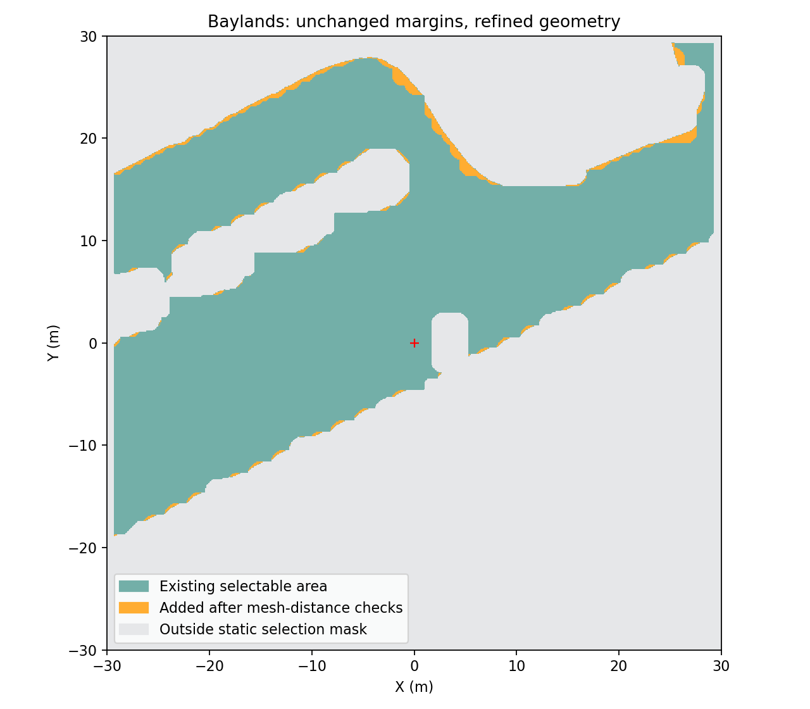

# RViz 航点范围显示与几何精化扩区

2026-10-16，Baylands，隔离 PX4 1.17 SITL。用户希望参考网格覆盖全图、看清真正可选的航点范围，并扩大不必要受限的空地。

## 界面含义

| 图层 | 含义 |
| --- | --- |
| 灰色参考网格 | 每格 0.5 m，覆盖 70×70 m；超出网格或有无网格不决定能否飞行 |
| 青色填色与轮廓 | 同一冻结规划端点掩码，包含原 0.40 m 跟踪余量和规划端点邻域；显示可选航点的静态几何范围 |
| 绿色地面区域 | 原始下降净空证书；未扣除上述规划余量，不等于最终航点范围 |
| 蓝色区域 | 原始额外巡航证书；不一定能原地下降 |
| 彩色场景、点云、航点球 | 分别为模型背景、传感器观测和任务状态；不作为空域许可 |

青色图层使用独立瞬态本地话题 `/astra/ui/goal_region`，一次构建并缓存，不随每秒状态或航点编辑重复生成；ROS 晚加入的 RViz 可获取完整图层。轮廓保留内部孔洞，不拿凸包填平树木或箱体。每次点击仍检查实时障碍、数据时效、任务状态、半径与末点降落条件。靠近 0.25 m 内圈和最大半径的跨界格子保守不显示；青色不保证动态准入或规划成功。

新增图层实测发布 3768 个填色三角形顶点、3120 个边线顶点，地面 RViz 截图已人工检查；缓存回归验证航点更新不会重建区域。全部回归 283 项通过，有 3 个既有 Python 弃用警告。

## 扩区方法与结果

原地图把每个三角面包进轴对齐矩形，快速排除完整下降柱体；矩形包含真实三角面以外的空地。新配置仅对原先被保守排除的格子，使用真实三角面距离减去整个三维柱体的覆盖半径，证明格子内所有 XY 和整个下降高度区间都有净空，再加入起飞点连通区域。

| 项目 | 原配置 | 精细几何配置 |
| --- | --- | --- |
| 目录 | `baylands_whole_map` | `baylands_whole_map_refined` |
| 最终静态可选面积 | 1264.86 m² | 1299.50 m² |
| 共享曲线允许面积 | 1333.03 m² | 1368.37 m² |
| 原始下降区域面积 | 1477.68 m² | 1512.53 m² |
| XY 检查边界／地图边缘预留 | ±30 m／5 m | 相同 |
| 下降连续净空下界要求 | 0.65 m | 相同 |
| 在线已知表面停测距离 | 0.55 m | 相同 |
| 跟踪余量／规划端点邻域 | 0.40 m／0.20 m | 相同 |

可选面积增加 **34.64 m²（约 2.74%）**，原可选格子没有减少。不是开放整个背景矩形，也没有实现坡地跟随。青色可见填色面积约 1299.18 m²：与表中端点掩码差的 0.32 m² 来自起飞点周围跨越最小选点半径的格子，不是空域被缩小。

独立审计重查全部 **3485 个新增下降柱体**；按原始碰撞三角面逐点计算并扣除连续覆盖半径，最低下界 **0.65004966 m**。原／新场景碰撞三角面、world 与 model 文件相同，安全距离相同。几何检查本身不作为飞行认证。



橙色是恢复的保守误排空地，青绿色为原可选范围，灰色为静态不可选区域。不是沿所有边界统一外扩，不会将树干或未检查坡地直接纳入。

## 仿真验证

运行 `outdoor_goal_region_20261016_01`，使用公共航点接口，目标相对冻结起飞原点 `(2.45,-2.95)` m；此目标旧端点掩码拒绝，新端点掩码允许。选择 EGO 返航后降落。完整路线审计通过一次：

| 检查 | 结果 |
| --- | --- |
| 实际水平路径 | 7.9926 m（机体参考） |
| 航点／返航终点真值 XY 误差 | 0.04015／0.03038 m，使用地面冻结变换 |
| 实际航段位移 | 去程 `(2.4635,-2.9068)` m，返程 `(-2.4848,2.8888)` m |
| 全程最小已知表面机体中心距离 | 1.3869 m，不是机体外缘净空 |
| 规划曲线 | 40 条完整曲线均在共享边界内；连续净空与动态约束通过 |
| 规划速度／加速度上界峰值 | 0.200 m/s／0.200 m/s² |
| 实际 setpoint 最大间隔 | 126.64 ms |
| PX4 EV | XY/Z 实际融合，输入测量未重打时间戳 |
| 任务与恢复 | 正常 EGO 返航、降落上锁；无 armed failsafe |
| 参数与源码 | 原 PX4 基线保持；源码未在飞行期间修改 |

本轮不是阻挡直线路径的绕障试验，`known_surface_blocked_path_avoidance_verified=false`，不将新短路线包装成新绕障认证。部分 UI 命令时间戳拒绝仍有记录，但有效航点和开始命令被接受，任务完整执行。本轮只验证一个新增航点往返，不证明全部新增区域、长期或重复稳定性。

审计命令：

```bash
source astra/env_117.bash
python3 astra/tools/audit_scan_flight.py astra/runtime/outdoor_goal_region_20261016_01
python3 astra/tools/audit_shared_envelope.py astra/runtime/outdoor_goal_region_20261016_01
python3 astra/tools/audit_external_vision.py astra/runtime/outdoor_goal_region_20261016_01
```

## 准备、启动和回退

在仓库根目录执行；输出目录必须尚不存在，原地图保留。新机器使用安装教程准备的 `baylands_park`，本机候选来自 `baylands_park_coloured`：

```bash
astra/runtime/map_tools_venv/bin/python astra/tools/prepare_return_airspace.py \
  --source astra/runtime/maps/baylands_park \
  --output astra/runtime/maps/baylands_whole_map_refined \
  --whole-map --refine-descent-prisms
source astra/env_117.bash
python3 astra/tools/audit_airspace_expansion.py \
  --original astra/runtime/maps/baylands_whole_map \
  --candidate astra/runtime/maps/baylands_whole_map_refined \
  --output astra/runtime/airspace_expansion_audit.json
```

对比审计需要原 `baylands_whole_map`，按全图准备教程生成；生成精化配置本身不依赖该原对比目录。不要对加入额外箱体的候选使用缺少箱体的原始距离模型，程序明确拒绝这种组合。

```bash
bash astra/rviz_outdoor_117.bash outdoor_NEW --external-vision
# 显式回退到原全图配置
bash astra/rviz_outdoor_117.bash outdoor_OLD --external-vision \
  --scan-dir astra/runtime/maps/baylands_whole_map
```

启动器优先使用存在的精化配置，再回退到原全图配置／旧地图；命令行 `--scan-dir` 仍最高优先。只允许一套仿真同时运行，均为 SITL，无实物操作。

[结构化证据](goal_region_refinement_117_evidence.json)。原始运行、截图 `goal_region_rviz_20261016.png`、日志在本机忽略目录 `astra/runtime/`，不随 Git 上传；图与摘要可随仓库获取。新增区域的长期、重复、跨地图可靠性及缺失几何尚未认证。
