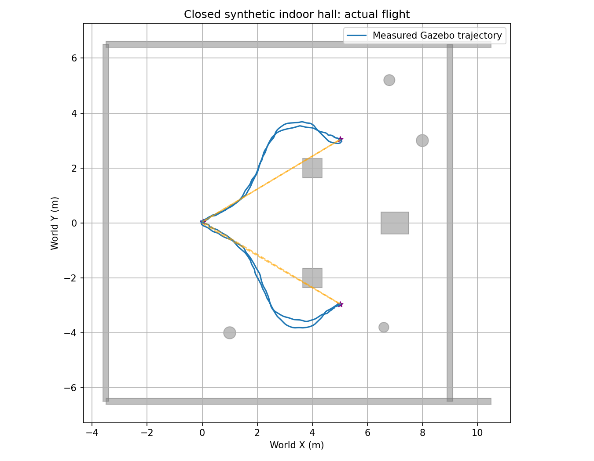

# 室内遍历、重复与阻挡绕行（2026-10-11）

后续扩大路线复测：见 [LARGE_INDOOR_117.md](LARGE_INDOOR_117.md)。新增
两轮 33 m 自主绕障严格通过、一次实际 8 m 横穿通过；更长七段路线
两轮仍分别高度差/odom 超时停测，不认证长路线稳定。

本次完成 **8 次隔离 PX4 1.17 SITL 飞行**。封闭合成室内测试场已完成一次
严格验收的约 29 m 自主绕行；修复后第二次重复因 odom 超时停测，**重复
稳定性仍未通过**。真实扫描办公室的短路线完成 2/3，也不能认证稳定。
历史失败与交接缺陷均保留，不以曾经到点代替完整验收。

## 结果和证据

原始 ULog、事件、测量时间位姿 CSV、配置和资源记录在
`astra/runtime/<运行名称>/`。汇总：[indoor_traversal_117.json](indoor_traversal_117.json)。

| 运行名称 | 结果 | 实际水平航程 m | 全程已知障碍最小距离 m |
| --- | --- | ---: | ---: |
| replica_repeat_117_01 | 旧交接逻辑，四段运动验收通过 | 0.777 | 0.896 |
| replica_repeat_117_02 | 同上 | 0.911 | 0.867 |
| replica_repeat_117_03 | 首段后高度差 >0.20 m，停测降落 | 0.374 | 0.762 |
| indoor_hall_traverse_117_01 | 默认平面筛选，首段途中高度差停测 | 2.692 | 1.547 |
| indoor_hall_quality_117_01 | 完成四段，但交接接口审计失败 | 30.373 | 0.798 |
| indoor_hall_quality_117_02 | 同上 | 29.976 | 0.706 |
| indoor_hall_handoff_fix_117_01 | 修复后完整四段严格验收通过 | 29.033 | 0.671 |
| indoor_hall_handoff_fix_117_02 | 前两段完成，第三段 odom 超时停测 | 17.676 | 0.766 |

全部 8 次正常降落并解除解锁，原 1.15 参数/源码基线哈希保持不变。
三次保护停测没有通过降低安全门槛继续飞。两个场景结果不能互换。

## 实际发现和修复

扩大合成场景 `astra_px4_indoor_hall.sdf` 保留原箱子、柱子、墙面纹理、
正常传感器噪声，并补齐西墙和实体天花板。它不是另一个真实扫描房间。
静态 box/cylinder 距离检查新增 XYZ 支持，以正确处理天花板、障碍物顶面
与机身杠杆臂；检查和距离记录覆盖起降及保护恢复。地面支撑允许接触，
不计入非地面障碍 0.55 m 门槛。

旧交接顺序存在确定的程序错误：发布下一目标会替换 `target`，随后等待
新轨迹时又把这个新 `target` 当成保持位置发送给 PX4。quality_01/02 的
交接记录证明，在约 59/98 ms 的等待中，目标相对已完成终点跳了
5.831 m；实测最大速度出现在对应交接后约 0.35/0.33 s，达到
0.297/0.479 m/s。短暂绕过规划器是接口错误，不能忽略。

现已改成 **先冻结已完成终点，再发布下一目标**。两轮修复后日志中，
所有已发生的交接等待目标相对已完成终点偏差均为 0。第一轮实际峰值
速度为 0.220 m/s，第二轮停测前为 0.182 m/s；旧速度突刺没有复现。
不同噪声/初始条件下的峰值变化不等于全部动态误差已修复。规划限速
0.20 m/s 通过也不等于实际飞行严格满足同一限速。

新增交接审计会拒绝把“提前发送下一目的地”的运行认证为完整闭环。
因此 quality_01/02 的物理到点、距离与定位记录保留，但
`complete_route_verified` 和 `blocked_path_avoidance_verified` 已撤销。
扫描短路线的旧通过记录只代表原运动/距离验收，未验证修复后的交接。

## 修复后完成的一次大范围自主绕行

目标偏移为 `[[5,3],[0,0],[5,-3],[0,0]]`，每段只给目的地，不给绕行
航点。四段起点到目标的直线均穿过箱子，规划器从实时 LiDAR 局部地图
自行选取绕行轨迹，PX4 实际执行后全部到点。

`indoor_hall_handoff_fix_117_01` 的结果：

- 真值水平航程 29.033 m，XY 覆盖约 5.097 × 7.501 m。
- 全程已知障碍距离至少 0.671 m，超过 0.55 m 门槛。
- 四段端点真值 XY 误差最大 0.0560 m。
- LIVO 地面冻结 XY/Z 误差 p95 为 0.00254 / 0.05253 m。
- PX4 地面冻结 XY/Z 误差 p95 为 0.06037 / 0.09109 m；
  Z 最大仍为 0.12050 m，不宣称 0.10 m 精确坐标认证。
- 按测量时间配对 p95 为 8 ms；LIVO 最大 8 ms、PX4 最大 12 ms。
- 规划峰值速度 0.19815 m/s，加速度 0.05736 m/s²。
- 规划连续距离保守下界至少 0.6111 m。使用 5 ms 网格及导数控制点
  速度上界扣除采样覆盖余量；实际飞行距离仍是测量样本审计。
- 监督器与桥合计最大发送间隔 63.47 ms；不能把桥单独间隔当作掉流。
- 执行期 XY/Z/航向 reset 为 0，无 armed failsafe，EV 融合标志为 0。
- LIVO RSS 最终约 413.37 MiB，最后一分钟仅增长 0.0625 MiB。
  这不是无限运行或持续扩展新地图的内存稳定证明。



## 重复失败与延迟分解

修复后第二轮在仿真 254.568 s 停测。前两段已完成，第三段实际仍在
绕行，机身离障碍至少 0.766 m。停测事件：odom 测量年龄 268 ms，
接收年龄约 281.7 ms；未通过延长原 250 ms 门槛继续飞。

[延迟分解 JSON](indoor_hall_handoff_fix_02_delivery.json) 保留以下证据：

- 独立 monitor 和 frame auditor 回调中，没有超过 250 ms 的 odom 接收
  间隔；monitor 最大间隔 184.9 ms。这不能证明监督器自己收到及时。
- 254.3 s 的 LIO 墙钟耗时 89.6 ms、线程 CPU 29.4 ms、调度等待
  45.3 ms；254.4 s 的 LIO 耗时 87.0 ms、CPU 30.1 ms、等待 51.7 ms。
- 相邻 VIO 墙钟耗时 41.6 ms、线程 CPU 12.0 ms、调度等待 17.4 ms。
- 存在计算和线程调度挤压，监督器还可能存在回调排队/处理延迟。
  不能把墙钟耗时全部说成算法计算，也不能把此证据归为电脑性能不足。
- 停测前 LIVO XY/Z p95 仍为 0.00266 / 0.02627 m，已发生交接保持
  检查全部通过；本次直接停测原因是新鲜度门控，不是已确认的定位发散。

根因仍需分离：主机调度、发布/传输、监督器与 preview/bridge 共用执行器
的回调耗时和队列。下一步优先记录这些回调并验证有界处理，保持实际测量
时间与 250 ms 门槛，不靠加大超时绕过问题。

## 配置、复现和验证

所有 quality/handoff_fix 运行仅在复制 YAML 中启用
`lio.max_plane_eigen_ratio=0.1`、`lio.min_plane_extent_ratio=0.01`。
默认仍关闭，保留体素 0.5 m、`min_eigen_value=0.005`、图像上限 512、
视觉平面修正上限 0.04 m。几轮质量候选的 Z 误差较基线更低，但各轮噪声、
EKF 初始状态不同，尚无固定输入成对回放，不能确认全部改善的因果来源。

新运行启动前自动保存 Python 执行源码、估计器和规划器二进制哈希，
退出后核对执行期间不变。旧 scan repeat_01/02 尚无该自动快照。
全部测试只用 SITL，没有真实硬件、External Vision，也没有自动 Git 提交/推送。

```bash
cd /home/cyf/dev/XT-Drone2-astra
# 干净终端；每轮使用新名称，运行期间不编译/分析/绘图
bash astra/run_117.bash obstacle hall_next --world-preset indoor-hall \
 --calibrate-ground-height --route-json astra/config/route_indoor_hall_traverse.json \
 --plane-quality-diagnostic
# 全部仿真退出后
python3 astra/tools/audit_indoor_hall.py astra/runtime/hall_next
python3 astra/tools/audit_odom_delivery_117.py astra/runtime/hall_next \
 --output astra/validation/hall_next_delivery.json
```

实际执行使用 `env -u AMENT_PREFIX_PATH -u COLCON_PREFIX_PATH -u CMAKE_PREFIX_PATH
-u PYTHONPATH -u LD_LIBRARY_PATH bash --noprofile --norc -c '上述启动命令'`。
场景/Python 修改不需要重新编译 C++；57 项相关回归通过，语法和 diff 检查通过，见
`indoor_regression_tests.log`。全部仿真进程已退出，原参数基线恢复核对通过。

另有 `route_indoor_hall_blocked.json` 的 `[5,2.5]` 往返候选，本次未飞，
不计为结果。本次阻挡证据来自已实际飞行的四段路线。
真实扫描 office0 深处家具挡住降落空间，不能通过删家具或放宽距离来扩展。
后续扩大真实地图需另选完整恢复空间更大的扫描场景。
