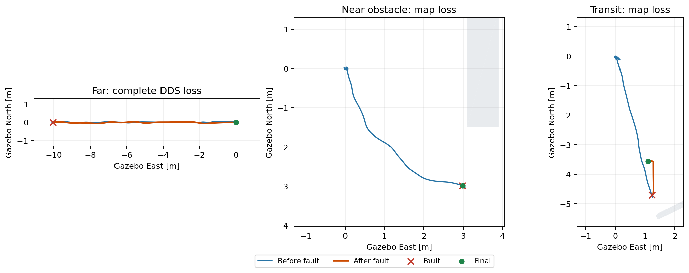

# 多位置故障恢复验收

日期：2026-10-20。PX4 1.17 / ROS 2 Jazzy / Gazebo Baylands，正常 FAST-LIVO2 图像融合、EV XY/Z、EGO 与 Offboard，规划速度上限 0.20 m/s。补充起点附近的[重置与 DDS 断链验收](ESTIMATOR_LINK_FAULTS_117.md)，不代表任意位置或实物认证。

## 实测结果

**三个位置的有效故障测试均停止正常任务，并由独立机载 ULog 确认落地上锁。** 地图故障保留通信，完整 DDS 故障切断 PX4 的 DDS 输入和输出；它们使用不同的恢复手段，不能互相替代。

| 场景与有效运行 | 故障处实际 XY，m | 执行端检测 | 恢复结果 | 注入至机载落地／上锁 |
| --- | --- | --- | --- | --- |
| 远端完整 DDS 断链，`acceptance_far_dds_20261020_03` | `(-10.042, -0.016)` | 208.66 ms | PX4 自主 RTL，回到起点附近降落；最终 `(0.005,-0.006)` | 约 38.4／40.4 s |
| 障碍旁地图停止，`acceptance_obstacle_map_20261020_02` | `(2.977,-2.987)` | 225.76 ms | 冻结后原地降落；故障后最大水平位移 0.0256 m | 约 5.1／7.1 s |
| 不可下降通行区地图停止，`acceptance_transit_map_20261020_02` | `(1.232,-4.701)` | 236.51 ms | 沿预检查恢复图撤出，水平路径约 1.390 m；最终 `(1.098,-3.558)` 可降落 | 约 15.4／17.4 s |

XY 为 Gazebo 实测 `base_link`，不是指令距离；注入时机体高度分别约 1.710／1.776／1.686 m。故障在实际到达航点并稳定后 1 s 注入；最后航点保持窗口为 30 s，以便观察保护。检测使用单调墙钟；机载落地相对时间采用相邻记录的测量时间锚点，属于近似值，不作为精确 DDS 传输延迟。

地图两轮冻结时刻分别为 226.00／236.86 ms。三轮任务完成标志均为 false，检测后没有正常 bridge 轨迹采样。远端约 10.08 m 的故障后路径是机载返航，不应解释成失控漂移。

三轮故障后记录点重算的最低已知表面至机体中心距离分别为 **3.095／1.408／1.677 m**；记录中没有恢复几何故障，最终位置均满足原下降区域条件。51／24／25 条完整曲线及实际执行曲线全部位于原共享飞行边界内。距离是采样的机体中心净空，不是连续旋翼体积或未知几何认证。



完整数值、原始判定、参数、状态和来源差异见[结构化证据](multilocation_faults_117.json)。原始记录保存在本机 `astra/runtime/<运行名>/`。

## 为什么远端失联会返航

远端这轮机载 `global_position_invalid=false`、`home_position_invalid=false`，本地位置与高度有效，手动控制已失联，GCS 仍在线。原有隔离配置中 `COM_OBL_RC_ACT=0`、`NAV_RCL_ACT=2`，因此 PX4 通过失联回退链选择 RTL；ULog 记录约 1.068 s 后 Offboard 丢失，约 1.080 s 后进入 AUTO_RTL。起点附近旧试验的全局位置无效，当时回退为 Land。**同一套参数在不同可用状态下可能选择不同恢复模式。**

这轮断链处下方允许下降，且起点至目标的直线矩形通道（额外预留 0.40 m）也在已检查下降区域内；因此本轮 RTL 路径有几何依据。它不能证明其他树木后方或不可下降位置的完整断链也安全。PX4 自带 RTL 不消费 EGO 障碍物地图。

DDS 停止后，机载没有继续收到 Offboard 心跳或地面 Land 命令，ROS 结果保持 `disarmed=false`；上锁由闭合 ULog 独立确认。Gazebo 传感器、PX4 内部控制和 MAVLink GCS 心跳继续工作，不等于所有物理、遥控或地面站链路同时失效。

## 修改与保留的问题

改动限于隔离运行器、注入与离线验收工具，未调整定位、规划、控制器或保护门槛。原 Odom 250 ms、测量配对 20 ms、高度差 0.20 m 保持，原 PX4 参数文件和二进制校验保留，每轮飞行期间源码不变。

- 新增 `--fault-at-waypoint N`：将既有故障延迟锚定到实际到达第 N 个航点（从 0 开始），不再只能在起点交接后注入。
- 悬停时 bridge 轨迹日志不再追加，注入器改为从仍持续写入的 setpoint 日志选择新鲜时间锚点；仍拒绝超过 250 ms、未完成或缺失的记录。
- 完整断链后 ROS 的 30 s 降落确认不能覆盖远端 RTL。运行器在监督器结束后增加至多 120 s 只读机载状态观察，保持仿真、传感器、GCS 和日志运行；不恢复 DDS，不发新控制命令，最终仍以 ULog 判定。超时仍为验收失败，不无限等待。
- 补齐悬停阶段地图心跳故障的等价报错识别；原检测、停止、上锁与任务失败检查保留。
- 离线共享边界审计在 ROS 无法确认上锁、没有导出内存数组时，从闭合 JSONL 恢复实际执行曲线 ID，并核对条数；不修改原始 ROS 上锁状态。

前两轮有效试验的执行源码哈希相同；通行区最终轮只增加测试判定器的等价报错分支。随后修改的离线审计不在空中执行，不把这些结果称作完全相同源码的三次重复任务。

保留所有未通过轮次，不计入三个有效结果：

| 运行 | 证据与处理 |
| --- | --- |
| `acceptance_far_dds_20261020_01` | 到达约 10 m 后正常飞完并降落；悬停日志时间锚点过期，未实际注入。修正注入器日志来源。 |
| `acceptance_far_dds_20261020_02` | 实际断链并进入 RTL，但测试运行器在 30 s 确认超时后过早关闭仿真；ULog 没有落地上锁，恢复验收失败。增加独立机载观察后重新飞行。 |
| `acceptance_obstacle_map_20261020_01` | `(2,-2)` 目标不满足额外规划边界余量，起飞后被拒绝并安全降落，未注入。按真正的端点准入掩码重新选点，没有缩小余量。 |
| `acceptance_transit_map_20261020_01` | 真实完成撤退、降落和上锁，但自动判定遗漏悬停阶段报错字符串，原结果为失败。保留原结果，补齐回归并用最终轮重新飞行通过。 |

最终 **392 项 Python 回归通过**，保留 3 条既有 protobuf／时间 API 弃用提示；语法、文档链接及差异检查通过。本批没有 C++ 或 PX4 构建变更。

## 本机复现

使用新运行名，不能覆盖已有证据。以下场景均由 `baylands_connected_full` 独立复制，保持几何、世界和 guard 不变，只同时修改 `route.json` 和 `flight_precheck.json` 的 `route_offsets_m`。目标分别为 `[[-10,0]]`、`[[3,-3]]`、`[[1.25,-4.75]]`；地图目录为本机已准备数据，不随 Git 提交原始网格。

```bash
# 远端全部 PX4 DDS 断链：先检查下方和直线 RTL 通道。
bash astra/run_117.bash obstacle far_dds_NEW \
  --world-preset baylands --scan-dir astra/runtime/maps/baylands_fault_far_20261020 \
  --route-json astra/runtime/maps/baylands_fault_far_20261020/route.json \
  --calibrate-ground-height --external-vision --executor-audit \
  --isolate-estimator-cpus --execution-executor events --endpoint-hold-seconds 30 \
  --stop-dds-agent-after-handoff-s 1 --fault-at-waypoint 0

# 障碍旁地图故障；通行区测试将下方两个目录替换成 baylands_fault_transit_20261020。
bash astra/run_117.bash obstacle obstacle_map_NEW \
  --world-preset baylands --scan-dir astra/runtime/maps/baylands_fault_obstacle_20261020_02 \
  --route-json astra/runtime/maps/baylands_fault_obstacle_20261020_02/route.json \
  --calibrate-ground-height --external-vision --executor-audit \
  --isolate-estimator-cpus --execution-executor events --endpoint-hold-seconds 30 \
  --stop-map-after-handoff-s 1 --fault-at-waypoint 0
```

每轮保留 `fault_injection.json`、`motion_events.json`、`bridge_samples.jsonl`、`motion_sent.csv`、`frame_samples.csv`、ULog、参数基线和源码快照；完整断链另保存只读观察日志。仿真退出后运行 `audit_shared_envelope.py <运行目录>`，故障类型对应 `extended_fault_audit.json` 或 `fault_regression.json`。退出码 0 表示故障恢复验收通过，不代表原任务完成。

## 后续边界

本项补齐远端可下降处完整 DDS 断链、障碍旁地图失效、不可下降处地图失效三种情况。未验证任意通行区完整断链、全局位置同时失效、大幅或反复估计器重置、所有链路同时失联和动态障碍；静态恢复图仍是已知 SITL 场景专用能力。

下一项为已知路线的单次连续约 30 分钟运动，观察 LIVO 内存及延迟尾部；既有三轮分别重启的测试不能替代它。历史高度漂移根因仍未证明修复。本批无实物测试，未进行 Git 提交或推送。
