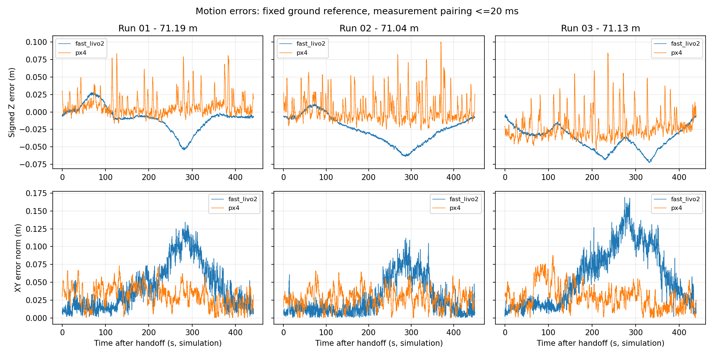
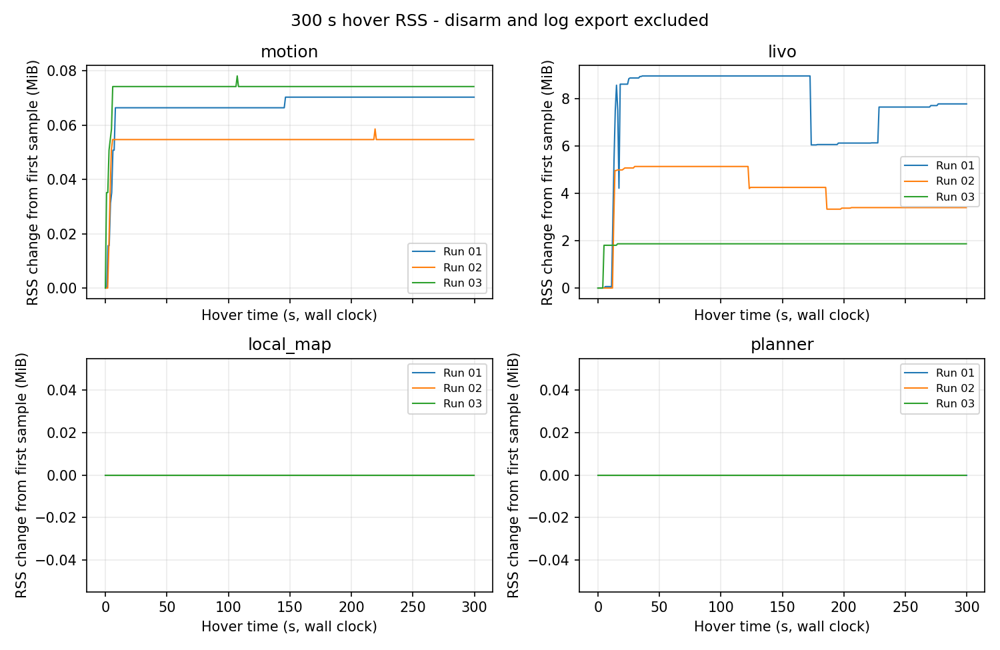

# 正常融合长路线重复验收

日期：2026-10-20。隔离 PX4 1.17 / ROS 2 Jazzy / Gazebo Baylands。使用正常 FAST-LIVO2 图像融合、EGO-Planner、Offboard 执行和 PX4 External Vision XY/Z 融合。

## 范围与配置

**三次独立运行均完成双远端航点、规划返航、300 s 末端保持和自动降落上锁，路线与时效门槛重复通过。** 本次使用同一套编译配置。每轮重新启动独立 SITL，因此不等于连续运行三倍时长，也不覆盖任意地图或实物。

- 图像时间偏移 `0`，VIO 平面修正门槛 `0.04 m`，保留正常图像处理；不采用此前 `−12 ms` 或 `1e-6 m` 隔离试验配置。
- EGO 速度约 `0.20 m/s`，两个目标偏移约 `[6.440,0.817]`、`[-9.091,19.639]`，随后规划返回起点。
- 原 Odom 测量/接收年龄 `250 ms`、测量配对 `20 ms`、冻结高度漂移 `0.20 m` 和机体中心已知表面净空 `0.55 m` 保持。
- CPU 隔离、事件执行器和详细审计开启；不在飞行中修改源码、重新拟合原点或恢复参数。
- 同配置以执行源码/二进制哈希、估计器 YAML 和 PX4 参数覆盖项一致为准，不把不同配置的历史成功合并计数。传感器噪声、初始化和实际路线仍会变化。

## 逐轮结果

| 运行末尾编号 | 实测水平路长 | 曲线数 | 初始化后无 Odom 输出 | 监督器测量年龄最大 | 运动期 LIVO 真值 XY/Z p95 | 任务结果 |
| --- | --- | --- | --- | --- | --- | --- |
| `01` | 71.195 m | 425 | 0 / 8509 次 LIO | 204 ms | 0.1089 / 0.0451 m | 路线、绕障、300 s 保持、降落上锁通过 |
| `02` | 71.040 m | 424 | 0 / 8619 次 LIO | 204 ms | 0.0776 / 0.0586 m | 路线、绕障、300 s 保持、降落上锁通过 |
| `03` | 71.129 m | 421 | 0 / 8503 次 LIO | 212 ms | 0.1286 / 0.0659 m | 路线、绕障、300 s 保持、降落上锁通过 |

运行名完整前缀为 `normal_long_acceptance_20261020_`。路长按 ≤20 ms 测量配对后的 Gazebo 真值计算；LIVO/PX4 误差采用起飞前冻结的真值参考，不在运动中拟合。表中 LIO 次数覆盖核心日志初始化后的完整记录；监督器时效来自实际控制采样，不能用“核心每轮都有输出”替代时效检查。

第一轮端点 XY 误差为 2.46 / 3.93 / 4.41 cm；第二轮为 1.32 / 3.19 / 5.93 cm；第三轮为 5.47 / 6.68 / 5.36 cm。126 项执行源码/二进制哈希、估计器 YAML、PX4 参数覆盖和 CPU 分配三轮一致；每轮确认原 PX4 基线保留、飞行期间执行源码未变。

运动期 LIVO XY p95 第一、三轮超过 0.10 m，第三轮最大 0.1692 m；三轮 PX4 真值 XY p95 为 0.0540 / 0.0497 / 0.0626 m。任务通过不等于全程 10 cm 精度或近障碍精度认证。三轮曲线分别为 425 / 424 / 421 条，连续净空、动态约束与共享边界均通过；最小已知表面机体中心净空分别为 1.213 / 1.424 / 1.422 m，不能直接当作旋翼净空。

EV 的 XY/Z aid-source 在 armed 窗口均实际融合，无 armed failsafe。测量配对覆盖为 99.927% / 100% / 99.976%，p95 均 8 ms、最大 12 / 20 / 16 ms。冻结 EV 变换下 LIVO-PX4 XY 差 p95 为 0.0970 / 0.0578 / 0.1212 m，Z 为 0.0435 / 0.0540 / 0.0567 m。两套估计器仍有差值；本轮不融合视觉 yaw 或速度。



## 延迟与内存

起飞预发送至上锁期间，核心实际 Odom 发布与监督器回调按测量时间关联；三轮全部关联成功。除发布次数外，下表单位均为 ms，成对数值为 p95/max。

| 运行 | 已关联/核心发布数 | LIO 整轮墙钟 | LIO 主线程 CPU | 发布调用开始至监督器回调 | 监督器接收年龄最大 |
| --- | --- | --- | --- | --- | --- |
| `01` | 7881/7881 | 26.40/84.24 | 19.21/22.53 | 9.27/26.33 | 166.57 |
| `02` | 7963/7963 | 26.34/82.92 | 19.49/24.89 | 9.62/54.78 | 151.90 |
| `03` | 7853/7853 | 26.12/64.22 | 19.25/22.35 | 9.53/39.54 | 173.90 |

LIO 墙钟包含调度等待，主线程 CPU 不代表所有工作线程总算量；发布到回调包含 DDS 传输和接收调度，不能全部称作算法计算。同步就绪减测量时间的仿真时差三轮均 p95/max 32/60 ms，不能与不同帧的墙钟最大值直接相加。核心单独记录实际 `publish()` 调用前后单调时钟，没有以发布后的地图处理结束时间替代发布时间。

实际控制采样的测量年龄三轮 p95 均 140 ms，最大 204/204/212 ms；合并原生与桥接发送记录最大间隔为 73.76/81.26/76.77 ms。这是本机发送记录间隔，不等于 PX4 接收延迟或压力上界。核心初始化后总计 25631 次 LIO 全部发布，没有空切片；控制时效仍由单独的年龄检查判定。

300 s 保持的内存首尾差如下，单位 MiB；不包含落地后的日志重建/导出。

| 运行 | 执行进程增长 | 执行进程末 120 s 增长 | LIVO 增长 | LIVO 末 120 s 增长 |
| --- | --- | --- | --- | --- |
| `01` | 0.070 | 0.000 | 7.770 | 1.715 |
| `02` | 0.055 | 0.000 | 3.395 | -0.852 |
| `03` | 0.074 | 0.000 | 1.867 | 0.000 |

地图和规划器三轮保持窗口 RSS 均无增长，执行进程末 120 s 也均不再增长；LIVO 第一轮尾段仍有增长，不能宣称全栈无限运行或扩大地图内存已稳定。三轮飞行窗口均未记录二代 GC，但此前 45.54 ms 飞行中 GC 的历史记录仍保留，不外推为永久不会发生。

保持时 Gazebo 真值 Z 峰峰值为 0.167 / 0.191 / 0.217 m；这是目标位置保持，不是连续四秒严格稳定 hold 或精密定高验收。



## 复现与证据

使用新运行名，避免覆盖已有目录：

```bash
bash astra/run_117.bash obstacle normal_long_NEW \
  --world-preset baylands \
  --scan-dir astra/runtime/maps/baylands_gc_receiver_20261018 \
  --route-json astra/runtime/maps/baylands_gc_receiver_20261018/route.json \
  --calibrate-ground-height --external-vision --executor-audit \
  --isolate-estimator-cpus --execution-executor events \
  --end-action return_home --endpoint-hold-seconds 300
```

结束仿真后再做离线分析；场景完整审计和 EV 审计可独立执行，漂移分解依赖两者输出：

```bash
source astra/env_117.bash
python3 astra/tools/audit_scan_flight.py astra/runtime/<运行名>
python3 astra/tools/audit_external_vision.py astra/runtime/<运行名>
python3 astra/tools/audit_shared_envelope.py astra/runtime/<运行名>
python3 astra/tools/audit_livo_cut_timing.py astra/runtime/<运行名> \
  --output astra/runtime/<运行名>/cut_timing_audit.json
python3 astra/tools/audit_long_route_drift.py astra/runtime/<运行名> --no-plot
python3 astra/tools/audit_runtime_growth_117.py astra/runtime/<运行名> \
  --output astra/runtime/<运行名>/runtime_growth_audit.json
```

各轮运行目录还保存 `acceptance_tail.py` 和 `publication_chain.py`，复核全部保持窗口、日志导出一致性和实际发布到回调的时间链。第一轮目录的 `summarize_repeats.py` 汇总三轮记录。完整 CSV、ULog、源码快照、参数校验和这些分析脚本在本机 `astra/runtime/`；可审查汇总见 [JSON 证据](normal_long_acceptance_117.json)。

## 适用边界

三轮固定配置的正常路线与时效重复验收通过，只代表这个场景、约 0.20 m/s、固定路线和本次延迟窗口内的结果。三轮分别启动 SITL，不是连续三轮运行的内存或累计漂移证明。

历史完整融合及严格 VIO 门槛下的高度漂移失败仍保留，见[切片时间审计](LIVO_CUT_TIMING_117.md)和[高度分解](COMPACT_AUDIT_HEIGHT_117.md)。没有以这次不复现证明历史漂移的根因已修复，也没有用离线高度拟合绕过保护。

本报告正常飞行未注入故障。后续[重置与完整 DDS 断链验收](ESTIMATOR_LINK_FAULTS_117.md)已补齐起点附近相关子项；扩大地图长期内存、通行区域多位置恢复和更广的故障条件仍需单独完成。实物的传感器时间/外参、机体体积、RK3588 性能和遥控接管另行验收。
