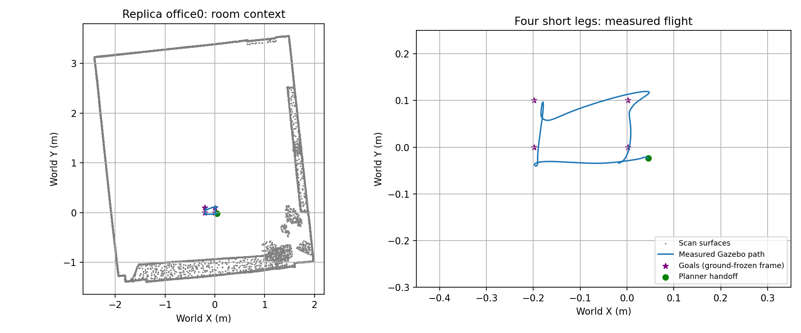

# Replica office0：室内运动与恢复审计（2026-10-11）

真实扫描场景已接到传感器、FAST-LIVO2、局部地图、EGO-Planner 和隔离
PX4 1.17 SITL。**四段室内短路线已完成一次测量审计通过**，不是整间办公室
遍历或障碍物阻挡路径的绕行认证。历史失败和最终通过证据均保留。
11 轮均确认降落/解除解锁，无 armed failsafe；原 1.15 参数与源码基线
各轮哈希均保留。External Vision 始终未融合。

随后新增三次独立短路线重复：`replica_repeat_117_01/02` 完成全部四段，
`_03` 首段完成后因地面冻结 PX4/LIVO 高度差 >0.20 m 停测并降落。
本阶段重复为 **2/3**，不能把一次短路线通过称为稳定。总计 14 次扫描
飞行记录保留，原参数基线全部未改变。独立合成封闭测试场的大范围遍历
与阻挡绕行结果见 [INDOOR_TRAVERSAL_117.md](INDOOR_TRAVERSAL_117.md)，
不能用该场景通过替代扫描办公室认证。
上述扫描运动记录使用修复前的交接逻辑；新增审计发现等待新轨迹时
会短暂发送下一目的地，现已修复。扫描短路线尚未用修复后接口重测。

## 最新通过：四段短路线

`replica_office0_terminal_slow_117_02` 完成起飞 → 后退 0.20 m → 侧移
0.10 m → 前进返回 → 侧移返回 → 降落，4/4 航点有实际运动记录。
每段到点后要求 PX4 位置误差 ≤0.045 m、三维速度 ≤0.08 m/s 持续
0.5 s，8 s 内不满足则停测；这不是先前的连续 4 s 悬停认证。

| 段 | 计划主轴位移 m | Gazebo 实际主轴位移 m | 到点真值 XY 误差 m |
| --- | ---: | ---: | ---: |
| 后退 | −0.200 | −0.241 | 0.0402 |
| 侧移 | +0.100 | +0.115 | 0.0293 |
| 前进返回 | +0.200 | +0.206 | 0.0215 |
| 侧移返回 | −0.100 | −0.132 | 0.0393 |

路线 XY 原点由起飞前 FAST-LIVO2 固定；高度由爬升后估计值提供。
实际位移是各段发送目标到确认到位期间的位移，包含最初回到固定原点
及控制误差，不能当作四段均精确走了计划距离。端点误差使用地面冻结的
LIVO→真值平移，事件与真值配对误差为 4～8 ms，没有起飞后重新拟合
原点来掩盖误差。四段方向、至少一半要求位移及 ≤0.10 m 端点误差均通过。

- 测量真值水平总航程 0.846 m，实际三维峰值速度 0.123 m/s。
- 规划峰值速度 0.0989 m/s、加速度 0.0980 m/s²；目标速度不等于实飞速度。
- 包含起飞、末端保持、降落的已知网格最小距离 0.8727 m，无范围越界。
- 执行期地面冻结 LIVO XY / Z p95 为 0.0321 / 0.0842 m；Z 最大仍
  0.1158 m。PX4 XY / Z p95 为 0.0715 / 0.0846 m。
- 执行期高度差最大 0.1591 m、XY/Z/航向 reset 均为 0。
- 最低 LIO correspondence 1895；odom 测量年龄 p95 124 ms、最大 140 ms。
- 桥和末端监督器合计 setpoint 最大发送间隔 67.6 ms。桥单独记录有
  1.10 s 间隔，期间由监督器发送末端保持，不能解释为 Offboard 中断。
- 执行源码与二进制哈希保存在该运行目录 `execution_sources/manifest.json`。

当前地面冻结的最大 Z 误差仍超过 0.10 m，不宣称精确坐标认证通过，
也不宣称大范围室内或长期重复运行稳定。可配置平面质量比例门控默认
关闭，本次没有飞行验证它。11 轮中只有最后一轮通过完整短路线。




## 已记录的试验（历史停测与最新通过）

运行目录均为 `astra/runtime/<名称>`。停止时刻为仿真时间；停止高度
是 Gazebo 外层模型位置，不是机身中心高度。误差使用起飞前固定偏置，
按测量时间与机身真值配对；不在起飞后重新拟合偏置掩盖爬升误差。

| 名称 | 配置 | 停止时间 s | 停止模型 Z m | 爬升 LIVO Z 最大误差 m | 全程已知网格最小距离 m |
| --- | --- | ---: | ---: | ---: | ---: |
| replica_office0_motion_117_01 | 完整融合，0.5 m 体素 | 95.132 | 1.648 | 0.153 | 0.575 |
| replica_office0_lio_diagnostic_117_01 | 关闭视觉，0.5 m | 77.940 | 0.859 | 0.204 | 0.918 |
| replica_office0_input_audit_117_01 | 完整融合，原始输入记录 | 96.248 | 1.674 | 0.133 | **0.459** |
| replica_office0_state_audit_117_01 | 关闭视觉，初始化修复与内部状态记录 | 77.648 | 0.946 | 0.223 | 0.748 |
| replica_office0_voxel025_117_01 | 关闭视觉，仅改为 0.25 m 体素 | 82.028 | 1.464 | 0.287 | 0.837 |
| replica_office0_matching_fix_117_01 | 体素坐标修复，原 +X 范围 | 73.400 | 0.005 | 0.006 | 0.920 |
| replica_office0_matching_fix_117_02 | 体素坐标与特征值修复，+X 扩展 | 94.448 | 1.612 | 0.097 | 0.802 |
| replica_office0_terminal_stop_117_01 | 零终速约束，起飞侧向预测停测 | 72.208 | 0.006 | 0.004 | 0.818 |
| replica_office0_terminal_stop_117_02 | −Y 扩展，后退预测停测 | 93.292 | 1.681 | 0.114 | 0.765 |
| replica_office0_terminal_slow_117_01 | 0.10 m/s，侧移起点预测停测 | 111.932 | 1.724 | 0.095 | 0.734 |
| replica_office0_terminal_slow_117_02 | 固定地面原点，0.20/0.10 m 四段 | 完成 | — | 0.078 | 0.873 |

最早两轮完整融合的实际 X 运动范围分别约 0.405、0.529 m，其余在爬升停测。
最早五轮没有到达首个完整目标，也没有执行侧移段。不同轮次受噪声和 PX4 起始
高度偏置影响，停止高度/时刻不能直接解释为参数改善程度。

第三轮恢复期间超出旧 ±0.6 m XY 范围，降落时距离低于 0.55 m。
停止前的约 0.96 m 距离不能代表全程安全；这一轮安全距离验收失败。

## 输入和估计分解

第三轮稀疏原始点云 69 帧、17664 个采样点：转换到 Gazebo 世界后，
与完整碰撞表面的距离 p95 0.00456 m，最大 0.01276 m，测量配对 p95 8 ms。
爬升 IMU 垂直加速度与平滑真值二阶导数的残差 p95 0.00658 m/s²。
这是输入一致性检查，不是全部外参或估计器正确性的证明。

修复后关闭视觉的状态记录中，LIO 积分覆盖时间差最大约 8.5e-15 s。
以零初始速度独立积分原始 IMU，爬升约 0.94 m，对应真值约 0.96 m；
LIO 累计位置修正约 −0.039 m、累计垂直速度修正约 −0.137 m/s。
最后估计垂直速度约 0.080 m/s，实际仍在上升。小位置修正会通过
速度状态影响后续传播，不能只把位置修正逐帧相加解释所有误差。

这些记录将重点缩小到 LIO 匹配与状态修正；仍不能确定错误关联、平面
近似、垂直几何约束或其他滤波实现中的哪一项是根因。0.25 m 体素
对照没有通过高度门槛，不能作为已修复方案。默认配置仍是 0.5 m。

## 代码与保护修改

- IMU 初始化完成时设置传播起始时间，消除首次读取未初始化变量；
  Reset 同时清除传播时间状态。两轮后续记录表明高度问题仍存在。
- 内部审计 CSV 增加传播起止时间、积分时长和修正前后速度、加速度
  偏置、重力；只在启用现有审计 CSV 时输出。
- 网格精确点到三角形距离检查保留 0.55 m 门槛；真值只用于仿真停止
  和审计，不用于生成飞行 setpoint。
- 故障保持与降落期间继续记录/检查网格；保持阶段发现距离或范围
  问题直接结束保持、请求降落。增加 0.6 s 实测运动边界预测，提前
  留出停止余量；它不保证 PX4 能瞬时停止或在传感器失效时避免碰撞。
- 当前路线为后退 0.20 m、侧移 0.10 m、返回，规划限速 0.10 m/s、
  限加速度 0.10 m/s²。机身检查范围为 X=[−0.40,0.30]、
  Y=[−0.25,0.20]、Z=[0.20,2.34] m。完整空间 6600 个采样点
  扣除覆盖半径 0.04323 m 后，连续距离保守下界为 0.61484 m。近地面 Z≤0.12 m 的完整三角形
  被排除，家具和天花板保留。未知/缺失扫描表面不在该保证范围。
- 最新范围已完成上述一次飞行；旧运行目录保留当时的 guard/precheck，
  不能套用新的范围重新计算旧试验通过率。
- 修复匹配时把无量纲体素坐标与米制体素中心比较的错误；负坐标键使用
  floor。特征值改用有序的对称矩阵求解，拒绝没有唯一法向的退化点簇。
  修复是确定的代码正确性问题，不是已证明所有高度误差都来自这些问题。
- 新增稀疏平面匹配 CSV 与可选比例质量门控；`--plane-quality-diagnostic`
  仅改运行目录 YAML，默认仍沿用原绝对阈值，不作为本次通过条件。
- 首条旧 B-spline 末端速度仍为 0.188 m/s。针对零终速目标固定末尾
  三个控制点，优化及时间重分配保留停车约束；非停车局部目标仍可自由优化。
  正常结束发布带轨迹 id 的完成事件，撤销事件不作为到点成功。
- 室内最短可规划距离设为 0.04 m，以支持 0.10 m 段；默认仍为 0.20 m。
  每段发送目标时刻和确认到位时刻的 Gazebo 实际位移单独验收。
- Gazebo 订阅可能在父类构造期间触发回调，真值速度缓存改为提前初始化。

## 复现命令

从干净终端运行，每轮使用新名称；不要在飞行时编译、绘图或做离线审计。

```bash
cd /home/cyf/dev/XT-Drone2-astra
python3 astra/tools/prepare_scan_flight.py
bash astra/run_117.bash obstacle replica_next \
 --world-preset replica-office0 --calibrate-ground-height \
 --route-json astra/config/route_replica_office0.json \
 --capture-scan-inputs
# 诊断可加 --lio-only-diagnostic 或 --plane-quality-diagnostic；仅改隔离 YAML。
# 全部仿真退出后：
python3 astra/tools/audit_scan_flight.py astra/runtime/replica_next
python3 astra/tools/audit_scan_inputs.py astra/runtime/replica_next
```

历史 5 轮使用原先后退 0.4 m、侧移 0.35 m 的 route；各目录中的
`route.json`、`runtime.json`、`runner.py`、`estimator_config.yaml`、
`mesh_guard.npz` 与 `flight_precheck.json` 保存该轮实际输入。

验证：核心包与规划器/桥相关包隔离编译通过；51 个网格、启动器、传感器、
高度对齐、体素坐标、平面特征值、停车边界测试通过，Python 编译及 diff
空白检查通过。仿真已全部退出。机器可读证据见
`replica_office0_motion_117.json`；原始 ULog、CSV、相机图和轨迹保留在
各运行目录。后续应先重复本短路线，再检查更大路线的完整恢复空间，
再考虑真正阻挡路径的绕障；当前不进入贴障或真实硬件测试。
