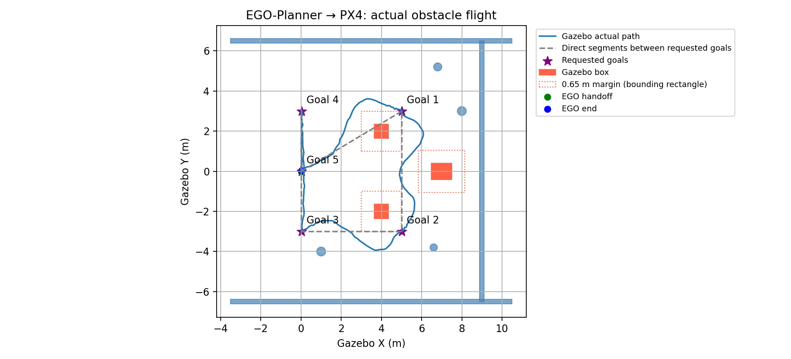
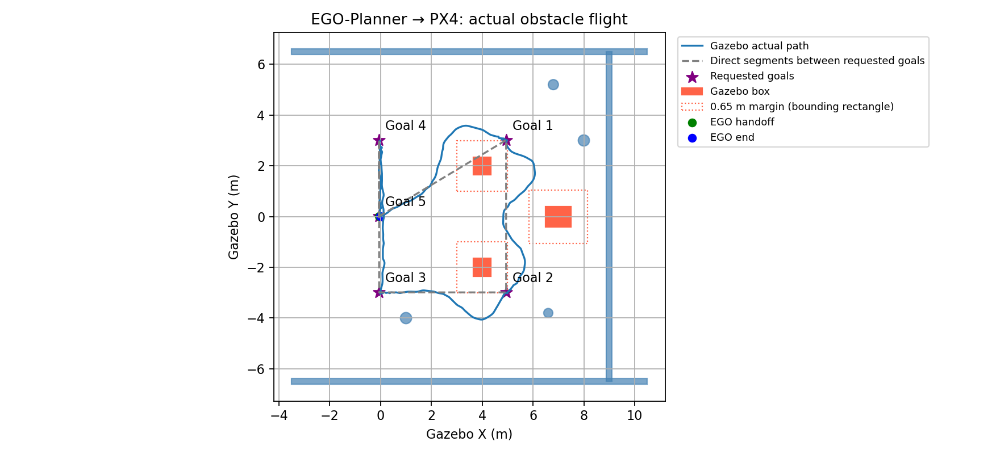
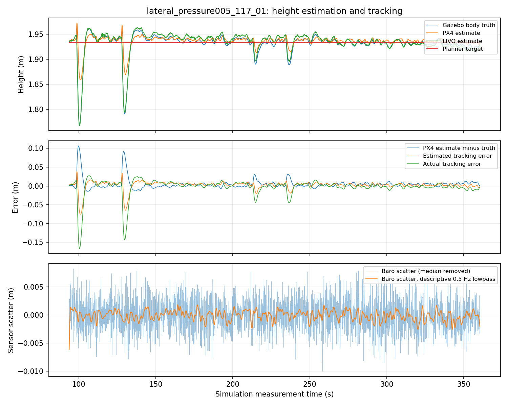
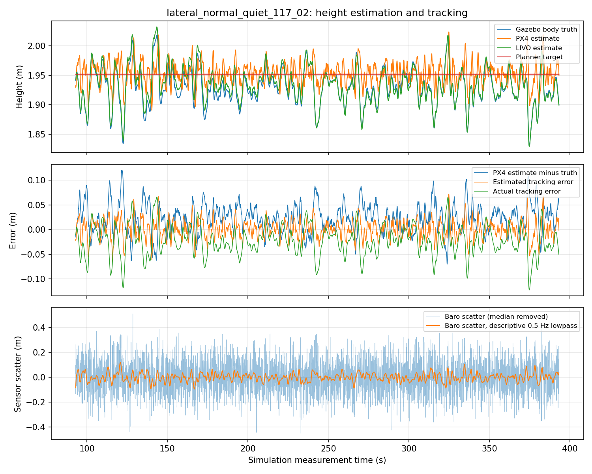

# PX4 1.17 / XT-Drone2 运行验收：2026-10-10

完整感知与规划源码已在新框架构建并运行。最终磁力计接口下已完成一次小范围原生 NED 飞行、一次 EGO-Planner 绕障往返，以及地图进程失联后的保持/降落试验。早期高度门控失败记录保留。以下结果限于低速静态障碍 SITL；不等于多场景、长期运行或实物认证。

## 已完成的移植

- 19 个 ROS 包和 PX4 v1.17.0 编译通过；使用固定 release/1.17 消息及版本话题后缀。
- XT-Drone2 负责增强世界、模型和 PX4 启动；完整 FAST-LIVO2、局部地图、EGO-Planner、审计和保护桥已接入。
- 旧版 Sophus 已独立保存并构建，修复缺少 `libSophus.so` 的运行依赖。
- 官方 1.17 在线定时器回归复现 `calls=1 sentinel=0 FAIL`；移植 HRT 补丁后 `calls=21 sentinel=50 PASS`。该试验复现调度缺陷，不证明所有历史传感器中断均由它导致。
- 每轮使用独立 rootfs、ROS domain 94、Gazebo partition；测试临时参数不写入旧版 BSON。
- localhost MAVLink GCS 心跳满足地面站健康检查；不发送目标、setpoint 或解锁命令。实际飞行命令仍由单一试验驱动负责。

## 静止与小范围运行证据

`static_stack_02` 连续 60 秒：LiDAR 约 10 Hz、RGB 约 30 Hz、IMU 约 100 Hz、LIVO odom 约 10 Hz、PX4 local position 约 50 Hz；odom 测量年龄 p95 24 ms，readiness 100%，仿真实时率约 1.0。见 `static_stack_117.json`。这不证明运动内存平台化。

`small_motion_05` 完成起飞、前进、侧移、返回、降落；无 armed failsafe。该轮仍采用官方 Harmonic 磁力计兼容路径：

| 运动段（5 秒目标渐变） | Gazebo 实际 ENU 位移 | LIVO XY p95 | PX4 XY p95 | PX4 Z p95 |
| --- | --- | --- | --- | --- |
| NED north | [-0.037, +0.336, -0.006] m | 0.0030 m | 0.0494 m | 0.1030 m |
| NED east | [+0.360, -0.031, -0.021] m | 0.0044 m | 0.0360 m | 0.0878 m |
| 返回 | [-0.304, -0.296, -0.037] m | 0.0033 m | 0.0694 m | 0.1120 m |

误差用前进前 2 秒的固定平移偏置、已知 ENU/NED 方向计算，不在后续飞行上重拟合。端点观察后的完整位移另存 `small_motion_before_mag_fix_117.json`；上表不是把控制目标 0.4 m 当成真实位移。测量时间配对 p95 8 ms。航向误差约 5～6°，运动开始后没有 XY/Z/yaw reset；爬升期间发生过一次已处理的 yaw reset。

本轮采用开阔区域到位后观察模式，不是连续 4 秒严格稳定悬停认证。该审计不认证整个坐标变换。全程拟合曾返回 `certified=true`，现已纠正：全程拟合只能返回 `fitted_alignment_checks_passed`，最终认证使用独立的固定初始变换。

全程监测曾在仿真 35.048 秒记录一次 odom 年龄 332 ms，发生在飞行 prestream（53.016 秒）之前，不能隐去该慢帧，也不能把它描述为飞行中的延迟通过记录。飞行驱动仍逐次执行 250 ms 新鲜度检查。

## 修复及失败记录

1. 被动检查原先把 `/clock - timestamp_sample` 的消息年龄当成时钟偏移，错误使用 20 ms 阈值。修正为分别记录测量到发布、发布到最后收到的 clock，并使用 20 ms 测量时间配对覆盖检查；保留 250 ms 新鲜度门限。异步 clock 回调滞后也会制造假的负年龄，不能据此声称 PX4 测量来自未来。配对覆盖率本身不等于独立时钟偏移认证。
2. Gazebo Harmonic 默认磁力计世界场为 NED、输出 gauss；官方 PX4 兼容处理交换轴。Astra 显式指定世界场 ENU/tesla，配套本地仿真桥按 body FLU→FRD、tesla→gauss 转换。官方模型原 gauss 噪声数值也等比例换算为 tesla，没有减小物理噪声。首次转换漏了噪声单位，磁场检查拦住了测试、没有解锁；已修正并保留记录。
3. 早期 `small_mag_enu_02` 和 `obstacle_mag_enu_01` 静止航向误差 p95 约 1°，磁场强度约 0.481 gauss，接近 PX4 参考 0.482 gauss；当时未取得成功飞行。后续最终接口飞行证据见本报告末尾。
4. `obstacle_mag_enu_01` 因地面高度偏置约 0.25 m 超过 0.15 m 门限，起飞前停止；没有 EGO 控制权交接、没有实际绕障。详见 `obstacle_attempt_117.json`。
5. `EKF2_GPS_CTRL=5` 是水平位置与三维速度，原本就没有 GPS 高度融合。试验中一度把位掩码读错，改为 1；该值关闭的是速度辅助，不能证明 GPS 高度影响。已恢复 5，失败实验保存在 `preflight_diagnostics_117.json`。
6. 气压噪声 0.1→0.3 m 的单因素试验没有解决地面 Z 偏置，已恢复默认测试值 0.1。保留 `--baro-noise-m 0.3` 作为显式对比入口，不能宣称该值修复了高度。

地面高度已分解为本轮固定原点偏置和后续漂移，结合 `ref_alt`、气压高度和测量时间。`ground_height_diagnostics_117.json` 保存早期分布；新增独立捕获与验证见下文。没有放宽高度残差、初始航向、数据新鲜度或障碍物保护来取得通过。

## 命令和日志

在未加载旧 ROS overlay 的终端：

```bash
cd /home/cyf/dev/XT-Drone2-astra
bash astra/build_px4_117.bash
bash astra/build_117.bash
bash astra/run_117.bash static static_check_02 --seconds 60
bash astra/run_117.bash small small_check_02
bash astra/run_117.bash obstacle obstacle_check_02
# 明确的单因素比较，非默认：
bash astra/run_117.bash small baro_compare_02 --baro-noise-m 0.3
```

飞行模式会对本机 SITL 解锁，必须使用从未用过的运行名称。官方 PX4 来源与本地补丁均由构建脚本核对。最终磁力计路径通过环境变量 `ASTRA_GZ_MAG_ENU_TESLA=1` 启用；原官方转换作为默认备用路径保留。

每轮完整日志在 `astra/runtime/<名称>/`：`runtime.json`、`simulator.log`、`preflight_health.json`、`frame_samples.csv`、`receipt_summary.json`、`motion_events.json` 和 PX4 `log/**/*.ulg`。完整日志和构建缓存不进 Git，结构化证据保存在本目录。

51 项桥、启动器、被动时间检查、固定高度偏置、路线输入与清理回归通过；完整算法新增时间戳转换回归后 4 项 CTest 通过，此前 11 项适配器/地图测试通过。旧 PX4 提交、已有源码修改状态、参数文件及 251 个 ROS 原源码哈希均未改变，见 `baseline_preservation_check.json`。当前仿真进程已停止，并核对了改写后的 Gazebo 标题。新 PX4 的补丁留在独立 checkout，并以 patch 文件保存在新框架。初次集成提交已上传 `astra/px4-1.17`；本次续测修改另行保存本地。


## 续测：固定高度原点与运动保护

`height_static_01` 连续 120 秒静止：前 4 秒冻结的 PX4/Gazebo 高度偏置约 0.114 m，后续 113 秒残差 p95 0.075 m、最大 0.157 m，未出现 reset。`ref_alt` 在本轮保持 0.150 m；不同轮的 `ref_alt` 不同，不可假设 local NED Z 与 Gazebo 共享零点。仍有气压/估计噪声，不能宣称漂移已消除。详见 `ground_height_static_117.json`。

新增显式 `--calibrate-ground-height`：在地面用 FAST-LIVO2 和 PX4 **测量时间配对**采集 4 秒，冻结 `PX4.z + LIVO.z` 的中位数；再用新的 4 秒样本逐帧验证偏置后的残差不超过原 0.15 m 门限。没有 Gazebo 校准输入，不向 PX4 发布 External Vision，也不改变其估计器原点。Gazebo 只用于初始地面边界检查和独立停测。采集失败、后续残差超限、reset 或数据间断均拒绝认证，不重新拟合后续数据。运行中新增冻结地面偏置的 0.20 m 高度差检查，规划执行桥原有 0.20 m Z 差检查保留。

`small_ground_aligned_01` 在最终 ENU/tesla 磁力计接口下完成起飞、前进、侧移、返回和降落：到位观察结束的真实前进 0.392 m、侧移 0.421 m；LIVO XY p95 0.0031～0.0035 m，PX4 XY p95 0.0169～0.0454 m、Z p95 0.0522～0.0746 m、航向 p95 1.04～1.23°。测量配对 p95 8 ms，没有 armed failsafe，运动开始后 reset 为零。冻结地面高度偏置全录制残差 p95 0.0677 m、最大 0.1083 m。四秒到位观察仍不是严格速度稳定悬停认证。详见 `small_ground_aligned_117.json`。

```bash
bash astra/run_117.bash static height_static_02 --seconds 120
bash astra/run_117.bash small small_ground_aligned_02 --calibrate-ground-height
bash astra/run_117.bash obstacle obstacle_ground_aligned_02 --calibrate-ground-height
```

新加入的 4 项回归覆盖独立验证、固定偏置、漂移拒绝、reset、测量间断与采集波动。

## 最终接口：EGO-Planner 实际绕障往返

`obstacle_ground_aligned_01` 使用最终传感器接口和固定地面高度偏置，完成起飞→目标偏移 [5,3] m→返回→降落/解除解锁。每段只给目标点，由 EGO 自主规划绕障，未手工提供绕行点。两段直线路径都穿过箱子；实际水平航迹约 14.798 m。全真值三维航迹为 16.759 m，包含垂直运动，不能混作水平距离。

| 检查 | 实测 |
| --- | --- |
| 机体参考点到全部 10 个静态障碍的最小水平距离 | 0.74357 m |
| 轨迹峰值速度 / 加速度 | 0.19782 m/s / 0.05580 m/s² |
| 实际峰值三维速度 | 0.21031 m/s |
| PX4 目标跟踪误差 p95 / 最大 | 0.07121 / 0.09751 m |
| LIVO 对真值 XY / Z 误差 p95 | 0.00662 / 0.00509 m |
| PX4 对真值 XY / Z 误差 p95 | 0.05469 / 0.09381 m |
| PX4 对真值 Z 最大误差 | 0.14050 m |
| PX4 对真值航向误差 p95 / 最大 | 1.417 / 1.600° |
| 固定地面偏置后 PX4/LIVO 高度差 p95 / 最大 | 0.07910 / 0.12300 m |
| 两套测量与真值配对 p95 | 8 ms |
| 桥发送最大间隔 | 58.95 ms |
| odom 测量年龄 p95 | 48 ms |
| 返回后真值 XY 误差 | 0.03893 m |

位置误差采用首次目标发送前 2 秒冻结的平移偏置、已知零航向生成场景的固定 ENU/NED 轴方向；不对整个运动重新拟合。该路线 p95 XY/Z 达到 0.10 m 目标，但 Z 最大误差仍超过 0.10 m，不能宣称全样本精确认证；通用坐标变换的 `frame_alignment_certified` 仍为 false。仅采用等效传感器模型，障碍距离以机体参考点计算，尚未扣除整机/旋翼外形。

PX4 ULog 确认了 700 个与执行桥目标精确对应的规划 setpoint（记录频率较低，桥共发送 2637 个跟踪样本），证明不是仅预览轨迹。飞行期间 armed failsafe、XY/Z/yaw reset、External Vision 融合均为零。GPS 实际日志 `vehicle_gps_position` 最大间隔 36 ms；磁力计被 ULog 降采样为约 1 Hz、最大记录间隔 1.008 s；电池记录最大间隔 0.212 s。三者持续覆盖规划飞行，没有复现共享更新中断；这仍不证明所有历史中断根因已确定。

全记录 readiness 最大接收间隔 364.59 ms 发生在仿真 52.504～52.868 秒，早于控制交接 93.224 秒；不能隐去该启动慢段。规划执行期间 readiness 最大间隔 88.47 ms、odom 最大间隔 145.60 ms、PX4 local 最大间隔 58.45 ms。正常路线未触发新鲜度保护。

本轮 LIVO RSS 从 180172 KiB 增至 414960 KiB，地图 99288→108476 KiB、规划器 171228→172440 KiB。保留图像上限仍为 512，但该短飞行不能证明新环境或大范围建图内存最终平台化。

证据：`obstacle_closed_loop_117.json`、`obstacle_reliability_117.json`、`obstacle_receipt_117.json`。图中蓝线为 Gazebo 实际航迹，灰虚线为直接目标连线，星号为出发/返回目标。


## 运行中的地图失联保护

`map_loss_117_01` 在 EGO 获得控制权 3 秒后，向本轮独立地图进程组发送 SIGINT。最后健康消息可能仍为 `ready=true`，失联由心跳过期检查捕获，而不是依赖退出前发布 false。

- 停图命令→退出规划跟踪：293.56 ms；→冻结保持目标：293.80 ms。
- 20 个保持 setpoint 的 XYZ 范围都为零；保持约 1 秒后请求降落，约 6.10 秒后解除解锁。
- 保持期间 Gazebo 仍移动 0.0705 m；这是固定控制目标，不能称为瞬时物理停止。
- 无 armed failsafe，安全降落；原参数/源码未改变。飞行驱动按预期故障返回 1，外层仅在观察到停图后故障、500 ms 内保持、解除解锁等条件时将故障回归记为通过，不记为正常路线完成。

证据：`map_loss_117.json`。此次测试覆盖 SIGINT 进程退出导致的心跳丢失，尚未覆盖所有通信分区、主机卡死或飞控失联情形。

复现和审计命令（名称必须全新）：

```bash
bash astra/run_117.bash obstacle obstacle_recheck_01 --calibrate-ground-height
python3 astra/tools/analyze_ego_obstacle_20261010.py astra/runtime/obstacle_recheck_01
python3 astra/tools/audit_obstacle_reliability_20261010.py astra/runtime/obstacle_recheck_01
bash astra/run_117.bash obstacle map_loss_recheck_01 --calibrate-ground-height --stop-map-after-handoff-s 3
python3 astra/tools/audit_map_loss_117.py astra/runtime/map_loss_recheck_01 --output astra/validation/map_loss_recheck_01.json
```

当前可以继续增加目标方向、重复路线和环境复杂度的仿真验收；一次往返通过不等于所有场景可靠。严格四秒稳定悬停、长时间大范围内存、动态障碍和真机迁移尚未认证，External Vision 继续关闭。

## 续测：重复启动和八段双向绕障

新增 `--route-json`，起飞前验证目标数量、有限数值及 7 m 原点范围。`astra/config/route_repeat_north_south.json` 请求 [5,3]→返回→[5,-3]→返回，各重复两次；规划速度与所有飞行保护不变，最长执行时间按不超过八段的原单段截止时间计算，监测覆盖完整运行。

首次两次续测均在起飞前被健康门控拦住，未解锁。原始 LiDAR/RGB/IMU 到达，但 adapter 的 `clock_ns=0`、无同步计时器事件，估计器点云/图像回调计数为零。发现本线程前次地图故障试验遗留了一个 Gazebo 子进程，同属 `astra_px4_117` partition：Gazebo 把完整命令改写成一个 argv[0]，原进程名称检查未识别；清理又仅在 launch 父进程仍运行时发送信号，漏掉了父进程退出后的子进程。明确核对归属后终止残留进程，干净重启恢复被动健康与规划交接。

现修复为识别完整 `gz sim ...` 标题及 ruby launcher，并始终对本轮创建的进程组发送 SIGINT→SIGTERM→SIGKILL。此后 `repeat_north_south_117_03` 结束时无残留 Gazebo，启动拒绝与清理回归已覆盖这些情形。证据 `simulator_cleanup_117.json`。此前“所有进程已停止”的旧结论未识别这种标题，已由本次 `/proc` 检查纠正。该现象不等同于历史 PX4 内部传感器共同停止更新的问题。

`repeat_north_south_117_03` 完成 6/8 段，第七段仿真 527.744 s 因冻结地面高度差超过 0.20 m 停测并安全降落，无 PX4 failsafe 或运动 reset。规划执行约 434.6 s；机体参考点最小障碍距离 0.75684 m，LIVO XY/Z p95 0.00640/0.01703 m、Z 最大 0.02279 m；PX4 XY/Z p95 0.06928/0.07610 m、Z 最大 0.17591 m。触发前最后配对的高度差 0.20264 m、时间差约零，支持两套估计高度差超限，不能归为消息迟到。该八段路线**未通过完整执行**，不得只凭前六段称为稳定。

保持传感器噪声与全部门控不变，开始只将隔离运行的 `EKF2_BARO_NOISE` 由 0.10 改为 0.30 m 的对照。依据：官方 Gazebo 气压噪声 3 Pa 在近海平面等效约 0.25 m；本轮气压高度对实测 Z 去均值后的散布标准差约 0.142 m、绝对中位差 p95 0.283 m。散布含滤波及动态误差，不是纯白噪声拟合。早期 0.30 m 未解决地面原点偏置，不能因此排除它对飞行高度动态的影响。本次先验证，不改默认值。分解脚本 `audit_height_noise_117.py`，证据 `repeat_height_noise_117.json`。

本轮 LIVO 最后两分钟 RSS 406.65～410.57 MiB、端点增量 2.53 MiB，最后五分钟增量 10.45 MiB；灰度图像约 150.3 MiB，地图根体素最终 8676、路径保留 2000。支持图像缓存受控、RSS 增长减缓，不支持无限运行或大范围地图内存认证。完整窗口与计数保存在 `repeat_runtime_growth_117.json`。

```bash
bash astra/run_117.bash obstacle repeat_route_01 --calibrate-ground-height --route-json astra/config/route_repeat_north_south.json
bash astra/run_117.bash obstacle repeat_route_baro03_01 --calibrate-ground-height --route-json astra/config/route_repeat_north_south.json --baro-noise-m 0.3
```

### 0.30 m 对照与测量时间戳边界

`repeat_north_south_baro03_117_01` 完成 5/8 段，仿真 461.936 s 在第六段安全停测：`ground-aligned height has no measurement pair within 20 ms`，随后安全降落。该轮 PX4 Z p95 0.06424 m、最大 0.12584 m；但运行未完成，且随机噪声与路径并不完全相同，不能据此证明 0.30 m 修复了高度问题。

边界检查发现 FAST-LIVO2 发布测量时间 `461903999999 ns`，最近 PX4 样本 `461924000000 ns`，差 `20000001 ns`。原激光/审计测量时间应为 `461904000000 ns`；C++ `sec2Stamp` 把浮点小数秒转换为无符号纳秒时向下截断，产生 1 ns 误差，恰好把实际 20 ms 的边界判成失败。这不是毫米级位置误差，也不是 20 ms 门限需要放宽。修复为四舍五入至最近纳秒，并处理进位到下一秒，保持原测量时间语义和全部配对门限。

新增核心回归覆盖本次实际测量值、20 ms 包含边界、跨秒进位和毫秒传感器时间线往返。`timestamp_boundary_117.json` 保存故障样本，后续完整路线需使用重建后的算法验证。此次发布精度修复不声称消除真实消息间断。

### 修复后的完整八段飞行

`repeat_north_south_stampfix_baro03_117_01` 使用重建后的 FAST-LIVO2，隔离 EKF 气压观测噪声 0.30 m，完整执行两次正方向、两次负方向往返，8/8 段通过并安全降落/解除解锁。规划执行约 555.8 s，水平航程 58.722 m。四趟均仅指定目标点，由 EGO 自主绕障；实际路径与原噪声对照并不完全相同。

| 检查 | 实测 |
| --- | --- |
| 最小机体参考点水平障碍距离 | 0.73686 m |
| 规划峰值速度 / 加速度 | 0.19791 m/s / 0.05586 m/s² |
| 实际峰值水平速度 / 三维速度 | 0.19381 / 0.26051 m/s |
| 实际峰值垂直速度 | 0.22038 m/s |
| PX4 目标跟踪误差 p95 / 最大 | 0.05274 / 0.10422 m |
| LIVO 对真值 XY / Z p95 | 0.00588 / 0.03303 m |
| LIVO 对真值 Z 最大 | 0.03896 m |
| PX4 对真值 XY / Z p95 | 0.05686 / 0.05931 m |
| PX4 对真值 Z 最大 | 0.14096 m |
| PX4 航向误差 p95 / 最大 | 0.516 / 0.907° |
| 冻结地面偏置后的高度差 p95 / 最大 | 0.08010 / 0.16607 m |
| odom 测量年龄 p95 | 48 ms |
| 桥最大发送间隔 | 70.19 ms |
| LIO 最低 correspondence | 4481 |

全部八段端点真值 XY 误差约 0.011～0.072 m；返回段是在到达后连续规划下一目标，不是严格四秒速度稳定悬停认证。运动中无 armed failsafe、XY/Z/yaw reset、视觉更新拒绝；EV 融合关闭。ULog 确认 2780 个规划 setpoint。最终全记录 6236 个 odom 时间戳均落在实际毫秒边界；执行期 readiness、odom、PX4 local 最大接收间隔约 89.39、158.08、90.76 ms，均保留原新鲜度检查。实际三维峰值速度包含高度振荡，不能拿规划水平目标速度代替实际控制动态。

LIVO RSS 177.17→412.57 MiB；最后五分钟范围 409.58～414.35 MiB、端点增量 2.51 MiB、拟合增长约 0.58 MiB/min；最后一分钟增量 0.92 MiB。最后两分钟端点下降 1.78 MiB，但窗口内有波动，拟合斜率仍约 1.04 MiB/min，不能只用负端点差宣称不增长。灰度图像最后 512 张、150.0 MiB（处理期间诊断可能包含当前帧至 513 张），激光根体素最终 8379、视觉点 3519、路径保留 2000。支持本路线内存接近平台，尚不证明大范围地图或无限运行稳定。

根据官方模型噪声规模及这次完整路线验证，将隔离运行器默认气压观测噪声设为 0.30 m；`--baro-noise-m 0.1` 保留对照。此变更不减小模拟传感器噪声，不改变配对、新鲜度、高度差和障碍保护门限。一次通过不证明统计显著改善；仍有高度瞬态和 LIVO Z 随路线积累到厘米级的误差，不宣称高度问题彻底解决。

结构化证据：`repeat_north_south_final_117.json`、`repeat_closed_loop_final_117.json`、`repeat_reliability_final_117.json`、`repeat_receipt_stampfix_117.json`、`repeat_runtime_growth_stampfix_117.json`。新核心二进制哈希见 `summary.json`；完整 PX4 ULog、测量 CSV 与执行源码快照在该运行目录。


```bash
# 现在默认采用本轮验证的 0.30 m 隔离气压观测噪声。
bash astra/run_117.bash obstacle repeat_verified_01 --calibrate-ground-height --route-json astra/config/route_repeat_north_south.json
# 原 0.10 m 对照，仍使用已修复的时间戳和进程清理。
bash astra/run_117.bash obstacle repeat_old_baro_01 --calibrate-ground-height --route-json astra/config/route_repeat_north_south.json --baro-noise-m 0.1
python3 astra/tools/audit_height_noise_117.py astra/runtime/repeat_verified_01 --output astra/validation/height_recheck_117.json
python3 astra/tools/audit_runtime_growth_117.py astra/runtime/repeat_verified_01 --output astra/validation/growth_recheck_117.json --plot astra/validation/growth_recheck_117.png
```

## 续测：连续侧移、后退和矩形路线

`lateral_rectangle_117_01` 使用同一套隔离配置与全部原保护门限，新增目标序列 `[5,3]→[5,-3]→[0,-3]→[0,3]→[0,0]`。这是五个目的地，由 EGO 自主规划每一段；不是人为提供绕障轨迹。约 300.1 秒规划执行，5/5 段完成，仿真 396.312 s 请求降落、402.288 s 解除解锁。无 armed failsafe、运动 XY/Z/yaw reset 或 EV 融合。

| 段 | Gazebo 实际 ΔX / ΔY (m) | 到达时水平误差 (m) |
| --- | --- | --- |
| 前进绕障 | +5.034 / +2.995 | 0.0333 |
| 负方向侧移 | −0.021 / −5.969 | 0.0322 |
| 后退 | −5.000 / −0.024 | 0.0146 |
| 正方向侧移 | +0.038 / +5.985 | 0.0521 |
| 返回原点 | −0.044 / −2.952 | 0.0380 |

端点采用测量时间最近的 Gazebo 位姿且配对不超过 20 ms；目标转到真值坐标时只使用执行前的冻结标定。`audit_route_motion_117.py` 记录每段实际位移和对应定位误差，也已对前次八段记录运行成功。到达事件和末尾短 hold 不等于严格四秒稳定悬停认证。

| 检查 | 实测 |
| --- | --- |
| 最小机体参考点水平障碍距离 | 0.80566 m |
| 实际水平航程 / 峰值水平速度 | 30.102 m / 0.18895 m/s |
| 规划峰值速度 / 加速度 | 0.19763 m/s / 0.05603 m/s² |
| PX4 目标跟踪误差 p95 / 最大 | 0.05528 / 0.10932 m |
| FAST-LIVO2 对真值 XY / Z p95 | 0.00710 / 0.00864 m |
| PX4 对真值 XY / Z p95 | 0.06359 / 0.06796 m |
| PX4 对真值 Z 最大 | 0.11802 m |
| PX4 航向误差 p95 / 最大 | 0.914 / 1.280° |
| PX4 与 LIVO 配对 XY 差 p95 / 最大 | 0.06111 / 0.08114 m |
| 冻结地面偏置后的高度差 p95 / 最大 | 0.10743 / 0.17406 m |
| 两套位姿与真值时间配对 p95 | 8 ms |
| odom 测量年龄 p95 / 桥最大发送间隔 | 48 / 66.16 ms |
| LIO 最低 correspondence | 4472 |

本路线执行通过且各方向对真值 p95 误差小于 0.10 m。**两套估计器的地面偏置高度差 p95 仍超过 0.10 m**，飞行时虽未触发原 0.20 m 最大差保护，仍不能把“路线通过”写成通用坐标或高度参考认证。PX4 起飞后的初始高度平移约 −0.139 m；原点偏置、动态高度误差应继续分开看，不能用整段数据重新拟合消掉误差。

ULog 确认 1501 个规划 setpoint；GPS、磁力计和电池日志覆盖执行全段，未见共同停止更新。磁力计记录约 1 秒的间隔是当前日志采样的结果，不能直接当作传感器更新延迟。无 VIO 零特征帧或视觉更新拒绝。

RSS 175.52→412.78 MiB，最后一分钟 412.73～415.55 MiB、端点增加 0.043 MiB，最后两分钟仍增加 5.48 MiB。灰度图像最终 512 张/150 MiB，激光根体素 9682、视觉点 3024。此六分钟记录支持缓存上限有效，仍不证明宽范围地图长期稳定；不能只用最后一分钟平台替代更长窗口。

完整测量记录与 PX4 ULog 保留在 `astra/runtime/lateral_rectangle_117_01`；结构化证据为 `lateral_closed_loop_117.json`、`lateral_reliability_117.json`、`lateral_route_motion_117.json`、`lateral_memory_117.json`。本轮未改估计器/控制器参数，原 1.15 文件哈希未变化，结束后无残留仿真进程。



```bash
bash astra/run_117.bash obstacle lateral_recheck_01 --calibrate-ground-height --route-json astra/config/route_lateral_rectangle.json
# 独立终端连接同一仿真画面。
GZ_PARTITION=astra_px4_117 gz sim -g
# 飞行结束后审计；逐段运动审计依赖前两份报告。
python3 astra/tools/analyze_ego_obstacle_20261010.py astra/runtime/lateral_recheck_01
python3 astra/tools/audit_obstacle_reliability_20261010.py astra/runtime/lateral_recheck_01
python3 astra/tools/audit_route_motion_117.py astra/runtime/lateral_recheck_01 --output astra/validation/lateral_recheck_01.json
python3 astra/tools/audit_runtime_growth_117.py astra/runtime/lateral_recheck_01 --output astra/validation/lateral_memory_recheck_01.json
```

## 模型安装高度与估计高度差的分解

对 `lateral_rectangle_117_01` 的实际运行模型用 `gz sdf -p` 展开所有 merge include，再按 `relative_to` 解析姿态，不能只看新增 link 的数字。官方 x500_base 自带模型 Z=0.24 m；合并后 PX4 IMU 所在 base_link 位于外层模型原点 Z=0.24 m。新增传感器 link 未指定相对 base_link，实际相对外层模型原点：LIVO IMU Z=0.12 m、雷达 link Z=0.18 m、雷达扫描原点 Z=0.22 m。**当前新增传感器并没有按照静态 TF 表达的位置安装到机身上方**；雷达扫描原点实际上比 base_link 低 0.02 m。外层 Gazebo 模型位姿也不能直接称为 base_link 位姿。

另外，adapter 复制 XYZ，不做平移；若 XYZ 在 GPU lidar 的扫描原点，按代码 `p_imu=R_IL*p_lidar+t_IL`，当前模型应使用 `extrinsic_T=[0,0,+0.10]`，现配置却为 `[0,0,-0.06]`。相机平移应约 `[0,-0.16,-0.16]`，现配置 `[0,-0.12,-0.16]` 没有包含扫描原点额外的 0.04 m。FAST-LIVO2 odom 直接发布 IMU 状态位置，既不是雷达位置，也不能仅凭 `camera_init` 名字认为是相机位置。未来修正必须使 SDF 安装、点云参考点、外参、TF 和真值审计参考点同时一致，并重新验收，不能只给高度加常数。

这些坐标定义问题应修正，但不能把本次剩余高度差直接归因为“雷达在飞控上方”。地面 offset 已扣掉固定的原点/安装差。ULog 最大机体倾斜约 1.002°，两 IMU 的 0.12 m 垂直杠杆相对水平姿态造成的 Z 投影变化最大仅 0.0000183 m（0.0183 mm），远小于本轮 0.107 m p95。这里仅估计几何投影项，不排除错误外参对滤波估计产生的间接影响。

本轮地面捕获 offset −0.08685 m，起飞后、规划执行前冻结 offset −0.13921 m，两者变化 −0.05236 m。相对地面的执行差值 p95=0.10743 m；相对起飞后已冻结的 offset，p95=0.06861 m、最大绝对值=0.12171 m。这不是用整段飞行重新拟合，也未改飞行保护：说明存在起飞前后参考变化及飞行动态残差，固定安装高度不是全部解释。两种 offset 的作用不同，应保留地面漂移监测，不可通过换参考点抹去起飞期间的变化。

证据与可重复解析脚本为 `model_height_reference_117.json`、`audit_model_height_reference_117.py`。此次仅离线审计，未移动传感器、修改外参或飞行门限，所有之前路线结果仍对应原模型。

```bash
python3 astra/tools/audit_model_height_reference_117.py astra/runtime/lateral_rectangle_117_01 --output astra/validation/model_height_reference_117.json
```

## 安装、扫描原点和机身位姿统一后的飞行

修正已应用到隔离的 1.17 工程：

- 新增传感器 link 显式 `relative_to="base_link"`，消除 x500_base 合并时自带 0.24 m 模型位移的歧义。雷达 link、扫描原点和 LIVO IMU 现在分别位于机身中心上方 0.18、0.22、0.12 m。
- 点云使用 `mid360_scan_frame`，SDF frame 和静态 TF 都包含扫描原点相对雷达 link 的 0.04 m。adapter 仍复制原始 XYZ。
- LiDAR→IMU 平移改为 `[0,0,+0.10]`；LiDAR→相机光学平移改为 `[0,-0.16,-0.16]`，旋转不变。默认核心配置、adapter 配置与实际飞行 profile 同步修正。
- 内部状态、点云配准和视觉计算仍使用 IMU 状态；发布的 odom、路径和 TF 使用 `p_body=p_imu+R_world_imu*[0,0,-0.12]`，child frame 为 `base_link`。默认零偏移仍保留核心原有行为，当前 1.17 飞行 profile 显式启用机身参考点。不能把补偿实现成世界 Z 常数减法。
- 真值审计按 Gazebo 姿态把外层模型原点转到 `base_link`（模型坐标中的 `[0,0,0.24]`）；冻结执行前平移后才计算残差。真值安全停测仍使用外层模型原点，运行元数据明确记录两者用途；真值没有进入控制 setpoint。
- 启动器保存实际 estimator YAML，并在任何仿真进程启动前运行展开模型的几何验收。18 项检查覆盖 SDF、TF、点云 frame、外参和发布参考点；配置错配会拒绝启动。旧运行模型、日志、源码提交及对应旧 profile 保留。

`lateral_geometryfix_117_01` 在相同五目标路线、相同 PX4 参数和原保护门限下完成 5/5 段，规划执行约 301.3 s，395.804 s 请求降落、401.928 s 解除解锁。真实水平航程 30.307 m，负/正方向侧移分别 −6.013/+6.022 m，后退 −4.991 m；各端点水平误差 0.034～0.068 m。

| 指标 | 修正前五段 | 修正后五段 |
| --- | --- | --- |
| FAST-LIVO2 对真值 XY p95 | 0.00710 m | 0.00407 m |
| FAST-LIVO2 对真值 Z p95 | 0.00864 m | 0.02175 m |
| PX4 对真值 XY p95 | 0.06359 m | 0.07472 m |
| PX4 对真值 Z p95 | 0.06796 m | 0.06627 m |
| PX4 对真值 Z 最大 | 0.11802 m | 0.11618 m |
| 冻结地面高度差 p95 / 最大 | 0.10743 / 0.17406 m | 0.07141 / 0.14302 m |
| 已冻结的空中参考高度差 p95 | 0.06861 m | 0.07277 m |
| 目标跟踪 p95 / 最大 | 0.05528 / 0.10932 m | 0.05596 / 0.10021 m |
| 最小水平障碍距离 | 0.80566 m（旧模型参考点） | 0.75927 m（机身中心） |
| odom 测量年龄 p95 | 48 ms | 44 ms |

修正后的规划峰值速度/加速度为 0.19743 m/s、0.05523 m/s²；PX4 航向误差 p95 1.055°，LIO 最少 5022 correspondence。无 armed failsafe、运动 XY/Z/yaw reset、VIO 零特征或拒绝帧。时间配对 p95 8 ms、最大 12 ms。新审计的机身中心绝对 Z 范围 1.778～2.054 m，旧记录的 Z 是外层模型原点，**二者不能直接当作同一绝对高度比较**。

地面冻结 offset=+0.20650 m、空中冻结 offset=+0.16452 m，起飞前后仍变化约 −0.04198 m。这些数值包含独立估计器的坐标原点，不能要求修正后 offset 必须为零。新数据支持模型/外参/输出定义一致以及这条路线能够执行；不证明安装错误导致了全部高度残差，也不证明所有精度指标改善。两个版本的传感器高度、可见点云和随机噪声均不同，表格只是观测对照。高度动态误差仍约 0.12 m 最大；不能关闭地面漂移保护或宣称通用坐标认证。

RSS 183.90→403.59 MiB，最后一分钟增加 0.86 MiB、最后两分钟增加 7.92 MiB。图像缓存仍受限，但该新区域六分钟运行不能证明长时间内存平台。结束后无仿真进程残留，原 1.15 文件哈希无变化。

验证：五个 CTest 目标通过（含倾斜时参考点补偿回归），42 个 Offboard/路线检查、11 个输入/局部地图检查、5 个几何错配检查通过，共 58 个 Python 测试。几何错配测试实际覆盖错误符号、漏掉扫描偏移、漏掉机身补偿和误用外层模型原点。核心和相关 ROS 包编译/安装成功。

证据：`sensor_geometry_fixed_117.json`、`geometryfix_closed_loop_117.json`、`geometryfix_reliability_117.json`、`geometryfix_route_motion_117.json`、`geometryfix_height_reference_117.json`、`geometryfix_memory_117.json`、`geometryfix_cleanup_117.json`；原始测量 CSV 和 ULog 在 `astra/runtime/lateral_geometryfix_117_01`。



```bash
bash astra/run_117.bash obstacle geometry_recheck_01 --calibrate-ground-height --route-json astra/config/route_lateral_rectangle.json
# 另开终端查看；运行结束后关闭 GUI 再启动下一轮。
GZ_PARTITION=astra_px4_117 gz sim -g
```


## 高度动态残差：日志分解与单因素诊断

新增 `audit_height_dynamics_117.py`，用 Gazebo 机身中心测量时间和 PX4 ULog 分解高度误差。执行前首个目标前 2 秒冻结两套估计器各自的真值平移，飞行过程中不重新拟合。20 Hz 公共网格用于位姿/控制对照；气压观测统计另保留 ULog 原始采样，避免插值平滑后低估噪声。目标映射也使用这份空中冻结参考，不能替代地面偏移保护或绝对高度认证。

基线 `lateral_geometryfix_117_01` 中，外部高度目标和 PX4 内部位置高度目标的跨度均约 0.01645 mm，规划垂直速度约微米/秒量级。PX4 融合气压高度和 GNSS 速度，未融合 GNSS 高度或 External Vision；这里的 GNSS 速度含垂直分量。配置仍为 `EKF2_DELAY_MAX=200 ms`、`EKF2_TAU_POS/VEL=0.25 s`，滤波/输出预测和传感器时间错配不能混为一谈。离线前移位姿时间后残差下降只是动态线索，没有改消息时间戳或用它认证时钟。

基线实际高度相对冻结目标的最大偏差发生在仿真 244.358 s，目标索引 2、发送该目标后 10.834 s：实际低 0.18834 m，PX4 估计高 0.09954 m，控制对其自身估计的目标偏差为 −0.08880 m，满足 `实际跟踪误差=控制估计跟踪误差−估计误差`。排除交接后前 10 秒仍保留此峰值，不能一概归为起飞 settling。该时刻前后 1 秒 LIO 匹配点最少 5207、最大 Z 修正 1.30 mm；VIO 最大 Z 修正 1.59 mm、无拒绝帧。FAST-LIVO2 测量间隔最大 128 ms、PX4 32 ms。这些证据不支持该峰值来自一次大的视觉修正或里程计长时间中断。

官方 x500_base 气压噪声标准差为 3 Pa（近海平面约 0.25 m 等效高度）。基线 ULog 气压高度减真值、仅移除中位数后的散布标准差为 0.14364 m、绝对偏差 p95=0.28424 m；这是记录到的观测散布，包含模拟/预处理，不是 PX4 输出高度误差。20 Hz 插值后的对应标准差只有 0.11790 m，因此两种统计分别列出。

PX4 1.17 的 `GZBridge::navSatCallback`（`GZBridge.cpp:727`）在回调中用 `hrt_absolute_time()` 标记 GPS 测量和发布时间，没有显式插入 110 ms 队列；EKF 的 `estimator_interface.cpp:181` 则减去 `EKF2_GPS_DELAY`。基线 GPS 垂直速度与 Gazebo 数值速度对照在零时移下标准差约 0.0224 m/s，比错开 −110 ms 时的 0.0233 m/s 小，但差异很小，且两者包含回调/差分误差，不能当作精确延迟标定。

因此加入仅在本次运行 rootfs 生效的 `--gps-delay-ms 0|110`（默认仍 110）。`lateral_gpsdelay0_117_01` 完成 5/5 段并降落，实际相反方向侧移、后退均发生；ULog 初始参数对照确认唯一变化为 `EKF2_GPS_DELAY:110→0`。保存的模型、FAST-LIVO2 配置、PX4 二进制和路线相同。零延迟没有在本次试验改善高度；随机噪声、初始估计偏置、生成轨迹高度仍有差异，不能把单轮结果写成参数的确定因果效应。

| 指标（20 Hz 时间对齐、冻结初始参考） | 110 ms 基线 | 0 ms GPS 试验 |
| --- | --- | --- |
| PX4 Z 估计误差 p95 | 0.06629 m | 0.10204 m |
| PX4 Z 估计误差标准差 | 0.03120 m | 0.03879 m |
| 控制估计高度跟踪误差 p95 | 0.04637 m | 0.05356 m |
| 实际高度跟踪误差 p95 | 0.07432 m | 0.11428 m |
| 实际高度跟踪最大绝对误差 | 0.18834 m | 0.17695 m |
| 气压原始记录散布标准差 | 0.14364 m | 0.14405 m |

0 ms 试验的独立最近时间配对审计：FAST-LIVO2 XY/Z p95=0.00519/0.00453 m，PX4 XY/Z p95=0.06674/0.10175 m，航向 p95=1.702°；测量配对 p95=8 ms、最大 12 ms；机身中心水平最小障碍距离 0.78940 m。无运动 XY/Z/yaw 重置、armed failsafe 或 EV 融合。实际 3D 峰值速度 0.25880 m/s、odom 年龄 p95=48 ms；桥最大发送间隔 70.09 ms。原保护门限不变；此结果不通过通用坐标认证，默认 GPS 延迟未改。

尝试完全移除气压噪声时，两轮在地面出现 `BARO #0 failed: STALE`，爬升约 74.168/73.688 s 出现 Z 重置，原保护立即中止并安全降落，均未交给规划器执行。PX4 `DataValidator.cpp:84,115` 会把连续相同读数判为 stale，即使消息时间戳持续更新。它是零噪声仿真的传感器健康特例，不能用来证明正常 3 Pa 条件下波动的原因，也不能与之前 GPS/磁力计/电池共同停更问题混淆。失败记录保留在 `pressure0_failed_attempt_117.json`。后续低噪声诊断使用非零 0.05 Pa，默认模型保持 3 Pa；诊断结果不用于真实噪声场景验收。

运行和审计命令：

```bash
# 在工程根目录、干净终端加载隔离环境。每轮使用新的名称。
bash astra/run_117.bash obstacle gps_delay_recheck_01 --gps-delay-ms 0 --calibrate-ground-height --route-json astra/config/route_lateral_rectangle.json
# 低噪声仅用于原因诊断；其他传感器噪声、EKF 参数和飞行门控保持一致。
bash astra/run_117.bash obstacle pressure_diagnostic_01 --pressure-noise-pa 0.05 --calibrate-ground-height --route-json astra/config/route_lateral_rectangle.json
python3 astra/tools/audit_height_dynamics_117.py astra/runtime/gps_delay_recheck_01 --output astra/validation/height_recheck_01.json --plot astra/validation/height_recheck_01.png
```


低噪声 `lateral_pressure005_117_01` 将气压噪声标准差临时从 3 Pa 降为 0.05 Pa；GPS 延迟恢复默认 110 ms，所有 EKF/控制参数与基线相同，模型安装和外参相同。ULog 初始参数对照无差异。它仅是原因诊断，不能把低噪声模型作为正式验收环境。完成前进、两个相反侧移和后退共 4/5 个目标后，返回段在 361.472 s 因 `FAST-LIVO2 receipt age exceeds 250 ms` 中止，之后安全降落、解除解锁。该轮不能记录为完整路线通过。

| 指标（本轮停测前约 267 秒公共网格） | 3 Pa 基线完整路线 | 0.05 Pa 诊断部分路线 |
| --- | --- | --- |
| PX4 Z 估计误差 p95 | 0.06629 m | 0.01863 m |
| PX4 Z 估计误差标准差 | 0.03120 m | 0.01365 m |
| 控制估计高度跟踪误差 p95 | 0.04637 m | 0.01605 m |
| 实际高度跟踪误差 p95 | 0.07432 m | 0.03150 m |
| 气压原始记录散布标准差 | 0.14364 m | 0.00298 m |

低噪声条件的典型高度误差明显减小，支持气压观测噪声是动态波动的重要贡献项；不是证明它是唯一根因。轨迹生成、初始高度/偏置、随机 GNSS/IMU 噪声及执行长度不同，且本轮存在额外计算负载干扰，不能作严格配对或正式安全认证。仍有交接后约 7.75 秒附近实际高度偏差约 0.166 m，首段约 130 s 又出现明显瞬态，不能只说是起飞未稳定；即使去掉交接后前 10 秒，实际高度最大偏差仍约 0.143 m、p95=0.02487 m，PX4 Z p95=0.01308 m。低噪声并没有消除短时动态误差。正常仿真继续保留 3 Pa，未用虚假的低噪声消掉验收问题。

接收超时事件中，监督节点自己的 odom receipt age 为 435.6 ms、其观测到的测量年龄为 152 ms。独立 monitor 和 frame auditor 同时段的 odom 最大接收间隔分别约 181.1/174.2 ms；LIO 处理结束/发布时刻间隔上界约 182.0 ms。LIO 最大处理墙钟/线程 CPU/调度等待约 61.4/22.8/35.9 ms，VIO 为 71.8/15.9/46.2 ms。因此不能说 FAST-LIVO2 在这一刻单帧计算了 436 ms；不同订阅者的回调调度/积压更值得查。

本次操作有已知干扰：低噪声飞行仍在运行时，启动了两份基线/零 GPS 延迟的离线 ULog 读取和绘图进程，两张图的生成结束约在停测后 5.5 秒。它们与调度等待增加重叠，但没有进程级 CPU 全量记录证明因果。该轮不作为无干扰的接收可靠性测试。高度审计 CLI 已加入检测：隔离 Astra 仿真运行时拒绝离线分析/绘图；验证使用带模拟器 argv/分区的受控 sleep 进程，未启动飞机。后续所有重型离线审计等待仿真完全退出再进行。原 250 ms 接收保护保留，没有延长门限或吞掉故障。

本轮只新增诊断参数和离线工具，没有修改正式估计器/控制器配置。默认 `EKF2_GPS_DELAY=110 ms`、气压噪声 3 Pa；EV 继续关闭。全部尝试保存隔离 rootfs、实际模型/YAML、CSV 和 ULog；原 1.15 源码/参数哈希均保留，结束后无隔离模拟器残留。20 项启动器/路线回归通过，活动仿真拒绝审计检查通过。源码与数据尚未推送 GitHub。

汇总证据：`height_diagnostics_comparison_117.json`、`height_dynamics_baseline_117.json`、`height_dynamics_gpsdelay0_117.json`、`height_dynamics_pressure005_117.json`、`pressure0_failed_attempt_117.json`、`height_audit_active_guard_117.json`、`height_diagnostics_cleanup_117.json`。完整正常路线为 `lateral_gpsdelay0_117_01`；低噪声部分路线为 `lateral_pressure005_117_01`。下一轮需要在正常 3 Pa 噪声下、无离线计算竞争时复测接收可靠性，并继续分开起飞/交接动态和巡航气压滤波影响；不盲改 GPS 延迟，不关闭 reset/超时保护。




## 2026-10-11：正常噪声、无离线分析竞争的两轮复测

`lateral_normal_quiet_117_01` 与 `_02` 均使用正常气压噪声 3 Pa、GPS 延迟 110 ms、EKF 气压观测标准差 0.3 m 和同一五目标路线。两轮分别完成 5/5，规划执行约 302.4/302.2 秒，起飞、前进、两次相反侧移、后退、返回、降落均完成。真实水平航程约 30 m；实际位移与逐目标端点误差在 `normal_quiet_1/2_route_motion_117.json`。无 armed failsafe、运动 XY/Z/yaw reset、External Vision 融合或接收保护中止。ULog 初始参数与修正几何基线无差异；模型唯一文本差别是气压噪声 `3` 序列化为 `3.0`，数值相同，归一化检查通过，FAST-LIVO2 配置和传感器 SDF 哈希相同。

这里的“无竞争”指飞行期间未启动离线 ULog 读取、绘图、编译或 Gazebo GUI，控制、地图、规划与必要监测仍在运行，并不表示操作系统没有其他负载。第一轮没有新接收日志；第二轮只给监督节点的轨迹采样加入 odom 原始测量时间、接收时间、接收年龄和桥接收年龄，未改变 spin、控制接口、setpoint 或门限。

| 指标（冻结执行前参考、测量时间配对） | 第 1 轮 | 第 2 轮 |
| --- | --- | --- |
| FAST-LIVO2 XY / Z p95 | 0.00515 / 0.02170 m | 0.00459 / 0.01443 m |
| PX4 XY / Z p95 | 0.04696 / 0.05973 m | 0.06282 / 0.07133 m |
| PX4 Z 最大绝对误差 | 0.09168 m | 0.11972 m |
| PX4 航向 p95 | 0.570° | 1.361° |
| 地面冻结后的两估计器高度差 p95 | 0.06339 m | 0.06375 m |
| 实际高度相对冻结目标 p95（20 Hz 网格） | 0.05913 m | 0.07623 m |
| 实际高度相对冻结目标最大绝对偏差 | 0.08708 m | 0.12237 m |
| 机身中心最小水平障碍距离 | 0.83539 m | 0.78387 m |
| 轨迹桥最大发送间隔 | 61.19 ms | 60.45 ms |

障碍距离仍是机身参考点与障碍水平投影的距离，不能当作旋翼/整个机体间隙。两轮结果支持这条低速、宽裕间距的仿真路线能闭环执行，未证明严格悬停、精确高度控制、近障碍或真机条件已经通过。

新增 `audit_odom_delivery_117.py` 按执行段分开计算 LIO/VIO 墙钟、线程 CPU、调度等待，以及两个独立订阅者的接收间隔和监督节点检查时的年龄。它使用 `processing_end_wall_ns` 作为 odom 已发布后的上界参考，而不是精确 DDS 发布时间；订阅回调减这个时间可略为负，报告明示此限制，不把负值当作时钟错误。CLI 与高度审计一样，在隔离仿真活跃时拒绝运行。

两轮 LIO 最大墙钟耗时为 31.81/34.37 ms，VIO 为 24.84/25.35 ms；最大线程 CPU 约 24.23/25.03 ms（LIO）和 14.68/14.69 ms（VIO）。LIO 处理结束/发布间隔上界最大 135.89/134.41 ms。独立 monitor odom 接收间隔最大 147.04/134.04 ms，测量年龄 p95 均 48 ms、最大 68/64 ms，均无超过 250 ms 的执行段接收间隔。

第二轮监督节点共有 5705 个轨迹采样：**检查时 odom 接收年龄 p95=96.76 ms、最大 130.77 ms；检查时测量年龄 p95=131.2 ms、最大 156 ms**。桥接收年龄最大 130.91 ms。48 ms 是消息刚回调时测量年龄，131.2 ms 是控制循环抽样时年龄，两者不能混用；10 Hz odom 在两个消息之间仍会自然变老。相同时间戳在 auditor 与 monitor 的回调时差 p95 约 1.2 ms。监督回调累计 22 次先于其 ROS /clock 对应更新，沿用原 pending 处理后正常恢复，未触发未来时间戳保护。

与前一次低噪声诊断中的 435.6 ms 监督接收年龄不同，这两轮未复现超时，支持避免重型离线计算和飞行并行这一工作方式。不过没有重新注入负载做因果实验，也没有证明所有主机负载下都稳定，因此不把离线绘图写成已经确认的唯一根因。保护仍为原 250 ms，未延长超时或降低地图/odom 安全门控。

高度瞬态审计增加了 20 Hz 公共网格上的绝对误差峰值检查：超过 0.10 m、峰间至少 2 秒，保存每个峰附近 ±2 秒气压与 GNSS 创新/融合状态和滤波故障。第一轮没有超过 0.10 m 的实际高度跟踪峰；第二轮在 122.562/374.862 s 发生 −0.11786/−0.12237 m 偏差，交接后分别 30.55/282.85 秒，不能归为尚未完成起飞。

第二次峰值的分解为：PX4 估计比真值高 0.07634 m，控制对自身估计的高度跟踪偏差 −0.04602 m，实际合计低约 0.12237 m。附近气压/GNSS 均保持融合，未拒绝观测，滤波故障位为零，最大气压/GNSS 垂直速度创新 test ratio 约 0.0672/0.00056，未达到拒绝门限。目标高度跨度约 0.00000012 m；目标没有在上下跳。不能用“没有创新拒绝”证明估计精确，也不能据峰附近相关性证明某次气压噪声独立导致该峰。原模型杠杆臂或大 VIO 修正不是这些记录支持的解释，气压估计波动与控制跟踪仍是重点。

两轮 RSS 约 183.96→403.87 MiB、183.95→407.11 MiB；最后一分钟增量 0.28/2.01 MiB，最后两分钟仍为 6.87/10.79 MiB。保存完整内存报告，不能因此宣称新区域地图已长期平台化。

验证：39 个轨迹桥/路线回归通过；新离线接收审计的活动仿真拒绝检查通过（使用受控 sleep 进程模拟 argv/分区，未启动飞机）。所有进程退出，原 1.15 参数/源码基线哈希保留。默认参数、正常噪声模型与保护未改；本地提交未推送 GitHub。

```bash
# 每轮必须使用新名称，运行期间不要启动离线绘图/分析或另一套仿真。
bash astra/run_117.bash obstacle quiet_recheck_01 --calibrate-ground-height --route-json astra/config/route_lateral_rectangle.json
# 等仿真全部退出后，再分析。
python3 astra/tools/analyze_ego_obstacle_20261010.py astra/runtime/quiet_recheck_01
python3 astra/tools/audit_obstacle_reliability_20261010.py astra/runtime/quiet_recheck_01
python3 astra/tools/audit_odom_delivery_117.py astra/runtime/quiet_recheck_01 --output astra/validation/quiet_delivery_01.json
python3 astra/tools/audit_height_dynamics_117.py astra/runtime/quiet_recheck_01 --output astra/validation/quiet_height_01.json --plot astra/validation/quiet_height_01.png
```

汇总 `normal_quiet_comparison_117.json`；原始数据分别在 `astra/runtime/lateral_normal_quiet_117_01` 和 `_02`，高度曲线与接收、运动、地图内存报告均已保存。下一步若要改善高度控制，应针对真实噪声下的滤波/控制动态做有对照的实验，不能把仿真噪声直接降小来替代正式验收。这两轮已有结果允许继续低速、宽裕距离的仿真开发；通用坐标认证、近障碍、长期运行与真机验收仍分别保持未通过状态。


