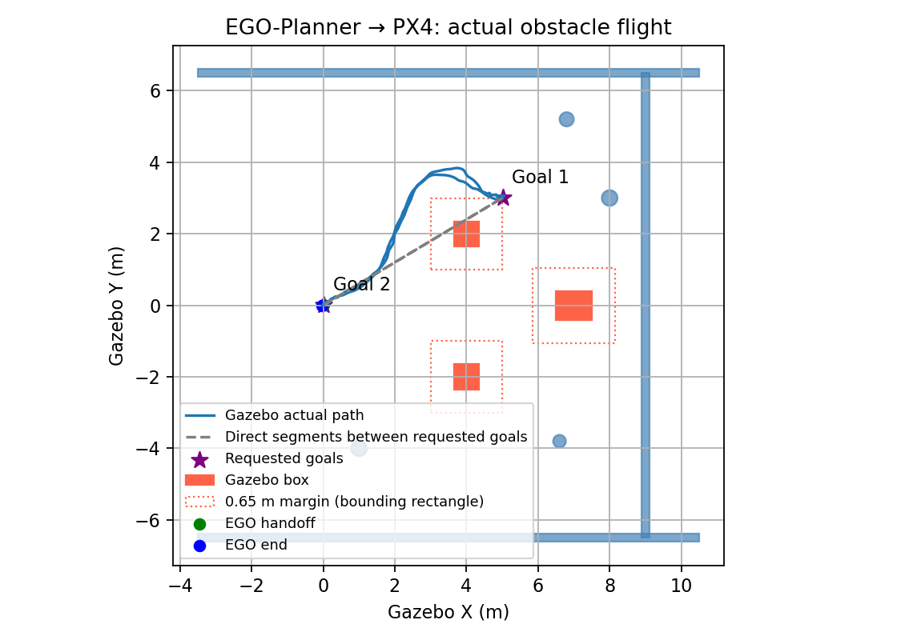
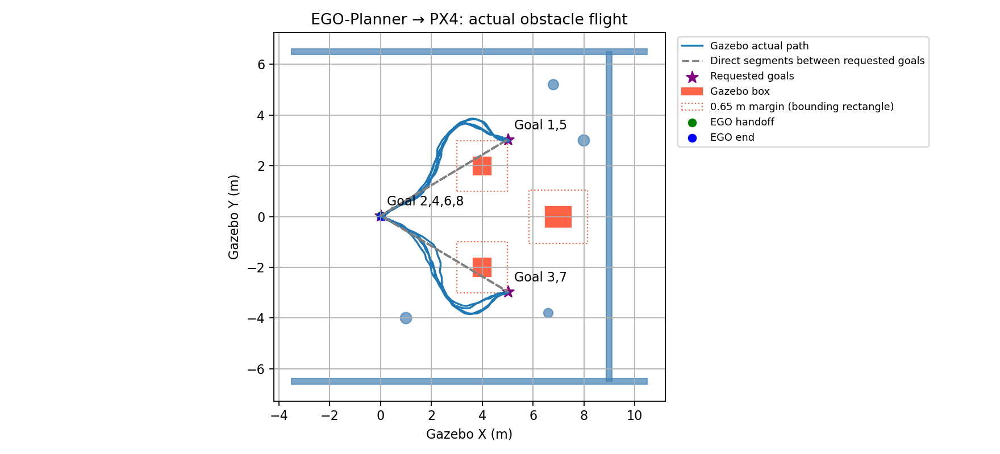
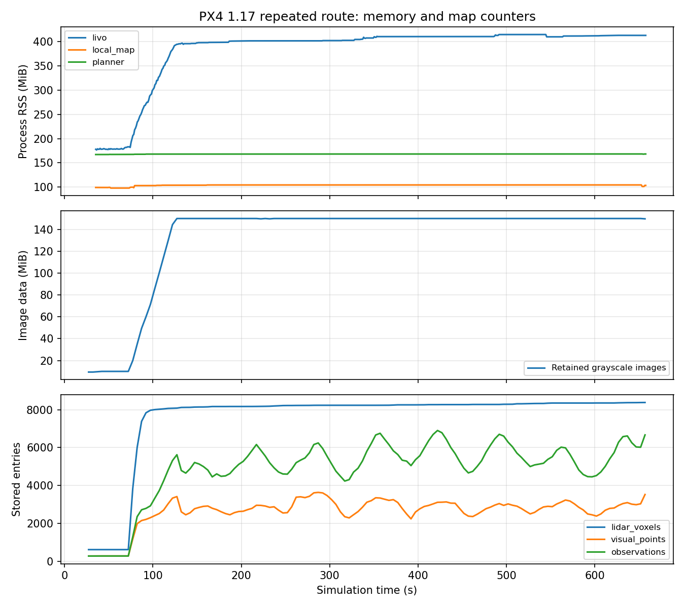

# PX4 1.17 / XT-Drone2 运行验收：2026-10-10

完整感知与规划源码已在新框架构建并运行。最终磁力计接口下已完成一次小范围原生 NED 飞行、一次 EGO-Planner 绕障往返，以及地图进程失联后的保持/降落试验。早期高度门控失败记录保留。以下结果限于低速静态障碍 SITL；不等于多场景、长期运行或实物认证。

## 已完成的移植

- 19 个 ROS 包和 PX4 v1.17.0 编译通过；使用固定 release/1.17 消息及版本话题后缀。
- XT-Drone2 负责增强世界、模型和 PX4 启动；完整 FAST-LIVO2、局部地图、EGO-Planner、审计和保护桥已接入。
- 旧版 Sophus 已独立保存并构建，修复缺少 `libSophus.so` 的运行依赖。
- 官方 1.17 在线定时器回归复现 `calls=1 sentinel=0 FAIL`；移植 HRT 补丁后 `calls=21 sentinel=50 PASS`。该试验复现调度缺陷，不证明所有历史传感器中断均由它导致。
- 每轮使用独立 rootfs、ROS domain 94、Gazebo partition；测试临时参数不写入旧版 BSON。
- localhost MAVLink GCS 心跳满足地面站健康检查；不发送目标、setpoint 或解锁命令。实际飞行命令仍由单一试验驱动负责。

## 静止与小范围运行证据

`static_stack_02` 连续 60 秒：LiDAR 约 10 Hz、RGB 约 30 Hz、IMU 约 100 Hz、LIVO odom 约 10 Hz、PX4 local position 约 50 Hz；odom 测量年龄 p95 24 ms，readiness 100%，仿真实时率约 1.0。见 `static_stack_117.json`。这不证明运动内存平台化。

`small_motion_05` 完成起飞、前进、侧移、返回、降落；无 armed failsafe。该轮仍采用官方 Harmonic 磁力计兼容路径：

| 运动段（5 秒目标渐变） | Gazebo 实际 ENU 位移 | LIVO XY p95 | PX4 XY p95 | PX4 Z p95 |
| --- | --- | --- | --- | --- |
| NED north | [-0.037, +0.336, -0.006] m | 0.0030 m | 0.0494 m | 0.1030 m |
| NED east | [+0.360, -0.031, -0.021] m | 0.0044 m | 0.0360 m | 0.0878 m |
| 返回 | [-0.304, -0.296, -0.037] m | 0.0033 m | 0.0694 m | 0.1120 m |

误差用前进前 2 秒的固定平移偏置、已知 ENU/NED 方向计算，不在后续飞行上重拟合。端点观察后的完整位移另存 `small_motion_before_mag_fix_117.json`；上表不是把控制目标 0.4 m 当成真实位移。测量时间配对 p95 8 ms。航向误差约 5～6°，运动开始后没有 XY/Z/yaw reset；爬升期间发生过一次已处理的 yaw reset。

本轮采用开阔区域到位后观察模式，不是连续 4 秒严格稳定悬停认证。该审计不认证整个坐标变换。全程拟合曾返回 `certified=true`，现已纠正：全程拟合只能返回 `fitted_alignment_checks_passed`，最终认证使用独立的固定初始变换。

全程监测曾在仿真 35.048 秒记录一次 odom 年龄 332 ms，发生在飞行 prestream（53.016 秒）之前，不能隐去该慢帧，也不能把它描述为飞行中的延迟通过记录。飞行驱动仍逐次执行 250 ms 新鲜度检查。

## 修复及失败记录

1. 被动检查原先把 `/clock - timestamp_sample` 的消息年龄当成时钟偏移，错误使用 20 ms 阈值。修正为分别记录测量到发布、发布到最后收到的 clock，并使用 20 ms 测量时间配对覆盖检查；保留 250 ms 新鲜度门限。异步 clock 回调滞后也会制造假的负年龄，不能据此声称 PX4 测量来自未来。配对覆盖率本身不等于独立时钟偏移认证。
2. Gazebo Harmonic 默认磁力计世界场为 NED、输出 gauss；官方 PX4 兼容处理交换轴。Astra 显式指定世界场 ENU/tesla，配套本地仿真桥按 body FLU→FRD、tesla→gauss 转换。官方模型原 gauss 噪声数值也等比例换算为 tesla，没有减小物理噪声。首次转换漏了噪声单位，磁场检查拦住了测试、没有解锁；已修正并保留记录。
3. 早期 `small_mag_enu_02` 和 `obstacle_mag_enu_01` 静止航向误差 p95 约 1°，磁场强度约 0.481 gauss，接近 PX4 参考 0.482 gauss；当时未取得成功飞行。后续最终接口飞行证据见本报告末尾。
4. `obstacle_mag_enu_01` 因地面高度偏置约 0.25 m 超过 0.15 m 门限，起飞前停止；没有 EGO 控制权交接、没有实际绕障。详见 `obstacle_attempt_117.json`。
5. `EKF2_GPS_CTRL=5` 是水平位置与三维速度，原本就没有 GPS 高度融合。试验中一度把位掩码读错，改为 1；该值关闭的是速度辅助，不能证明 GPS 高度影响。已恢复 5，失败实验保存在 `preflight_diagnostics_117.json`。
6. 气压噪声 0.1→0.3 m 的单因素试验没有解决地面 Z 偏置，已恢复默认测试值 0.1。保留 `--baro-noise-m 0.3` 作为显式对比入口，不能宣称该值修复了高度。

地面高度已分解为本轮固定原点偏置和后续漂移，结合 `ref_alt`、气压高度和测量时间。`ground_height_diagnostics_117.json` 保存早期分布；新增独立捕获与验证见下文。没有放宽高度残差、初始航向、数据新鲜度或障碍物保护来取得通过。

## 命令和日志

在未加载旧 ROS overlay 的终端：

```bash
cd /home/cyf/dev/XT-Drone2-astra
bash astra/build_px4_117.bash
bash astra/build_117.bash
bash astra/run_117.bash static static_check_02 --seconds 60
bash astra/run_117.bash small small_check_02
bash astra/run_117.bash obstacle obstacle_check_02
# 明确的单因素比较，非默认：
bash astra/run_117.bash small baro_compare_02 --baro-noise-m 0.3
```

飞行模式会对本机 SITL 解锁，必须使用从未用过的运行名称。官方 PX4 来源与本地补丁均由构建脚本核对。最终磁力计路径通过环境变量 `ASTRA_GZ_MAG_ENU_TESLA=1` 启用；原官方转换作为默认备用路径保留。

每轮完整日志在 `astra/runtime/<名称>/`：`runtime.json`、`simulator.log`、`preflight_health.json`、`frame_samples.csv`、`receipt_summary.json`、`motion_events.json` 和 PX4 `log/**/*.ulg`。完整日志和构建缓存不进 Git，结构化证据保存在本目录。

51 项桥、启动器、被动时间检查、固定高度偏置、路线输入与清理回归通过；完整算法新增时间戳转换回归后 4 项 CTest 通过，此前 11 项适配器/地图测试通过。旧 PX4 提交、已有源码修改状态、参数文件及 251 个 ROS 原源码哈希均未改变，见 `baseline_preservation_check.json`。当前仿真进程已停止，并核对了改写后的 Gazebo 标题。新 PX4 的补丁留在独立 checkout，并以 patch 文件保存在新框架。初次集成提交已上传 `astra/px4-1.17`；本次续测修改另行保存本地。


## 续测：固定高度原点与运动保护

`height_static_01` 连续 120 秒静止：前 4 秒冻结的 PX4/Gazebo 高度偏置约 0.114 m，后续 113 秒残差 p95 0.075 m、最大 0.157 m，未出现 reset。`ref_alt` 在本轮保持 0.150 m；不同轮的 `ref_alt` 不同，不可假设 local NED Z 与 Gazebo 共享零点。仍有气压/估计噪声，不能宣称漂移已消除。详见 `ground_height_static_117.json`。

新增显式 `--calibrate-ground-height`：在地面用 FAST-LIVO2 和 PX4 **测量时间配对**采集 4 秒，冻结 `PX4.z + LIVO.z` 的中位数；再用新的 4 秒样本逐帧验证偏置后的残差不超过原 0.15 m 门限。没有 Gazebo 校准输入，不向 PX4 发布 External Vision，也不改变其估计器原点。Gazebo 只用于初始地面边界检查和独立停测。采集失败、后续残差超限、reset 或数据间断均拒绝认证，不重新拟合后续数据。运行中新增冻结地面偏置的 0.20 m 高度差检查，规划执行桥原有 0.20 m Z 差检查保留。

`small_ground_aligned_01` 在最终 ENU/tesla 磁力计接口下完成起飞、前进、侧移、返回和降落：到位观察结束的真实前进 0.392 m、侧移 0.421 m；LIVO XY p95 0.0031～0.0035 m，PX4 XY p95 0.0169～0.0454 m、Z p95 0.0522～0.0746 m、航向 p95 1.04～1.23°。测量配对 p95 8 ms，没有 armed failsafe，运动开始后 reset 为零。冻结地面高度偏置全录制残差 p95 0.0677 m、最大 0.1083 m。四秒到位观察仍不是严格速度稳定悬停认证。详见 `small_ground_aligned_117.json`。

```bash
bash astra/run_117.bash static height_static_02 --seconds 120
bash astra/run_117.bash small small_ground_aligned_02 --calibrate-ground-height
bash astra/run_117.bash obstacle obstacle_ground_aligned_02 --calibrate-ground-height
```

新加入的 4 项回归覆盖独立验证、固定偏置、漂移拒绝、reset、测量间断与采集波动。

## 最终接口：EGO-Planner 实际绕障往返

`obstacle_ground_aligned_01` 使用最终传感器接口和固定地面高度偏置，完成起飞→目标偏移 [5,3] m→返回→降落/解除解锁。每段只给目标点，由 EGO 自主规划绕障，未手工提供绕行点。两段直线路径都穿过箱子；实际水平航迹约 14.798 m。全真值三维航迹为 16.759 m，包含垂直运动，不能混作水平距离。

| 检查 | 实测 |
| --- | --- |
| 机体参考点到全部 10 个静态障碍的最小水平距离 | 0.74357 m |
| 轨迹峰值速度 / 加速度 | 0.19782 m/s / 0.05580 m/s² |
| 实际峰值三维速度 | 0.21031 m/s |
| PX4 目标跟踪误差 p95 / 最大 | 0.07121 / 0.09751 m |
| LIVO 对真值 XY / Z 误差 p95 | 0.00662 / 0.00509 m |
| PX4 对真值 XY / Z 误差 p95 | 0.05469 / 0.09381 m |
| PX4 对真值 Z 最大误差 | 0.14050 m |
| PX4 对真值航向误差 p95 / 最大 | 1.417 / 1.600° |
| 固定地面偏置后 PX4/LIVO 高度差 p95 / 最大 | 0.07910 / 0.12300 m |
| 两套测量与真值配对 p95 | 8 ms |
| 桥发送最大间隔 | 58.95 ms |
| odom 测量年龄 p95 | 48 ms |
| 返回后真值 XY 误差 | 0.03893 m |

位置误差采用首次目标发送前 2 秒冻结的平移偏置、已知零航向生成场景的固定 ENU/NED 轴方向；不对整个运动重新拟合。该路线 p95 XY/Z 达到 0.10 m 目标，但 Z 最大误差仍超过 0.10 m，不能宣称全样本精确认证；通用坐标变换的 `frame_alignment_certified` 仍为 false。仅采用等效传感器模型，障碍距离以机体参考点计算，尚未扣除整机/旋翼外形。

PX4 ULog 确认了 700 个与执行桥目标精确对应的规划 setpoint（记录频率较低，桥共发送 2637 个跟踪样本），证明不是仅预览轨迹。飞行期间 armed failsafe、XY/Z/yaw reset、External Vision 融合均为零。GPS 实际日志 `vehicle_gps_position` 最大间隔 36 ms；磁力计被 ULog 降采样为约 1 Hz、最大记录间隔 1.008 s；电池记录最大间隔 0.212 s。三者持续覆盖规划飞行，没有复现共享更新中断；这仍不证明所有历史中断根因已确定。

全记录 readiness 最大接收间隔 364.59 ms 发生在仿真 52.504～52.868 秒，早于控制交接 93.224 秒；不能隐去该启动慢段。规划执行期间 readiness 最大间隔 88.47 ms、odom 最大间隔 145.60 ms、PX4 local 最大间隔 58.45 ms。正常路线未触发新鲜度保护。

本轮 LIVO RSS 从 180172 KiB 增至 414960 KiB，地图 99288→108476 KiB、规划器 171228→172440 KiB。保留图像上限仍为 512，但该短飞行不能证明新环境或大范围建图内存最终平台化。

证据：`obstacle_closed_loop_117.json`、`obstacle_reliability_117.json`、`obstacle_receipt_117.json`。图中蓝线为 Gazebo 实际航迹，灰虚线为直接目标连线，星号为出发/返回目标。



## 运行中的地图失联保护

`map_loss_117_01` 在 EGO 获得控制权 3 秒后，向本轮独立地图进程组发送 SIGINT。最后健康消息可能仍为 `ready=true`，失联由心跳过期检查捕获，而不是依赖退出前发布 false。

- 停图命令→退出规划跟踪：293.56 ms；→冻结保持目标：293.80 ms。
- 20 个保持 setpoint 的 XYZ 范围都为零；保持约 1 秒后请求降落，约 6.10 秒后解除解锁。
- 保持期间 Gazebo 仍移动 0.0705 m；这是固定控制目标，不能称为瞬时物理停止。
- 无 armed failsafe，安全降落；原参数/源码未改变。飞行驱动按预期故障返回 1，外层仅在观察到停图后故障、500 ms 内保持、解除解锁等条件时将故障回归记为通过，不记为正常路线完成。

证据：`map_loss_117.json`。此次测试覆盖 SIGINT 进程退出导致的心跳丢失，尚未覆盖所有通信分区、主机卡死或飞控失联情形。

复现和审计命令（名称必须全新）：

```bash
bash astra/run_117.bash obstacle obstacle_recheck_01 --calibrate-ground-height
python3 astra/tools/analyze_ego_obstacle_20261010.py astra/runtime/obstacle_recheck_01
python3 astra/tools/audit_obstacle_reliability_20261010.py astra/runtime/obstacle_recheck_01
bash astra/run_117.bash obstacle map_loss_recheck_01 --calibrate-ground-height --stop-map-after-handoff-s 3
python3 astra/tools/audit_map_loss_117.py astra/runtime/map_loss_recheck_01 --output astra/validation/map_loss_recheck_01.json
```

当前可以继续增加目标方向、重复路线和环境复杂度的仿真验收；一次往返通过不等于所有场景可靠。严格四秒稳定悬停、长时间大范围内存、动态障碍和真机迁移尚未认证，External Vision 继续关闭。

## 续测：重复启动和八段双向绕障

新增 `--route-json`，起飞前验证目标数量、有限数值及 7 m 原点范围。`astra/config/route_repeat_north_south.json` 请求 [5,3]→返回→[5,-3]→返回，各重复两次；规划速度与所有飞行保护不变，最长执行时间按不超过八段的原单段截止时间计算，监测覆盖完整运行。

首次两次续测均在起飞前被健康门控拦住，未解锁。原始 LiDAR/RGB/IMU 到达，但 adapter 的 `clock_ns=0`、无同步计时器事件，估计器点云/图像回调计数为零。发现本线程前次地图故障试验遗留了一个 Gazebo 子进程，同属 `astra_px4_117` partition：Gazebo 把完整命令改写成一个 argv[0]，原进程名称检查未识别；清理又仅在 launch 父进程仍运行时发送信号，漏掉了父进程退出后的子进程。明确核对归属后终止残留进程，干净重启恢复被动健康与规划交接。

现修复为识别完整 `gz sim ...` 标题及 ruby launcher，并始终对本轮创建的进程组发送 SIGINT→SIGTERM→SIGKILL。此后 `repeat_north_south_117_03` 结束时无残留 Gazebo，启动拒绝与清理回归已覆盖这些情形。证据 `simulator_cleanup_117.json`。此前“所有进程已停止”的旧结论未识别这种标题，已由本次 `/proc` 检查纠正。该现象不等同于历史 PX4 内部传感器共同停止更新的问题。

`repeat_north_south_117_03` 完成 6/8 段，第七段仿真 527.744 s 因冻结地面高度差超过 0.20 m 停测并安全降落，无 PX4 failsafe 或运动 reset。规划执行约 434.6 s；机体参考点最小障碍距离 0.75684 m，LIVO XY/Z p95 0.00640/0.01703 m、Z 最大 0.02279 m；PX4 XY/Z p95 0.06928/0.07610 m、Z 最大 0.17591 m。触发前最后配对的高度差 0.20264 m、时间差约零，支持两套估计高度差超限，不能归为消息迟到。该八段路线**未通过完整执行**，不得只凭前六段称为稳定。

保持传感器噪声与全部门控不变，开始只将隔离运行的 `EKF2_BARO_NOISE` 由 0.10 改为 0.30 m 的对照。依据：官方 Gazebo 气压噪声 3 Pa 在近海平面等效约 0.25 m；本轮气压高度对实测 Z 去均值后的散布标准差约 0.142 m、绝对中位差 p95 0.283 m。散布含滤波及动态误差，不是纯白噪声拟合。早期 0.30 m 未解决地面原点偏置，不能因此排除它对飞行高度动态的影响。本次先验证，不改默认值。分解脚本 `audit_height_noise_117.py`，证据 `repeat_height_noise_117.json`。

本轮 LIVO 最后两分钟 RSS 406.65～410.57 MiB、端点增量 2.53 MiB，最后五分钟增量 10.45 MiB；灰度图像约 150.3 MiB，地图根体素最终 8676、路径保留 2000。支持图像缓存受控、RSS 增长减缓，不支持无限运行或大范围地图内存认证。完整窗口与计数保存在 `repeat_runtime_growth_117.json`。

```bash
bash astra/run_117.bash obstacle repeat_route_01 --calibrate-ground-height --route-json astra/config/route_repeat_north_south.json
bash astra/run_117.bash obstacle repeat_route_baro03_01 --calibrate-ground-height --route-json astra/config/route_repeat_north_south.json --baro-noise-m 0.3
```

### 0.30 m 对照与测量时间戳边界

`repeat_north_south_baro03_117_01` 完成 5/8 段，仿真 461.936 s 在第六段安全停测：`ground-aligned height has no measurement pair within 20 ms`，随后安全降落。该轮 PX4 Z p95 0.06424 m、最大 0.12584 m；但运行未完成，且随机噪声与路径并不完全相同，不能据此证明 0.30 m 修复了高度问题。

边界检查发现 FAST-LIVO2 发布测量时间 `461903999999 ns`，最近 PX4 样本 `461924000000 ns`，差 `20000001 ns`。原激光/审计测量时间应为 `461904000000 ns`；C++ `sec2Stamp` 把浮点小数秒转换为无符号纳秒时向下截断，产生 1 ns 误差，恰好把实际 20 ms 的边界判成失败。这不是毫米级位置误差，也不是 20 ms 门限需要放宽。修复为四舍五入至最近纳秒，并处理进位到下一秒，保持原测量时间语义和全部配对门限。

新增核心回归覆盖本次实际测量值、20 ms 包含边界、跨秒进位和毫秒传感器时间线往返。`timestamp_boundary_117.json` 保存故障样本，后续完整路线需使用重建后的算法验证。此次发布精度修复不声称消除真实消息间断。

### 修复后的完整八段飞行

`repeat_north_south_stampfix_baro03_117_01` 使用重建后的 FAST-LIVO2，隔离 EKF 气压观测噪声 0.30 m，完整执行两次正方向、两次负方向往返，8/8 段通过并安全降落/解除解锁。规划执行约 555.8 s，水平航程 58.722 m。四趟均仅指定目标点，由 EGO 自主绕障；实际路径与原噪声对照并不完全相同。

| 检查 | 实测 |
| --- | --- |
| 最小机体参考点水平障碍距离 | 0.73686 m |
| 规划峰值速度 / 加速度 | 0.19791 m/s / 0.05586 m/s² |
| 实际峰值水平速度 / 三维速度 | 0.19381 / 0.26051 m/s |
| 实际峰值垂直速度 | 0.22038 m/s |
| PX4 目标跟踪误差 p95 / 最大 | 0.05274 / 0.10422 m |
| LIVO 对真值 XY / Z p95 | 0.00588 / 0.03303 m |
| LIVO 对真值 Z 最大 | 0.03896 m |
| PX4 对真值 XY / Z p95 | 0.05686 / 0.05931 m |
| PX4 对真值 Z 最大 | 0.14096 m |
| PX4 航向误差 p95 / 最大 | 0.516 / 0.907° |
| 冻结地面偏置后的高度差 p95 / 最大 | 0.08010 / 0.16607 m |
| odom 测量年龄 p95 | 48 ms |
| 桥最大发送间隔 | 70.19 ms |
| LIO 最低 correspondence | 4481 |

全部八段端点真值 XY 误差约 0.011～0.072 m；返回段是在到达后连续规划下一目标，不是严格四秒速度稳定悬停认证。运动中无 armed failsafe、XY/Z/yaw reset、视觉更新拒绝；EV 融合关闭。ULog 确认 2780 个规划 setpoint。最终全记录 6236 个 odom 时间戳均落在实际毫秒边界；执行期 readiness、odom、PX4 local 最大接收间隔约 89.39、158.08、90.76 ms，均保留原新鲜度检查。实际三维峰值速度包含高度振荡，不能拿规划水平目标速度代替实际控制动态。

LIVO RSS 177.17→412.57 MiB；最后五分钟范围 409.58～414.35 MiB、端点增量 2.51 MiB、拟合增长约 0.58 MiB/min；最后一分钟增量 0.92 MiB。最后两分钟端点下降 1.78 MiB，但窗口内有波动，拟合斜率仍约 1.04 MiB/min，不能只用负端点差宣称不增长。灰度图像最后 512 张、150.0 MiB（处理期间诊断可能包含当前帧至 513 张），激光根体素最终 8379、视觉点 3519、路径保留 2000。支持本路线内存接近平台，尚不证明大范围地图或无限运行稳定。

根据官方模型噪声规模及这次完整路线验证，将隔离运行器默认气压观测噪声设为 0.30 m；`--baro-noise-m 0.1` 保留对照。此变更不减小模拟传感器噪声，不改变配对、新鲜度、高度差和障碍保护门限。一次通过不证明统计显著改善；仍有高度瞬态和 LIVO Z 随路线积累到厘米级的误差，不宣称高度问题彻底解决。

结构化证据：`repeat_north_south_final_117.json`、`repeat_closed_loop_final_117.json`、`repeat_reliability_final_117.json`、`repeat_receipt_stampfix_117.json`、`repeat_runtime_growth_stampfix_117.json`。新核心二进制哈希见 `summary.json`；完整 PX4 ULog、测量 CSV 与执行源码快照在该运行目录。





```bash
# 现在默认采用本轮验证的 0.30 m 隔离气压观测噪声。
bash astra/run_117.bash obstacle repeat_verified_01 --calibrate-ground-height --route-json astra/config/route_repeat_north_south.json
# 原 0.10 m 对照，仍使用已修复的时间戳和进程清理。
bash astra/run_117.bash obstacle repeat_old_baro_01 --calibrate-ground-height --route-json astra/config/route_repeat_north_south.json --baro-noise-m 0.1
python3 astra/tools/audit_height_noise_117.py astra/runtime/repeat_verified_01 --output astra/validation/height_recheck_117.json
python3 astra/tools/audit_runtime_growth_117.py astra/runtime/repeat_verified_01 --output astra/validation/growth_recheck_117.json --plot astra/validation/growth_recheck_117.png
```
