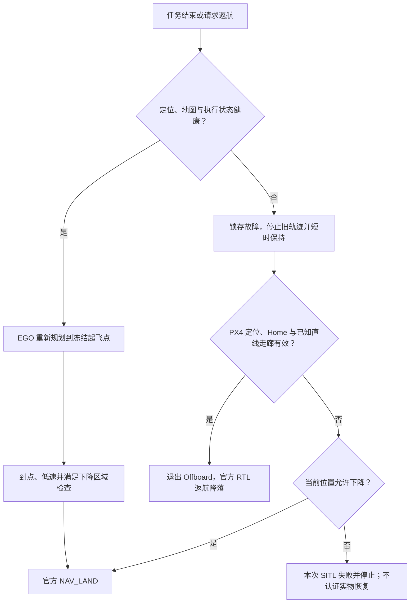

# 独立通行／降落区与返航验证

2026-10-15，隔离 PX4 v1.17 SITL。原先“沿途任何位置都必须能原地下降”是项目自定义限制，并非 PX4 官方要求。本次把巡航通行证书与下降证书分开，保留旧地图和参数基线。

## 策略



- 绿色为全下降柱体的已知净空区域；蓝色为独立巡航高度带。实际规划仍扣除跟踪与端点余量，颜色不是任意点可飞承诺。
- 保留原下降区域的通行权限，再合并额外巡航区域；规划器、预览与监督器使用同一通行掩码。下降单独检查，包含 0.25 m 邻域余量。
- 健康返航必须收到新 B-spline，不能直接把“回家”坐标发给飞控绕开 EGO。任务支持返航降落、末点降落、末点限时悬停，也可中途请求返航；通行区的降落请求转为规划返航。
- **官方 RTL 不使用 EGO 的障碍地图。** 第一版额外通行区域只开放预先证明能直线回家的静态走廊，未开放任意障碍后的区域；地图正常时仍使用 EGO 规划。
- RTL 前检查全局／局部位置、Home、reset、冻结变换、走廊和实际几何；不满足就拒绝。定位／地图失效时不会继续依赖失效来源重新规划。

## 试验场景与配置

复制彩色 Baylands 场景，在 `(-1.5,0)` 添加尺寸 `0.5×0.7×0.35 m` 的低箱子。箱子同时进入 Gazebo 碰撞／视觉和独立几何保护，不是只加显示模型。路线目标为 `(-3,0)`，再由程序请求返航；没有指定绕箱中间点。

巡航相对高度 1.5 m，初始航向校准 1.6 m，机体世界 Z 的巡航证书为 `[1.2,2.0] m`。本次验证的是**飞越低障碍物**和返航机制，不新增高箱体侧向绕行认证。旧默认地图保持 0.9 m 巡航与原下降区限制。

新场景关闭“把低障碍一直向上投影”的 `static_descent_columns`，仍使用实时膨胀点云和全曲线检查。下降证书覆盖全高度，巡航证书只覆盖指定高度带；不验证坡地跟随或缺失扫描几何。

RTL 仅在隔离 rootfs 中设置：`RTL_RETURN_ALT=1.5`、`RTL_DESCEND_ALT=1.5`、`RTL_CONE_ANG=0`、`RTL_MIN_DIST=0.5`、`RTL_LAND_DELAY=0`、`RTL_TYPE=0`、`RTL_PLD_MD=0`、`NAV_ACC_RAD=0.2`、`MPC_XY_CRUISE=0.3`。

首轮日志发现 `vehicle_global_position.alt_valid=false`，Commander 的 `global_position_invalid=true`，因此正确拒绝 RTL。PX4 1.17 的 `ekf.h::isGlobalVerticalPositionValid()` 要求已初始化的绝对高度原点。新场景改用 `EKF2_HGT_REF=1`，保留 `EKF2_GPS_CTRL=5`（GNSS 高度不融合）；官方参数文档明确该组合仍用 GNSS 初始化高度原点。EV XY/Z 继续融合，yaw／速度不融合。没有跳过 PX4 定位有效性检查。

## 运行证据

| 运行 | 结果 |
| --- | --- |
| `return_airspace_20261015_01` | 到达 3 m 目标后返航切换失败，安全原地降落；保留失败。切换时首次加载界面依赖造成约 150 ms 停顿，随后触发测量配对保护；另有绝对高度原点未建立，RTL 被拒绝。 |
| `return_airspace_20261015_02` | 去掉飞行中的临时界面依赖加载、建立高度原点后，完整往返审计通过。此轮使用较窄的独立通行掩码。 |
| `return_airspace_20261015_03` | 合并原下降区域与新通行区域后，在低箱上方中断地图；正常任务按预期失败，故障恢复单独审计通过，官方 RTL 回到起飞区并上锁。 |
| `return_airspace_20261015_04` | 合并区域正常往返完整审计通过，实际 6.243 m，返航终点误差 0.0287 m，最小已知表面机体中心距离 1.139 m。 |
| `return_airspace_20261015_05` | 加入全曲线巡航高度带检查后，再次往返完整审计通过，实际 6.286 m，返航终点误差 0.0293 m，最小已知表面机体中心距离 1.179 m。 |

第二轮：实际水平航迹 **6.356 m**，两段实际进展分别为 **3.034 / 2.960 m**；出发／返航航点的地面冻结参考真值误差为 **0.0389 / 0.0588 m**。执行期间 LIVO XY/Z p95 为 **0.0334 / 0.0071 m**，PX4 为 **0.0418 / 0.0833 m**。全飞行已知表面机体中心最小距离 **1.202 m**，无边界越界、armed failsafe 或执行曲线越界，降落上锁，ULog 确认 EV XY/Z 实际融合。

第三轮故障恢复：地图在首次 EGO 交接后 10 秒停止，故障检测 **225.5 ms**，首次冻结保持指令在 **319.4 ms**；保持约 1 秒后，于故障注入后 **1320.1 ms** 请求 RTL。PX4 **31.1 ms** 确认接管，返航降落耗时 **11.228 仿真秒**，实际返航水平航迹 **1.672 m**，落点距起飞点 **0.0455 m**。

RTL 开始时不满足原地下降检查；整个恢复过程中已知表面机体中心最小距离 **1.208 m**，无包络越界、armed failsafe 或无效定位／Home 标志。监督器记录与 ULog 都确认 RTL 请求后没有新的 Offboard 控制消息。恢复阶段所有 LIVO／PX4 测量都在 20 ms 内与真值配对，p95 **8 ms**；LIVO XY/Z p95 **0.0511 / 0.0097 m**，PX4 **0.0400 / 0.0921 m**。未使用空中重拟合。

**这不是 31 ms 内完成故障处理。** 31.1 ms 仅为 RTL 请求后的模式接管时间，前面还包含故障检测和约 1 秒受控保持。低速静态试验通过，不代表该反应预算适合高速或近障飞行。

五次运行的 PX4 原参数基线和执行源码校验均保持。正常与故障任务结果分开，故障轮 `flight_complete=false`，只有 `native_recovery_verified=true`，不伪装成完成了原任务。配置／检查有阶段性改动，不把三次正常往返当作完全相同源码的三次重复认证。

第五轮执行期 LIVO XY/Z p95 **0.0338 / 0.0179 m**，PX4 为 **0.0408 / 0.1117 m**。所有被执行的完整曲线同时通过 XY 通行掩码和冻结 LIVO 高度带 `[0.9400,1.5400] m` 的凸包细分检查；这个高度带由起飞前 odom 和已检查机体高度带换算，未用真值拟合控制。

**高度精度仍有限制：第五轮 PX4 Z p95 为 11.2 cm，超过此前 10 cm 的精密对齐目标。** 本次“完整路线通过”检查路线进展、航点位置、曲线距离／动态约束和保护恢复，并不包含全部估计器精密对齐认证。尚不能把返航功能通过写成近障／实物高度精度通过。

最终 **240 项** Python／独立 C++ 回归通过（含高度曲线、无效航向拒绝 RTL、安全位置按操作员要求原地 Land 等测试）；中文面板离屏检查通过，三种末点动作与返航按钮可用。改动为 Python 监督、审计、准备和界面逻辑，无需重新编译 ROS C++ 包；本次没有重新认证全部旧场景。最后两项保守保护分支以回归验证，未另外注入飞行中的无效航向。

## 复现

仓库根目录执行；输出目录和运行名称必须未被使用。源场景是已准备的彩色 Baylands，新克隆可使用按快速启动生成的 `baylands_park`。

```bash
astra/runtime/map_tools_venv/bin/python astra/tools/prepare_return_airspace.py \
  --source astra/runtime/maps/baylands_park_coloured \
  --output astra/runtime/maps/baylands_return_union --validation-low-box

# 自动：到达目标后请求新的 EGO 返航轨迹。
bash astra/run_117.bash obstacle return_test_NEW \
  --world-preset baylands --scan-dir astra/runtime/maps/baylands_return_union \
  --route-json astra/runtime/maps/baylands_return_union/route.json \
  --calibrate-ground-height --external-vision --isolate-estimator-cpus \
  --executor-audit --end-action return_home

# 故障：上述命令换新运行名，追加此选项。
# --stop-map-after-handoff-s 10

# 交互：中文窗口选择返航后降落；蓝色巡航区不允许直接降落。
bash astra/rviz_outdoor_117.bash return_ui_NEW \
  --scan-dir astra/runtime/maps/baylands_return_union --external-vision
# 另一个终端显示 Gazebo。
GZ_PARTITION=astra_px4_117 gz sim -g
```

停止仿真后，以新运行目录执行 `audit_scan_flight.py`、`audit_external_vision.py`、`audit_shared_envelope.py` 和 `audit_transit_return.py`。正常往返要看完整审计；主动中断地图的任务必须报告未完成，另查 `fault_regression.json`、`transit_return_audit.json` 与 RTL 事件，不能算正常路线成功。

原始记录在本机 `astra/runtime/<运行名>/`，含代码快照、ULog、测量时间位姿、发送指令和参数校验。原始运行资源不上传。已知静态走廊、指定短路线的通过，不代表整图、动态障碍、长时运行或实物已通过。

小型指标与每轮执行快照摘要见 [结构化汇总](transit_return_117.json)，首轮失败未删除。
