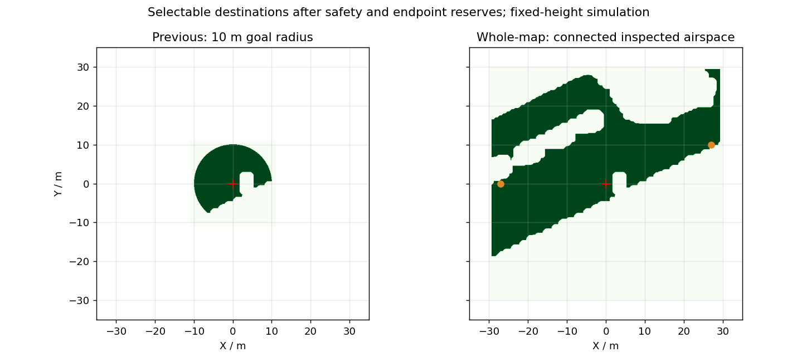

# 全图范围选点与远端飞行

2026-10-15，Baylands 70×70 m 公园，隔离 PX4 1.17 SITL。这里的“全图”是对整张地图的可用内部区域做空域检查并开放连通航点，不是把树、箱体、坡地或缺失几何当作可飞空间。

2026-10-16 后续：新增青色静态航点范围图层与真实三角面距离精化配置；可选面积从 1264.86 增至 1299.50 m²，保持原余量。下文保留原配置及其运行证据，最新范围与验证见 [航点范围与扩区](GOAL_REGION_REFINEMENT_117.md)。

## 空域变化

| 项目 | 原彩色地图 | 全图配置 |
| --- | --- | --- |
| XY 检查边界 | ±11 m | ±30 m；地图边缘保留 5 m |
| 起飞点目标距离限制 | 10 m | 43 m，覆盖检查方形的对角线 |
| 规划栅格宽度 | 32 m | 70 m；保留实时局部地图 12 m 半径和 10 m 规划前视 |
| 相对巡航高度 | 0.90 m | 1.50 m；初始对齐高度仍为 1.60 m |
| 扣除余量后的可选面积 | 211.52 m² | 1264.86 m²，约 5.98 倍 |



深绿色是扣除余量后允许选点的区域，红十字是起飞点，橙点是东／西远端测试目的地。浅色区域包括障碍、坡地与安全边界，不能仅凭底图看起来空旷就进入。

两种空域保持分离：完整下降柱体已检查的区域允许通行和降落；额外巡航空域仅在已检查直线返航走廊内开放。障碍后方符合下降净空的区域也可以通过 EGO 绕行到达，不要求正常路线能直线回家。发生异常时，官方 RTL 仍须现场通过直线走廊检查；否则只允许在有下降净空的位置降落，不能用官方 RTL 穿越树木。

规划器、预览和监督器使用同一冻结掩码；全曲线 XY/Z 检查、安全距离和新鲜度门槛保留。对全图配置，扣除跟踪余量和规划端点余量后再次检查与起飞点的连通性，拒绝被窄通道断开的孤岛。整张背景地图显示出来，不代表全部 XY 都在开放空域内。本轮没有实现坡地跟随、动态避障或实物恢复。

## 使用

先按安装教程准备原始彩色地图，再生成独立配置；源地图、PX4 参数基线和旧运行记录保留。输出目录必须不存在。本机从 `baylands_park_coloured` 生成，新电脑使用新准备的 `baylands_park`。

```bash
astra/runtime/map_tools_venv/bin/python astra/tools/prepare_return_airspace.py \
  --source astra/runtime/maps/baylands_park \
  --output astra/runtime/maps/baylands_whole_map --whole-map

bash astra/rviz_outdoor_117.bash whole_ui_$(date +%Y%m%d_%H%M%S) \
  --external-vision
# 另一个终端
GZ_PARTITION=astra_px4_117 gz sim -g
```

启动器优先使用存在的 `baylands_whole_map`，并打印实际边界。用 `--scan-dir` 可以显式切回其他配置。RViz 默认相机拉远显示大范围，保留近景三维视图。地面编辑不限时，READY 后添加目标，选择返航降落或末点降落，再点击开始。空中暂停与等待仍有时限。

自动测试准备可追加 `--route-kind east|west|cross-map`：东侧目标 `(27,10)`、西侧 `(-27,0)`、跨区三目标 `(27,10)→(-27,10)→(-25,-10)`。这些是任务目的地，不是人工指定的绕障中间点。对应配置单段最多 500 秒，速度仍为 0.20 m/s；健康返航请求新的 EGO 曲线。路径长、观测不足或定位保护仍可能使任务失败，延长上限不等于认证规划可靠。

```bash
bash astra/run_117.bash obstacle whole_east_NEW \
  --world-preset baylands --scan-dir astra/runtime/maps/baylands_whole_map_east \
  --route-json astra/runtime/maps/baylands_whole_map_east/route.json \
  --calibrate-ground-height --external-vision --isolate-estimator-cpus \
  --executor-audit --end-action return_home
```

## 运行证据

- `whole_map_east_20261015_01`：解锁前失败。600×600 边界构建与消息准备阻塞约 0.28 秒，导致监督器 odom 接收过期；没有解锁或有效位移。修正为边界准备后重新等待连续 1 秒健康，并确认冻结地面参考没有移动，仍保留 250 ms 门槛。
- `whole_map_east_20261015_02`：约到 `(16.92,4.87)` 后局部地图容量超限，记录 `local map capacity exceeded (voxels=20039)`；任务失败，在已检查下降区安全降落并上锁。原地降落不是完成了远端任务。全图配置随后单独分配最多 50,000 个体素，原地图仍用 20,000；12 m 半径、TTL、0.20 m 分辨率、膨胀距离、处理期限和新鲜度门槛不变，不通过随机删障碍控制容量。
- `whole_map_east_20261015_03`：巡航高度稳定阶段因测量年龄超过 250 ms 中止。LiDAR／图像输入一同晚到约 300 ms，LIO 计算约 18.3 ms；不是把计算耗时误算成全部延迟。输入偶发迟到仍待查明，没有放宽新鲜度门槛。
- `whole_map_east_20261015_04`：实际水平累计飞行 29.52 m，到模型真值 `(25.645,8.797,1.267)` 时因冻结地面偏置后的 PX4／LIVO 高度差 `0.202 m` 中止，没有到达 `(27,10)`。官方 RTL 因直线走廊不成立被拒绝，随后在有下降净空的位置安全降落并上锁。局部地图本次最高 17,412 体素、构建最高 140 ms，没有再次触发容量保护；本次没有压到新 50,000 上限，不能作为容量极限验证。

## 高度差诊断

第 04 次的 ULog 证明 EV XY 和高度各 2400 次更新全部参与融合，拒绝数均为零；高度创新绝对值 p95 为 0.014 m。**融合开启不等于 PX4 直接复制输入高度，也不等于两者高度基准相同。**

返航配置此前把 `EKF2_HGT_REF` 从视觉 `3` 覆盖为 GNSS `1`，以初始化官方 RTL 所需的绝对高度原点；同时 `EKF2_GPS_CTRL=5` 不融合 GNSS 高度。气压计和视觉高度仍融合，但视觉高度不是主参考。`estimator_ev_pos_bias.bias[2]` 从约 60 秒的 0.180 m 变到约 302 秒的 0.346 m。PX4 源码的 `HeightBiasEstimator` 允许非主参考高度源持续调整偏置，因此很小的视觉创新不能证明两者没有原始高度差。

同一远端飞行段，按测量时间对齐 Gazebo 后，FAST-LIVO2 的 Z 绝对误差 p95 为 0.0193 m，PX4 为 0.0977 m；不能把这次问题归为 LiDAR 安装高度或 FAST-LIVO2 整体失效。EKF 与视觉姿态差造成的瞬时高度旋转估计约 1～2 cm，尚不足以单独解释 0.20 m。

修正实验保留 `EKF2_HGT_REF=3`，等视觉融合在地面启动后，使用官方 `SET_GPS_GLOBAL_ORIGIN`，以有效 GNSS 的 MSL 高度为缺失的绝对高度原点赋值。保留已有水平原点，并把本地 Z 纳入原点计算；不使用 Gazebo 真值做标定。该步骤必须在解锁前完成，检查 ACK、本地位置变化不超过 0.03 m、全局高度有效以及 EV XY/Z 持续融合；失败则不解锁。0.20 m 高度保护仍保留。初始化代码通过不等于飞行修复通过，结果须由新运行记录确认。

修正复测：

- `whole_map_evref_short_20261015_01`：首次地面初始化没有解锁。发现 PX4 1.17 的 `local_position.z_global/ref_alt` 可以在绝对高度尚未初始化时给出真／0，不能替代 `vehicle_global_position.alt_valid`；随后修正有效性检查。
- `whole_map_evref_short_20261015_02`：有效 GNSS 原点命令 ACK 成功，全局高度有效、EV 连续融合。完成 `(-3,0)→(0,0)`，实际水平路径约 6.29 m，安全降落并上锁。EV 地面冻结变换下两估计器高度差 p95 为 0.0286 m、最大 0.0666 m；XY p95 为 0.0441 m。ULog 中飞行期视觉 Z 偏置保持 0，未再随气压计漂移。32 条完整 B-spline 均在共同空域内，连续障碍距离与动态约束通过，Gazebo 全程障碍净空最小 3.02 m，无 failsafe。此短路线与此前远端路线长度不同，不能据此宣称远端高度差已经修复。
- `whole_map_evref_east_20261015_01`：实际到达东侧目标，模型真值 `(27.076,10.052,1.505)`。返航至约 `(6.456,10.149)` 时触发估计器测量配对保护，官方 RTL 因直线走廊不成立被拒绝，随后安全降落。实际水平飞行累计 52.67 m，整个任务失败，不能称为完成往返。3754 次 EV XY/Z 更新均融合，视觉 Z 偏置始终为 0；320 条曲线均在共同空域内，动态约束和连续障碍距离检查通过，Gazebo 全程障碍最小距离 1.245 m。

同一东侧去程，监督器在**原点设置完成后、起飞前**冻结偏置得到的高度漂移：

| 指标 | 旧 GNSS 参考运行 04 | 视觉主参考远端运行 01 |
| --- | --- | --- |
| 冻结地面偏置后的高度差 p95 | 0.1266 m | 0.0709 m |
| 冻结地面偏置后的高度差最大值 | 0.2021 m，触发保护 | 0.1288 m |
| PX4 对 Gazebo 高度误差 p95 | 0.0977 m | 0.0470 m |

这只是两次运行对比，尚不是重复性认证。不要混用 EV 启动前期冻结变换与设置绝对原点后的执行变换：后者只在解锁前冻结，飞行中不重新拟合。远端运行 01 的早期 EV 变换直接比对得到 Z p95 0.269 m，含后续设置绝对原点的固定基准变化，不可冒充上述飞行漂移指标，也不能隐去。

配对保护另有已复现的选择顺序问题：故障时桥节点时钟为 445.348 s，最新已处理 LIVO 测量 445.104 s；候选 PX4 测量 445.096 s 更近但年龄 252 ms，已经过期。旁边 445.120 s 的实测样本年龄 228 ms、与 LIVO 相差 16 ms，仍合格，却被先选最近再检查年龄的逻辑漏掉。修正为先筛选复位代次、有效性和原有新鲜度合格样本，再选最近测量；仍保留 20 ms 配对和 250 ms 年龄门槛。新增回归同时验证：旁边有真实合格样本时通过，仅剩过期样本时仍拒绝。CPU／DDS 偶发挤压没有因此被宣称彻底解决。

后续可靠性修正：

- `whole_map_evref_east_20261015_02`：初始共享空域全局引导被拒绝，未产生有效路线位移；测试人工发送官方 `NAV_LAND` 提前结束等待，随后监督器记录离开 Offboard 并安全恢复、落地上锁。`operator_abort.json` 保留命令与 ACK，不把主动中止混作自发 failsafe。
- 大地图的每次全局搜索原来都先重新收缩 600×600 冻结掩码，收缩也消耗同一个 20 ms 搜索预算。改为收到冻结掩码时一次性准备并缓存，只把全局搜索放进原 20 ms 预算；掩码变化仍锁死，障碍／未知格、边界与额外余量保持一致。回归检查整条路径邻域净空和未知格关闭，并重新构建 `plan_env/path_searching/bspline_opt/ego_planner`；规划器尾段障碍 CTest 通过。
- 长距离飞行仍有 500 s 单段预算，但初始有效轨迹等待单独收紧为 10 s；规划拒绝不能再变成几分钟原地悬停。没有用直接位置跳转绕过 EGO。
- `whole_map_evref_east_20261015_03`：冻结搜索掩码准备耗时 13.055 ms；起飞初期、模型仍在地面时 EV 发布年龄超过 250 ms，保护中止并上锁。此轮不算运动验证；偶发输入迟到仍未修复。
- `whole_map_evref_east_20261015_04`：实际到达东侧目标 `(27.080,10.019,1.416)`；返航至 `(7.749,10.109,1.447)` 时测量配对保护中止，安全降落并上锁。实际水平路径 51.88 m，全程最小已知表面距离 1.2745 m，连续障碍距离和动态约束通过，任务未完成。去程冻结地面高度差 p95 为 0.0627 m、最大 0.0983 m，说明高度主参考修正有效，但不等于完整往返已通过。

第 04 次返航故障有真实采样间隙：443.476 s 检查时，LIVO 测量为 443.324 s，收到的相邻 PX4 测量为 443.300／443.348 s，各差 24 ms，均超出 20 ms 配对门槛；前一帧 LIVO 已老到 252 ms，下一帧又在中止后 8 ms 才发布。LIO 计算约 34.3 ms。这次不是前述“先选过期最近样本”的逻辑问题。

后续将官方 DDS 配置中 `vehicle_local_position` 输出上限由 50 Hz 改为 100 Hz，使用可反向应用的 `astra/config/px4_117_dds_local_position.patch`，并由 PX4 构建脚本幂等应用。只改变本地位置输出频率，不改变消息格式、飞控控制增益或 20 Hz setpoint。运行记录保存 PX4 二进制 SHA-256；仍保留 20 ms 配对与 250 ms 新鲜度。配置和编译通过不证明运行时始终 100 Hz，需从实际回调测量采样间隔。

### 100 Hz 输出复测

`whole_map_dds100_east_20261015_01` 实际到达 `(27.069,10.078,1.501)`；返航至 `(5.153,10.227,1.418)` 时执行桥触发 `stale measurement timestamp`，随后在已检查下降区落地、上锁。任务仍失败。按测量时间计算的实际水平路径 54.571 m；324 条完整 B-spline 均在共享空域内，动态和连续净空检查通过，全程最小已知表面机体中心距离 1.421 m，armed failsafe 为零。

ULog 确认视觉 XY/Z 实际融合，飞行中视觉高度偏置保持 0。去程／返航冻结地面高度差 p95 为 0.0833／0.0892 m，最大 0.1424／0.1109 m；比旧配置改善，但不同运行有波动，不宣称高度误差已经消失。早期 EV 变换与执行冻结变换仍按前述规则分别报告。

帧审计订阅者实际收到的 PX4 测量平均 99.98 Hz，间隔 p50／p95／最大为 8／16／44 ms。故障前执行桥保留尾段的 PX4 间隔 p95／最大为 16／40 ms。此结果证明输出频率提升生效，但不能保证每个订阅者连续无丢帧。

中止前执行桥已处理 LIVO 452.200 s 测量；收到 `/clock=452.452 s` 后，其测量年龄达到 252 ms。监督器当时只处理到 452.432 s，因此自身显示年龄为 232 ms，不能据此说桥的 250 ms 检查错误。452.300 s 测量在独立监视节点约 452.408 s 已收到，但桥在故障前尚未执行对应回调。该帧 LIO 墙钟 67.5 ms，其中线程 CPU 20.8 ms、调度等待 44.3 ms；接收侧另有排队。执行期桥的 DDS 接收到 odom 回调延迟 p95 14.2 ms、最大 107.1 ms，保留尾段接收批次 70.3% 用完 4 ms 预算。应继续查计算调度和接收积压，不能把 67.5 ms 全说成算法算力成本，也不能用提高 DDS 输出频率宣称延迟已修复。

本次未再触发高度保护，没有修改门槛。重复远端完整往返、西侧和跨区路线尚未验证通过。简要可追溯数值保存在 [本轮证据摘要](whole_map_airspace_117_evidence.json)，原始运行资源位于本机 `astra/runtime/`，不随 Git 上传。

后续采用事件执行器，两轮东侧约 69 m 完整往返均通过，见[接收积压复测](WHOLE_MAP_RECEIVER_117.md)。上段为默认 Python 接收模式的历史结论，不覆盖后续成功，也不因后续成功删除原失败。

上述运行均记录原 PX4 参数／基线未变、执行源码未在飞行期间修改。后续远端结果在完成后补入；空域准备成功本身不作为飞行成功证据。

本轮完整回归 261 项通过，包含初始化健康等待、全图连通性、原点有效性、未解锁／失效数据门控，以及执行桥和高度配对两处过期候选遮蔽有效配对的回归；`astra_px4_offboard` 已重新构建。旧返航策略和故障注入证据见《独立通行／降落区与返航验证》；那些是指定短路线结果，不替代本轮远端测试。
