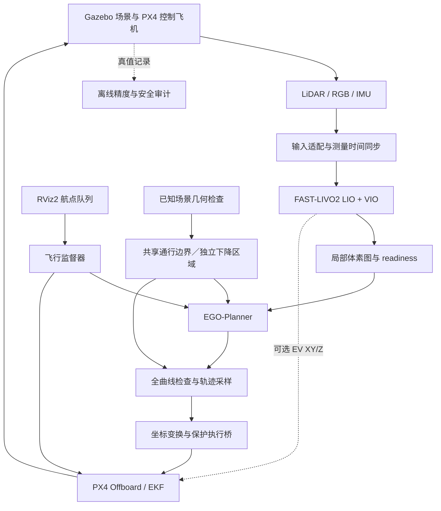

# 架构与接口

[返回文档索引](README.md)

本页描述仿真和实物共用的数据流、消息接口、坐标约定、控制权和保护策略。实物部署必须重新确认传感器驱动、时间源、外参、网络和 PX4 参数，具体迁移步骤见[实物迁移与飞行](HARDWARE.md)。

## 数据流与职责

## 模块流程与入口

| 模块 | 输入 → 处理 → 输出 | 实现入口 |
| --- | --- | --- |
| 统一启动 | `sim.launch.py` / `hardware.launch.py` → 选择时钟、驱动和模块组合 → 可回退的 ROS 2 启动图 | [astra_bringup](../astra/packages/astra_bringup/README.md) |
| 启动与隔离 | 模式/场景/路线 → 检查依赖、独立 rootfs、启动/清理所属进程 → 运行证据 | [run_sitl_117.py](../astra/tools/run_sitl_117.py)、`xtd2_launch` |
| 传感器 | 场景与飞机运动 → Gazebo 渲染/桥接 → LiDAR/RGB/IMU | [astra_gz_sensors](../astra/packages/astra_gz_sensors/README.md) |
| 适配与定位 | 原始传感器 → 点时间模型、RGB/IMU 同步、LIO/VIO → odom、配准点云 | [astra_fast_livo2](../astra/packages/astra_fast_livo2/README.md)、`astra_fast_livo2_core` |
| 局部地图 | odom/配准点云 → 新鲜度、跳变检查、体素容量/保留、膨胀 → 障碍点云与 ready | [local_mapping_guard.py](../astra/packages/astra_fast_livo2/scripts/local_mapping_guard.py) |
| 规划 | ready、odom、障碍点云、目标、共享边界 → 搜索/优化/调时/曲线检查 → B-spline、有效性与心跳 | [ego_planner_jazzy](../astra/packages/ego_planner_jazzy/UPSTREAM.md) |
| 轨迹预览 | B-spline/状态 → 时间与动态约束检查、20 Hz 采样 → 位置/速度预览、保持状态 | [preview_bspline.py](../astra/packages/astra_px4_offboard/scripts/preview_bspline.py) |
| 执行桥 | 预览、LIVO/PX4 位姿 → 测量配对、ENU/NED、跟踪/新鲜度保护 → PX4 setpoint | [guarded_bspline_bridge.py](../astra/packages/astra_px4_offboard/scripts/guarded_bspline_bridge.py) |
| 任务监督 | 航点队列/健康状态 → 起飞、航向对齐、规划交接、末点动作、异常降落 | [ego_sitl_flight.py](../astra/tools/ego_sitl_flight.py)、[rviz_mission.py](../astra/tools/rviz_mission.py) |
| External Vision | LIVO 位姿、地面配对 → 冻结变换、有效性与测量时间 → PX4 视觉里程计 | [external_vision_sitl.py](../astra/tools/external_vision_sitl.py)、[external_vision_geometry.py](../astra/tools/external_vision_geometry.py) |
| 审计 | Gazebo/LIVO/PX4 测量、曲线、事件、ULog → 时间配对与冻结原点误差 → JSON/图表 | [audit_scan_flight.py](../astra/tools/audit_scan_flight.py)、[audit_long_route_drift.py](../astra/tools/audit_long_route_drift.py) |

SITL 组合执行中，监督器按顺序调用预览采样与桥检查，直接传递同一份位置、速度和模式，并共用一个 ROS 仿真时钟。预览话题继续供显示与诊断使用；独立启动 preview / bridge 时仍通过 ROS 话题连接。这样避免同进程定时器和回环消息的排队错序，输入新鲜度与轨迹保护仍照常检查。

## 主要接口

| 接口 | 内容 / 坐标 |
| --- | --- |
| `/sensors/lidar/points` | 等效 LiDAR PointCloud2，10 Hz |
| `/sensors/camera/color/image_raw` | RGB，标称 30 Hz |
| `/sensors/imu/data` | 传感器 IMU，标称 100 Hz |
| `/fast_livo2/input/*` | 归一化/同步后的核心输入 |
| `/fast_livo2/odom` | FAST-LIVO2 测量时刻位姿，`camera_init` |
| `/fast_livo2/cloud_registered_full` | 配准点云，局部地图默认输入 |
| `/local_mapping/occupied`、`/local_mapping/obstacles` | 占据体素与膨胀障碍点云 |
| `/local_mapping/ready` | 地图可用性心跳，撤销即禁止继续有效规划 |
| `/move_base_simple/goal` | 监督器审核并发送的规划目标 |
| `/planning/execution_envelope` | 已冻结的共享通行边界；旧场景仍使用下降区域 |
| `/planning/bspline` | EGO B-spline |
| `/planning/trajectory_valid`、`/planning/heartbeat` | 轨迹有效性、规划器存活 |
| `/planning/position_preview`、`/planning/velocity_preview` | `camera_init` 轨迹采样 |
| `/planning/bridge_state` | 执行桥状态与保护原因 |
| `/astra/external_vision/ready` | EV 输入/融合健康门控 |
| `/x500_0/fmu/out/vehicle_local_position_v1` | PX4 EKF 的 NED 位姿 |
| `/x500_0/fmu/in/trajectory_setpoint` | 飞行位置/速度 setpoint |
| `/x500_0/fmu/in/vehicle_visual_odometry` | 可选 EV 测量输入 |

PX4 话题后缀由消息 `MESSAGE_VERSION` 决定，版本 0 不带后缀。不要手工把所有 `/fmu/*` 都加 `_v1`，也不要混用其他版本 overlay。

## 坐标与时间

Gazebo 世界采用 ENU，机体为 FLU；PX4 局部为 NED、机体为 FRD。FAST-LIVO2 的 `camera_init` 是估计器初始化坐标，不应仅根据名称认定其为相机光学坐标。

当前固定朝向 SITL 通过检查过的旋转、传感器安装杆臂和地面冻结平移实现转换。机体参考点不同，必须包含随姿态旋转的安装偏移；“雷达在上、飞控在下”不能仅用一个永久 Z 常数替代。实物需重新标定安装和时钟。

EV 转换入口当前明确限定为已审计的零初始 yaw SITL，不能直接用于任意朝向起飞或真实设备。

odom header 表示**估计状态对应的测量时刻**；snapshot 仿真中可能是融合图像时刻，不能一概写成发布时间或所有配置都为扫描末时刻。PX4 使用 `timestamp_sample`；发布/接收时刻单独记录。测量配对限制 20 ms，低配对误差不证明处理延迟也低。

地面高度标定采用 4 秒 LIVO/PX4 配对并冻结，再用独立 4 秒验证；Gazebo 真值不参与该偏置估计。飞行中不重新拟合消除漂移。真值误差审计采用独立的起飞前冻结参考，两种偏置不可混用。

## 规划边界、显示与控制权

实时障碍来自传感器 → FAST-LIVO2 → 局部地图。导入的整张背景模型、彩色显示图不直接充当实时障碍点云。已知场景几何另外用于下降净空检查、共享边界和独立停测，因此当前系统包含事先了解的 SITL 安全区域约束，并非未知环境的完整自主安全认证。

Gazebo 真值只用于审计和独立停测，不生成定位、EV 或轨迹 setpoint。绿色地面格是可下降区域，不是全部可飞空间。轨迹、地图、RGB 图层分别显示规划、观测和图像来源。

XT-Drone2 默认通信控制节点在 Astra 执行时关闭。同一飞机每时刻只有一个 setpoint 控制权拥有者；监督器与桥通过交接协调。预览不发送 `/fmu/in/*`；执行桥单独启动默认不输出，启用也不自行解锁。隔离运行器在健康门控后负责解锁与 Offboard。

## 保护策略

地图 readiness、规划心跳、轨迹有效性、测量配对、位姿年龄、航向/重置、冻结高度差、跟踪误差与几何边界共同门控。室外规划曲线限速 0.20 m/s、加速度 0.25 m/s²；实际飞机可能因跟踪修正短时超过曲线速度。

任务可选择末点降落、悬停等下一点、EGO 返航后降落。健康返航重新请求一条经过相同检查的 B-spline，不把起飞点直接当作 PX4 位置 setpoint。到家后使用官方 `VEHICLE_CMD_NAV_LAND`。

独立通行场景用巡航高度带检查空中通行，用全下降柱体检查落地区域；旧地图保持原有下降区域策略。第一版通行试验还保留到家的已知静态直线走廊，才能在地图失效时退出 Offboard、交给官方 `VEHICLE_CMD_NAV_RETURN_TO_LAUNCH`。RTL 不消费 EGO 地图，不保证绕过未知／动态障碍。交接检查 PX4 全局／局部定位、Home、reset、走廊和高度；RTL 的高度、速度与落点半径只在隔离配置里设置。

新连通配置使用 `connected_route_to_certified_landing`：地面构建共享飞行网格到可降落区的多源恢复图，全部开放单元必须有路线才允许起飞。异常锁存后，能安全下降就降落，否则使用冻结的坐标变换和新鲜有效的 PX4 位姿，以 0.25 m/s 以内的目标速度沿检查过的边撤到可降落点；不要求到家的直线走廊。正常任务和健康返航仍由 EGO 规划。该备用路径来自已知静态地图，不能用于未知动态障碍或直接移植到实物。

异常先冻结新鲜的 PX4 保持位姿并锁存。通行区不能无条件原地降落；所选配置的恢复条件不满足时，本次 SITL 明确失败并由运行器停止。界面丢失、低电量、场景边界和真值审计保护也可结束任务。具体阈值以本轮 `runtime.json`、launch 与源码为准。
